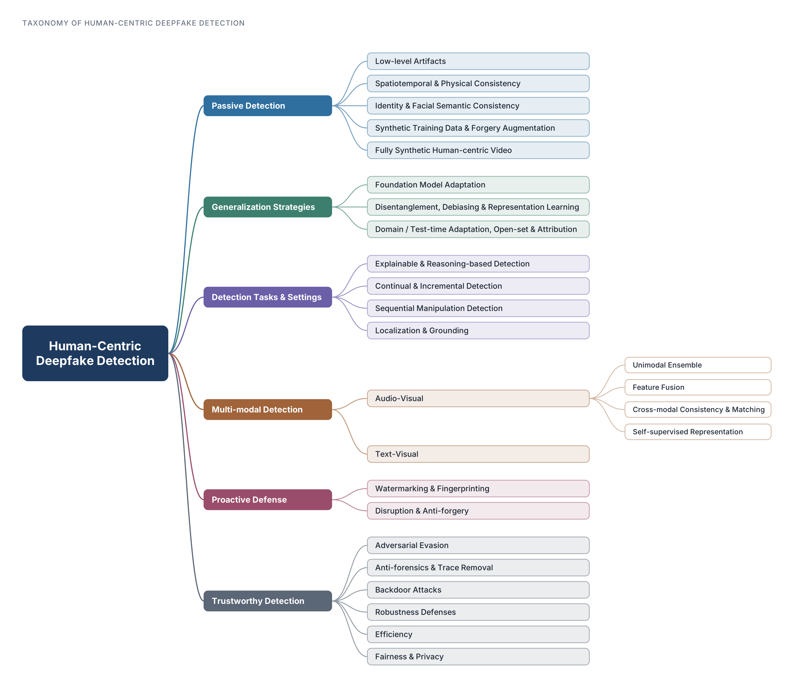

# Awesome Human-Centric Deepfake Detection 

This repository collects research on detecting deepfakes of people: manipulated or synthesized faces, talking heads, bodies, and identity-linked voices, in single-modal and multi-modal settings. It accompanies the survey below.

<p align="center" style="font-size:20px;">
  <h2>Evolving from Single-modal to Multi-modal Facial Deepfake Detection: Progress and Challenges
  <a href="https://arxiv.org/abs/2406.06965"></a>
  </h2>
</p>
<p align="center">
  <a href="https://pinglmlcv.github.io/pingliu264/">Ping Liu<sup>1</sup></a>
  ,
  Qiqi Tao<sup>2</sup>
  ,
  <a href="https://joeyzhouty.github.io/">Joey Tianyi Zhou<sup>2,3</sup></a>
</p>

<p align="center">
  <sup>1</sup><a href="https://www.unr.edu/cse">University of Nevada, Reno</a><br>
  <sup>2</sup><a href="https://www.a-star.edu.sg/cfar/home">Centre for Frontier AI Research (CFAR), A*STAR</a><br>
  <sup>3</sup><a href="https://www.catos.sg/"> Centre for Advanced Technologies in Online Safety (CATOS)</a>
</p>

If you believe there are additional works that should be included in our list, please do not hesitate to send us an email (pingl@unr.edu / tao.qiqi@outlook.com / zhouty@cfar.a-star.edu.sg) or raise an issue. Your suggestions and comments are invaluable to ensuring the completeness and accuracy of our resource.

\[2026.10\] We reorganized the list around a human-centric scope and a new taxonomy, removed duplicate entries, and corrected venues and links.

\[2025.04\] 🎉 We update a new version on arXiv, including more recent relevant works, systematic taxonomy of detection methods, and thorough discussions. Have a check on our updated survey [here](https://arxiv.org/abs/2406.06965)!

<p align="center"></p>

## Scope

We include a work when the forged subject is a person (face, body, motion, voice, or identity), or when a general detector is evaluated substantially on human data. We do not include detectors for non-human AI-generated images (scenes, objects, artwork) or detectors for AI-generated text. A few widely used general AIGI baselines are kept for reference and marked `General AIGI`. For voice, we include identity-linked forgery such as voice cloning and speaker impersonation, with priority on audio-visual work.

Within each section, entries are ordered from newest to oldest. Each paper appears once, in the section that matches its main contribution.

## Contents

- [Datasets and Benchmarks](#datasets-and-benchmarks)
  - [Single-modal Face Manipulation Video Datasets](#single-modal-face-manipulation-video-datasets)
  - [Single-modal Generated Face Image Datasets](#single-modal-generated-face-image-datasets)
  - [Explainable and Reasoning Benchmarks](#explainable-and-reasoning-benchmarks)
  - [Single-modal Mixed-generation Video Benchmarks](#single-modal-mixed-generation-video-benchmarks)
  - [Multi-modal Audio-Visual Datasets](#multi-modal-audio-visual-datasets)
  - [Multi-modal Text-Visual Datasets](#multi-modal-text-visual-datasets)
  - [Benchmarks and Evaluation Studies](#benchmarks-and-evaluation-studies)
- [Passive Detection](#passive-detection)
  - [Low-level Artifacts](#low-level-artifacts)
  - [Spatiotemporal and Physical Consistency](#spatiotemporal-and-physical-consistency)
  - [Identity and Facial Semantic Consistency](#identity-and-facial-semantic-consistency)
  - [Synthetic Training Data and Forgery Augmentation](#synthetic-training-data-and-forgery-augmentation)
  - [Fully Synthetic Human-centric Video](#fully-synthetic-human-centric-video)
- [Generalization Strategies](#generalization-strategies)
  - [Foundation Model Adaptation](#foundation-model-adaptation)
  - [Disentanglement, Debiasing and Representation Learning](#disentanglement-debiasing-and-representation-learning)
  - [Domain and Test-time Adaptation, Open-set Detection and Attribution](#domain-and-test-time-adaptation-open-set-detection-and-attribution)
- [Detection Tasks and Settings](#detection-tasks-and-settings)
  - [Explainable and Reasoning-based Detection](#explainable-and-reasoning-based-detection)
  - [Continual and Incremental Detection](#continual-and-incremental-detection)
  - [Sequential Manipulation Detection](#sequential-manipulation-detection)
  - [Localization and Grounding](#localization-and-grounding)
- [Multi-modal Detection](#multi-modal-detection)
  - [Audio-Visual: Unimodal Ensemble](#audio-visual-unimodal-ensemble)
  - [Audio-Visual: Feature Fusion](#audio-visual-feature-fusion)
  - [Audio-Visual: Cross-modal Consistency and Matching](#audio-visual-cross-modal-consistency-and-matching)
  - [Audio-Visual: Self-supervised Representation](#audio-visual-self-supervised-representation)
  - [Text-Visual Manipulation Detection](#text-visual-manipulation-detection)
- [Proactive Defense](#proactive-defense)
  - [Watermarking and Fingerprinting](#watermarking-and-fingerprinting)
  - [Disruption and Anti-forgery](#disruption-and-anti-forgery)
- [Trustworthy Detection](#trustworthy-detection)
  - [Adversarial Evasion](#adversarial-evasion)
  - [Anti-forensics and Trace Removal](#anti-forensics-and-trace-removal)
  - [Backdoor Attacks](#backdoor-attacks)
  - [Robustness Defenses](#robustness-defenses)
  - [Efficiency](#efficiency)
  - [Fairness and Privacy](#fairness-and-privacy)
- [Citation](#citation)
- [Relevant Surveys](#relevant-surveys)

---

## Datasets and Benchmarks
### Single-modal Face Manipulation Video Datasets
|Dataset|Year|Task|Manipulated Modality|\# of real videos|\# of fake videos|Paper|Link|
|:-:|:-:|:-:|:-:|:-:|:-:|-|-|
|FaceForensics++(FF++)|2019|Classification|Visual|1,000|4,000|[FaceForensics++: Learning to Detect Manipulated Facial Images](https://arxiv.org/abs/1901.08971)|[Download](https://github.com/ondyari/FaceForensics)|
|DFD|2019|Classification|Visual|363|3,068|[Contributing data to deepfake detection research](https://blog.research.google/2019/09/contributing-datato-deepfake-detection.html)|[Download](https://github.com/ondyari/FaceForensics)|
|DFFD|2020|Classification|Visual|1,000|3,000|[On the Detection of Digital Face Manipulation](https://arxiv.org/abs/1910.01717)|[Download](https://cvlab.cse.msu.edu/dffd-dataset.html)|
|FaceShifter|2020|Classification|Visual|-|1,000|[FaceShifter: Towards High Fidelity And Occlusion Aware Face Swapping](https://arxiv.org/abs/1912.13457)|[Download](https://github.com/ondyari/FaceForensics)|
|DFDC|2020|Classification|Visual|23,654|104,500|[The DeepFake Detection Challenge (DFDC) Dataset](https://arxiv.org/abs/2006.07397)|[Download](https://ai.meta.com/datasets/dfdc/)|
|Celeb-DF|2020|Classification|Visual|590|5,639|[Celeb-df: A large-scale challenging dataset for deepfake forensics](https://arxiv.org/abs/1909.12962)|[Download](https://github.com/yuezunli/celeb-deepfakeforensics)|
|DeeperForensics-1.0|2020|Classification|Visual|50,000|10,000|[DeeperForensics-1.0: A Large-Scale Dataset for Real-World Face Forgery Detection](https://www.arxiv.org/abs/2001.03024)|[Download](https://github.com/EndlessSora/DeeperForensics-1.0)|
|WildDeepfake|2020|Classification|Visual|3,805|3,509|[WildDeepfake: A Challenging Real-World Dataset for Deepfake Detection](https://dl.acm.org/doi/10.1145/3394171.3413769)|[Download](https://github.com/deepfakeinthewild/deepfake-in-the-wild)|
|KoDF|2020|Classification|Visual|62,166|175,776|[KoDF: A Large-scale Korean DeepFake Detection Dataset](https://arxiv.org/abs/2103.10094)|[Download](https://deepbrainai-research.github.io/kodf/)|
|FFIW_10k|2021|Classification & Spatial Grounding|Visual|10,000|10,000|[Face Forensics in the Wild](https://arxiv.org/abs/2103.16076)|[Download](https://github.com/tfzhou/FFIW)|
|ForgeryNet|2021|Classification & Spatial Grounding & Temporal Grounding|Visual|99,630|121,617|[Forgerynet: A versatile benchmark for comprehensive forgery analysis](https://arxiv.org/abs/2103.05630)|[Download](https://yinanhe.github.io/projects/forgerynet.html)|
|DF-Platter|2023|Classification|Visual|133,260|132,496|[DF-Platter: Multi-Face Heterogeneous Deepfake Dataset](https://openaccess.thecvf.com/content/CVPR2023/papers/Narayan_DF-Platter_Multi-Face_Heterogeneous_Deepfake_Dataset_CVPR_2023_paper.pdf)|[Download](https://iab-rubric.org/df-platter-database)|
|Celeb-DF++|2025|Classification|Visual|590|53,196|[Celeb-DF++: A Large-scale Challenging Video DeepFake Benchmark for Generalizable Forensics](https://arxiv.org/pdf/2507.18015)|[Download](https://github.com/OUC-VAS/Celeb-DF-PP)|
### Single-modal Generated Face Image Datasets
|Dataset|Year|Task|Manipulated Modality|\# of real images|\# of fake images|Paper|Link|
|:-:|:-:|:-:|:-:|:-:|:-:|-|-|
|DeepFakeFace|2023|Classification|Visual|30,000|90,000|[Robustness and Generalizability of Deepfake Detection: A Study with Diffusion Models](https://arxiv.org/abs/2309.02218)|[Download](https://github.com/OpenRL-Lab/DeepFakeFace)|
|GenFace|2024|Classification|Visual|100,000|515,000|[GenFace: A Large-Scale Fine-Grained Face Forgery Benchmark and Cross Appearance-Edge Learning](https://arxiv.org/abs/2402.02003)|[Download](https://github.com/Jenine-321/GenFace)|
|DiFF|2024|Classification|Visual|23,661|537,466|[Diffusion Facial Forgery Detection](https://arxiv.org/abs/2401.15859)|[Download](https://github.com/xaCheng1996/DiFF)|
|DiffusionFace|2024|Classification|Visual|30,000|600,000|[DiffusionFace: Towards a Comprehensive Dataset for Diffusion-Based Face Forgery Analysis](https://arxiv.org/abs/2403.18471)|[Download](https://github.com/Rapisurazurite/DiffFace)|
|DiffusionDB-Face|2024|Classification|Visual|94,120|24,794|[Diffusion Deepfake](https://arxiv.org/abs/2404.01579)|[Download](https://surrey-uplab.github.io/research/diffusion_deepfake/)|
|JourneyDB-Face|2024|Classification|Visual|94,120|87,833|[Diffusion Deepfake](https://arxiv.org/abs/2404.01579)|[Download](https://surrey-uplab.github.io/research/diffusion_deepfake/)|
|TalkingHeadBench|2025|Classification|Visual|2,312|2,984|[TalkingHeadBench: A Multi-Modal Benchmark & Analysis of Talking-Head DeepFake Detection](https://arxiv.org/abs/2505.24866)|[Download](https://huggingface.co/datasets/luchaoqi/TalkingHeadBench)|
|DeepMoiréFake (DMF)|2025|Classification|Visual|12,832 videos in total (35.6 h)|-|[Through the Lens: Benchmarking Deepfake Detectors Against Moiré-Induced Distortions](https://arxiv.org/pdf/2510.23225)|-|
|VIPBench|2025|Identity-aware Classification|Visual|80,080 images in total (22 identities)|-|[Guard Me If You Know Me: Protecting Specific Face-Identity from Deepfakes](https://arxiv.org/abs/2505.19582)|[Download](https://huggingface.co/datasets/Kaiqing/VIPBench)|
### Explainable and Reasoning Benchmarks
|Dataset|Year|Task|Manipulated Modality|\# of real samples|\# of fake samples|Paper|Link|
|:-:|:-:|:-:|:-:|:-:|:-:|-|-|
|MMTT|2024|Classification & Explanation|Visual|100,000|128,303|[A Large-scale Interpretable Multi-modality Benchmark for Facial Image Forgery Localization](https://arxiv.org/abs/2412.19685)|not released yet|
|Beyond Static Artifacts|2026|Reasoning / QA|Video (FS/FR)|1,000|5,000|[Beyond Static Artifacts: A Forensic Benchmark for Video Deepfake Reasoning in Vision-Language Models](https://arxiv.org/pdf/2602.21779)|--|
|CoT-Face|2026|Reasoning / QA|Visual|5,953|--|[EvolveReason: Self-Evolving Reasoning Paradigm for Explainable Deepfake Facial Image Identification](https://arxiv.org/abs/2603.07515)|--|
### Single-modal Mixed-generation Video Benchmarks
|Dataset|Year|Task|Manipulated Modality|\# of real videos|\# of fake videos|Paper|Link|
|:-:|:-:|:-:|:-:|:-:|:-:|-|-|
|FakeI2V-Bench|2026|Classification & Benchmarking|Visual|25,053|72,495|[FakeI2V-Bench: Benchmarking the Applicability of Image-level Deepfake Detectors for Deepfake Video Detection](https://arxiv.org/abs/2608.03096)|[Download](https://github.com/CryptoAILab/FakeI2V-Bench)|

> **Note:** FakeI2V-Bench aggregates 97,548 videos from CDFV2, DFD, GenVideo, and GenVidBench rather than introducing an entirely new video collection.
### Multi-modal Audio-Visual Datasets
|Dataset|Year|Task|Manipulated Modality|\# of real videos|\# of fake videos|Paper|Link|
|:-:|:-:|:-:|:-:|:-:|:-:|-|-|
|FakeAVCeleb|2021|Classification|Visual & Audio|500|19,500|[FakeAVCeleb: A Novel Audio-Video Multimodal Deepfake Dataset](https://arxiv.org/abs/2108.05080)|[Download](https://sites.google.com/view/fakeavcelebdash-lab/)|
|TMC|2022|Classification & Temporal Grounding|Visual & Audio|2,563|4,380|[Trusted Media Challenge Dataset and User Study](https://arxiv.org/abs/2201.04788)|-|
|LAV-DF|2022|Classification & Temporal Grounding|Visual & Audio|36,431|99,873|[Do You Really Mean That? Content Driven Audio-Visual Deepfake Dataset and Multimodal Method for Temporal Forgery Localization](https://arxiv.org/abs/2204.06228)|[Download](https://github.com/ControlNet/LAV-DF)|
|DefakeAVMiT|2023|Classification|Visual & Audio|540|6,480|[AVoiD-DF: Audio-Visual Joint Learning for Detecting Deepfake](https://doi.org/10.1109/TIFS.2023.3262148)|-|
|AV-Deepfake1M|2023|Classification & Temporal Grounding|Visual & Audio|286,721|860,039|[AV-Deepfake1M: A Large-Scale LLM-Driven Audio-Visual Deepfake Dataset](https://arxiv.org/abs/2311.15308)|[Download](https://github.com/ControlNet/AV-Deepfake1M)|
|MMDFD|2023|Classification|Visual & Audio & Text|1,500|5,000|[MMDFD- A Multimodal Custom Dataset for Deepfake Detection](https://doi.org/10.1145/3607947.3608013)|-|
|PolyGlotFake|2024|Classification|Visual & Audio & Text|766|14,472|[PolyGlotFake: A Novel Multilingual and Multimodal DeepFake Dataset](https://arxiv.org/abs/2405.08838)|[Download](https://github.com/tobuta/PolyGlotFake)|
|DeepFake-eval-2024|2025|Classification|Visual & Audio|1,208|767|[Deepfake-Eval-2024: A Multi-Modal In-the-Wild Benchmark of Deepfakes Circulated in 2024](https://arxiv.org/abs/2503.02857)|-|
|DDL|2025|Classification/Spatial Grounding/Temporal Grounding|Visual & Audio|367K(V)/97K(A)|1.8M|[DDL: A Large-Scale Datasets for Deepfake Detection and Localization in Diversified Real-World Scenarios](https://arxiv.org/abs/2506.23292)|-|
|AV-Deepfake1M++|2025|Classification & Temporal Grounding|Visual & Audio|627,936|1,423,218|[AV-Deepfake1M++: A Large-Scale Audio-Visual Deepfake Benchmark with Real-World Perturbations](https://arxiv.org/abs/2507.20579)|[Download](https://deepfakes1m.github.io/2025)|
|DeepfakeBench-MM (Mega-MMDF)|2025|Classification|Visual & Audio|580,000|1,100,000|[DeepfakeBench-MM: A Comprehensive Benchmark for Multimodal Deepfake Detection](https://arxiv.org/pdf/2510.22622)|-|

### Multi-modal Text-Visual Datasets
|Dataset|Year|Task|Manipulated Modality|\# of real image-text pairs|\# of fake image-text pairs|Paper|Link|
|:-:|:-:|:-:|:-:|:-:|:-:|-|-|
|DGM4|2023|Classification & Spatial Grounding & Text Grounding|Visual & Text|77,426|152,574|[DGM4: Detecting and Grounding Multi-Modal Media Manipulation and Beyond](https://arxiv.org/abs/2309.14203)|[Download](https://github.com/rshaojimmy/MultiModal-DeepFake)|

### Benchmarks and Evaluation Studies
1. \[arXiv 2026\] When AUC Misleads: Polarization-Aware Evaluation of Deepfake Detectors under Domain Shift [Paper](https://arxiv.org/pdf/2606.19184)
2. \[arXiv 2025\] LLMs Are Not Yet Ready for Deepfake Image Detection [Paper](https://arxiv.org/abs/2506.10474)
3. \[Visual Intelligence 2025\] SHIELD: An Evaluation Benchmark for Face Spoofing and Forgery Detection with Multimodal Large Language Models [Paper](https://arxiv.org/abs/2402.04178)
4. \[arXiv 2025\] A Sanity Check for Multi-In-Domain Face Forgery Detection in the Real World [Paper](https://arxiv.org/pdf/2512.04837)
5. \[arXiv 2025\] Can Multi-Modal (Reasoning) LLMs Work as Deepfake Detectors [Paper](https://arxiv.org/pdf/2503.20084)
6. \[arXiv 2024\] Nearly Solved? Robust Deepfake Detection Requires More than Visual Forensics [Paper](https://arxiv.org/abs/2412.05676)
7. \[CVPR Workshop 2024\] Can ChatGPT Detect DeepFakes? A Study of Using Multimodal Large Language Models for Media Forensics [Paper](https://arxiv.org/abs/2403.14077)
8. \[ACM ICMRW 2024\] Towards Quantitative Evaluation of Explainable AI Methods for Deepfake Detection [Paper](https://arxiv.org/abs/2404.18649)
9. \[ACM MM 2024\] Diffusion Facial Forgery Detection [Paper](https://arxiv.org/abs/2401.15859)
10. \[ACM MM 2024\] 1M-Deepfakes Detection Challenge [Paper](https://arxiv.org/abs/2409.06991)
11. \[ACM MMW 2021\] Evaluation of an Audio-Video Multimodal Deepfake Dataset using Unimodal and Multimodal Detectors [Paper](https://arxiv.org/abs/2109.02993)
12. \[ICCV 2019\] FaceForensics++: Learning to Detect Manipulated Facial Images [Paper](https://arxiv.org/abs/1901.08971)

---

## Passive Detection

### Low-level Artifacts
1. \[arXiv 2026\] Unveiling Deepfakes: A Frequency-Aware Triple Branch Network for Deepfake Detection [Paper](https://arxiv.org/pdf/2604.17477)
2. \[arXiv 2026\] Phase4DFD: Multi-Domain Phase-Aware Attention for Deepfake Detection [Paper](https://arxiv.org/pdf/2601.05861)
3. \[arXiv 2026\] Deepfake Detection Generalization with Diffusion Noise [Paper](https://arxiv.org/pdf/2604.14570)
4. \[arXiv 2025\] From Specificity to Generality: Revisiting Generalizable Artifacts in Detecting Face Deepfakes [Paper](https://arxiv.org/pdf/2504.04827)
5. \[ACM MM 2025\] SpecXNet: A Dual-Domain Convolutional Network for Robust Deepfake Detection [Paper](https://arxiv.org/abs/2509.22070)
6. \[arXiv 2025\] Forgery Guided Learning Strategy with Dual Perception Network for Deepfake Cross-domain Detection [Paper](https://arxiv.org/pdf/2508.10741)
7. \[arXiv 2025\] Towards Generalizable Deepfake Detection with Spatial-Frequency Collaborative Learning and Hierarchical Cross-Modal Fusion [Paper](https://arxiv.org/abs/2504.17223)
8. \[arXiv 2025\] Generalizable Deepfake Detection via Effective Local-Global Feature Extraction [Paper](https://arxiv.org/pdf/2501.15253)
9. \[arXiv 2025\] WMamba: Wavelet-based Mamba for Face Forgery Detection [Paper](https://arxiv.org/abs/2501.09617)
10. \[WACV Workshop 2025\] Wavelet-Driven Generalizable Framework for Deepfake Face Forgery Detection [Paper](https://arxiv.org/pdf/2409.18301)
11. \[PR 2025\] Distilled Transformers with Locally Enhanced Global Representations for Face Forgery Detection [Paper](https://www.sciencedirect.com/science/article/abs/pii/S0031320324010045)
12. \[CVPR 2024\] Rethinking the Up-Sampling Operations in CNN-based Generative Network for Generalizable Deepfake Detection [Paper](https://arxiv.org/abs/2312.10461) `General AIGI`
13. \[CVPR 2024\] LAA-Net: Localized Artifact Attention Network for Quality-Agnostic and Generalizable Deepfake Detection [Paper](https://arxiv.org/abs/2401.13856)
14. \[arXiv 2024\] Data-Independent Operator: A Training-Free Artifact Representation Extractor for Generalizable Deepfake Detection [Paper](https://arxiv.org/abs/2403.06803)
15. \[TIFS 2024\] GenFace: A Large-Scale Fine-Grained Face Forgery Benchmark and Cross Appearance-Edge Learning [Paper](https://arxiv.org/abs/2402.02003)
16. \[arXiv 2024\] Multiple Contexts and Frequencies Aggregation Network for Deepfake Detection [Paper](https://arxiv.org/abs/2408.01668v1)
17. \[AAAI 2024\] Frequency-Aware Deepfake Detection: Improving Generalizability through Frequency Space Learning [Paper](https://arxiv.org/abs/2403.07240)
18. \[arXiv 2024\] FakeFormer: Efficient Vulnerability-Driven Transformers for Generalisable Deepfake Detection [Paper](https://arxiv.org/pdf/2410.21964)
19. \[TMM 2024\] GLFF: Global and Local Feature Fusion for AI-synthesized Image Detection [Paper](https://arxiv.org/abs/2211.08615)
20. \[AAAI 2023\] Noise based deepfake detection via multi-head relative-interaction [Paper](https://ojs.aaai.org/index.php/AAAI/article/view/26701/26473)
21. \[CVPR 2023\] Dynamic Graph Learning with Content-guided Spatial-Frequency Relation Reasoning for Deepfake Detection [Paper](https://openaccess.thecvf.com/content/CVPR2023/papers/Wang_Dynamic_Graph_Learning_With_Content-Guided_Spatial-Frequency_Relation_Reasoning_for_Deepfake_CVPR_2023_paper.pdf)
22. \[ICCV 2023\] DIRE for Diffusion-Generated Image Detection [Paper](https://arxiv.org/pdf/2303.09295) `General AIGI`
23. \[ICASSP 2023\] On the detection of synthetic images generated by diffusion models [Paper](https://arxiv.org/abs/2211.00680) `General AIGI`
24. \[AAAI 2022\] FrePGAN: Robust Deepfake Detection Using Frequency-level Perturbations [Paper](https://arxiv.org/abs/2202.03347)
25. \[AAAI 2022\] ADD: Frequency Attention and Multi-View based Knowledge Distillation to Detect Low-Quality Compressed Deepfake Images [Paper](https://arxiv.org/abs/2112.03553)
26. \[CVPR 2021\] Multi-attentional Deepfake Detection [Paper](https://openaccess.thecvf.com/content/CVPR2021/papers/Zhao_Multi-Attentional_Deepfake_Detection_CVPR_2021_paper.pdf)
27. \[CVPR 2021\] Spatial-Phase Shallow Learning: Rethinking Face Forgery Detection in Frequency Domain [Paper](https://arxiv.org/abs/2103.01856)
28. \[CVPR 2021\] Generalizing Face Forgery Detection with High-frequency Features [Paper](https://arxiv.org/abs/2103.12376)
29. \[CVPR 2021\] Frequency-aware Discriminative Feature Learning Supervised by Single-Center Loss for Face Forgery Detection [Paper](https://arxiv.org/abs/2103.09096)
30. \[AAAI 2021\] Local Relation Learning for Face Forgery Detection [Paper](https://arxiv.org/pdf/2105.02577)
31. \[IJCAI 2021\] Beyond the Spectrum: Detecting Deepfakes via Re-Synthesis [Paper](https://arxiv.org/abs/2105.14376)
32. \[CVPR 2020\] Global Texture Enhancement for Fake Face Detection In the Wild [Paper](https://openaccess.thecvf.com/content_CVPR_2020/papers/Liu_Global_Texture_Enhancement_for_Fake_Face_Detection_in_the_Wild_CVPR_2020_paper.pdf)
33. \[ECCV 2020\] Thinking in Frequency: Face Forgery Detection by Mining Frequency-aware Clues [Paper](https://arxiv.org/abs/2007.09355)
34. \[WIFS 2018\] Mesonet: a compact facial video forgery detection network [Paper](https://ieeexplore.ieee.org/document/8630761/)

### Spatiotemporal and Physical Consistency
1. \[ICLR 2026\] Exploring specular reflection inconsistency for generalizable face forgery detection [Paper](https://arxiv.org/pdf/2602.06452)
2. \[NeurIPS 2025\] SpeechForensics: Audio-Visual Speech Representation Learning for Face Forgery Detection [Paper](https://arxiv.org/pdf/2508.09913)
3. \[CVPR 2025\] Face Forgery Video Detection via Temporal Forgery Cue Unraveling [Paper](https://openaccess.thecvf.com/content/CVPR2025/papers/Guo_Face_Forgery_Video_Detection_via_Temporal_Forgery_Cue_Unraveling_CVPR_2025_paper.pdf)
4. \[arXiv 2025\] VoD: Learning Volume of Differences for Video-Based Deepfake Detection [Paper](https://arxiv.org/pdf/2503.07607)
5. \[arXiv 2025\] GC-ConsFlow: Leveraging Optical Flow Residuals and Global Context for Robust Deepfake Detection [Paper](https://arxiv.org/pdf/2501.13435)
6. \[ICCV 2025\] Vulnerability-Aware Spatio-Temporal Learning for Generalizable and Interpretable Deepfake Video Detection [Paper](https://arxiv.org/pdf/2501.01184)
7. \[ICCV 2025\] Beyond Spatial Frequency: Pixel-wise Temporal Frequency-based Deepfake Video Detection [Paper](https://arxiv.org/abs/2507.02398)
8. \[arXiv 2025\] Detecting Lip-Syncing Deepfakes: Vision Temporal Transformer for Analyzing Mouth Inconsistencies [Paper](https://arxiv.org/pdf/2504.01470)
9. \[arXiv 2025\] Do You See What I Say? Generalizable Deepfake Detection based on Visual Speech Recognition [Paper](https://arxiv.org/pdf/2511.22443)
10. \[ECCV 2024\] Learning Natural Consistency Representation for Face Forgery Video Detection [Paper](https://arxiv.org/abs/2407.10550v1)
11. \[IJCV 2024\] Learning Spatiotemporal Inconsistency via Thumbnail Layout for Face Deepfake Detection [Paper](https://arxiv.org/abs/2403.10261)
12. \[CVPR 2024\] Exploiting Style Latent Flows for Generalizing Deepfake Video Detection [Paper](https://openaccess.thecvf.com/content/CVPR2024/html/Choi_Exploiting_Style_Latent_Flows_for_Generalizing_Deepfake_Video_Detection_CVPR_2024_paper.html)
13. \[arxiv 2024\] Compressed Deepfake Video Detection Based on 3D Spatiotemporal Trajectories [Paper](https://arxiv.org/abs/2404.18149)
14. \[TMM 2025\] DIP: Diffusion Learning of Inconsistency Pattern for General DeepFake Detection [Paper](https://arxiv.org/pdf/2410.23663)
15. \[ICCV 2023\] TALL: Thumbnail Layout for Deepfake Video Detection [Paper](https://arxiv.org/abs/2307.07494)
16. \[CVPR 2023\] AltFreezing for More General Video Face Forgery Detection [Paper](https://arxiv.org/abs/2307.08317)
17. \[TCSVT 2023\] MRE-Net: Multi-Rate Excitation Network for Deepfake Video Detection [Paper](https://ieeexplore.ieee.org/document/10025759)
18. \[ACM MM Asia 2022\] Latent pattern sensing: Deepfake video detection via predictive representation learning [Paper](https://doi.org/10.1145/3469877.3490586)
19. \[CVPR 2021\] Lips don’t lie: A generalisable and robust approach to face forgery detection [Paper](https://arxiv.org/abs/2012.07657)
20. \[ICCV 2021\] Exploring Temporal Coherence for More General Video Face Forgery Detection [Paper](https://arxiv.org/abs/2108.06693)
21. \[ACM MM 2020\] DeepRhythm: Exposing DeepFakes with Attentional Visual Heartbeat Rhythms [Paper](https://arxiv.org/abs/2006.07634)
22. \[WIFS 2018\] In Ictu Oculi: Exposing AI Created Fake Videos by Detecting Eye Blinking [Paper](https://ieeexplore.ieee.org/document/8630787/)

### Identity and Facial Semantic Consistency
1. \[WACV Workshops 2025\] DiffFake: Exposing Deepfakes using Differential Anomaly Detection [Paper](https://arxiv.org/pdf/2502.16247)
2. \[ICCV 2025\] Seeing Through Deepfakes: A Human-Inspired Framework for Multi-Face Detection [Paper](https://arxiv.org/pdf/2507.14807)
3. \[CVPR Workshop 2025\] Detecting Localized Deepfake Manipulations Using Action Unit-Guided Video Representations [Paper](https://arxiv.org/pdf/2503.22121)
4. \[arXiv 2025\] SELFI: Selective Fusion of Identity for Generalizable Deepfake Detection [Paper](https://arxiv.org/pdf/2506.17592)
5. \[NeurIPS 2025\] Guard Me If You Know Me: Protecting Specific Face-Identity from Deepfakes [Paper](https://arxiv.org/pdf/2505.19582)
6. \[arXiv 2024\] Securing Social Media Against Deepfakes using Identity, Behavioral, and Geometric Signatures [Paper](https://arxiv.org/pdf/2412.05487)
7. \[NeurIPS 2024\] DiffusionFake: Enhancing Generalization in Deepfake Detection via Guided Stable Diffusion [Paper](https://arxiv.org/abs/2410.04372)
8. \[WACV 2023\] TI2Net: Temporal Identity Inconsistency Network for Deepfake Detection [Paper](https://openaccess.thecvf.com/content/WACV2023/papers/Liu_TI2Net_Temporal_Identity_Inconsistency_Network_for_Deepfake_Detection_WACV_2023_paper.pdf)
9. \[CVPR 2023\] AUNet: Learning Relations Between Action Units for Face Forgery Detection [Paper](https://openaccess.thecvf.com/content/CVPR2023/papers/Bai_AUNet_Learning_Relations_Between_Action_Units_for_Face_Forgery_Detection_CVPR_2023_paper.pdf)
10. \[CVPR 2023\] Implicit Identity Leakage: The Stumbling Block to Improving Deepfake Detection Generalization [Paper](https://openaccess.thecvf.com/content/CVPR2023/papers/Dong_Implicit_Identity_Leakage_The_Stumbling_Block_to_Improving_Deepfake_Detection_CVPR_2023_paper.pdf)
11. \[CVPR 2023\] Implicit Identity Driven Deepfake Face Swapping Detection [Paper](https://openaccess.thecvf.com/content/CVPR2023/papers/Huang_Implicit_Identity_Driven_Deepfake_Face_Swapping_Detection_CVPR_2023_paper.pdf)
12. \[CVPR 2022\] Protecting Celebrities from DeepFake with Identity Consistency Transformer [Paper](https://openaccess.thecvf.com/content/CVPR2022/papers/Dong_Protecting_Celebrities_From_DeepFake_With_Identity_Consistency__CVPR_2022_paper.pdf)
13. \[TPAMI 2021\] DeepFake Detection Based on Discrepancies Between Faces and Their Context [Paper](https://ieeexplore.ieee.org/document/9468380)
14. \[ICCV 2021\] ID-Reveal: Identity-aware DeepFake Video Detection [Paper](https://openaccess.thecvf.com/content/ICCV2021/papers/Cozzolino_ID-Reveal_Identity-Aware_DeepFake_Video_Detection_ICCV_2021_paper.pdf)

### Synthetic Training Data and Forgery Augmentation
1. \[arXiv 2025\] Agent4FaceForgery:Multi-Agent LLM Framework for Realistic Face Forgery Detection [Paper](https://arxiv.org/pdf/2509.12546)
2. \[CVPR 2025\] Generalizing Deepfake Video Detection with Plug-and-Play: Video-Level Blending and Spatiotemporal Adapter Tuning [Paper](https://openaccess.thecvf.com/content/CVPR2025/papers/Yan_Generalizing_Deepfake_Video_Detection_with_Plug-and-Play_Video-Level_Blending_and_Spatiotemporal_CVPR_2025_paper.pdf)
3. \[arXiv 2025\] Practical Manipulation Model for Robust Deepfake Detection [Paper](https://www.arxiv.org/abs/2506.05119)
4. \[arXiv 2024\] A Quality-Centric Framework for Generic Deepfake Detection [Paper](https://arxiv.org/pdf/2411.05335)
5. \[ECCV 2024\] Fake It till You Make It: Curricular Dynamic Forgery Augmentations towards General Deepfake Detection [Paper](https://arxiv.org/pdf/2409.14444)
6. \[arXiv 2024\] Can We Leave Deepfake Data Behind in Training Deepfake Detector? [Paper](https://arxiv.org/pdf/2408.17052)
7. \[arXiv 2024\] FSBI: Deepfakes Detection with Frequency Enhanced Self-Blended Images [Paper](https://arxiv.org/html/2406.08625v1)
8. \[NeurIPS 2024\] FreqBlender: Enhancing DeepFake Detection by Blending Frequency Knowledge [Paper](https://arxiv.org/abs/2404.13872)
9. \[CVPR 2024\] Transcending Forgery Specificity with Latent Space Augmentation for Generalizable Deepfake Detection [Paper](https://arxiv.org/abs/2311.11278)
10. \[ICCV 2023\] SeeABLE: Soft Discrepancies and Bounded Contrastive Learning for Exposing Deepfakes [Paper](https://openaccess.thecvf.com/content/ICCV2023/papers/Larue_SeeABLE_Soft_Discrepancies_and_Bounded_Contrastive_Learning_for_Exposing_Deepfakes_ICCV_2023_paper.pdf)
11. \[CVPR 2022\] Detecting Deepfakes with Self-Blended Images [Paper](https://openaccess.thecvf.com/content/CVPR2022/papers/Shiohara_Detecting_Deepfakes_With_Self-Blended_Images_CVPR_2022_paper.pdf)
12. \[CVPR 2022\] Self-supervised Learning of Adversarial Example: Towards Good Generalizations for Deepfake Detection [Paper](https://openaccess.thecvf.com/content/CVPR2022/papers/Chen_Self-Supervised_Learning_of_Adversarial_Example_Towards_Good_Generalizations_for_Deepfake_CVPR_2022_paper.pdf)
13. \[CVPR 2021\] Representative Forgery Mining for Fake Face Detecti [Paper](https://openaccess.thecvf.com/content/CVPR2021/papers/Wang_Representative_Forgery_Mining_for_Fake_Face_Detection_CVPR_2021_paper.pdf)
14. \[ICCV 2021\] Learning Self-Consistency for Deepfake Detection [Paper](https://openaccess.thecvf.com/content/ICCV2021/papers/Zhao_Learning_Self-Consistency_for_Deepfake_Detection_ICCV_2021_paper.pdf)
15. \[CVPR 2020\] Face X-ray for More General Face Forgery Detection [Paper](https://arxiv.org/abs/1912.13458)

### Fully Synthetic Human-centric Video
1. \[CVPR 2025\] Towards a Universal Synthetic Video Detector: From Face or Background Manipulations to Fully AI-Generated Content [Paper](https://arxiv.org/pdf/2412.12278)

> This section is new and still sparse. Suggestions are welcome.

---

## Generalization Strategies

### Foundation Model Adaptation
1. \[arXiv 2026\] DBCF: Dual-Branch Complementary Fusion of Foundation Models for Generalized Deepfake Detection [Paper](https://arxiv.org/pdf/2609.34720)
2. \[arXiv 2026\] Harnessing CLIP and DINO: An Uncertainty-Aware Cascaded Fusion Network for Generalizable Deepfake Image Detection [Paper](https://arxiv.org/pdf/2609.07670)
3. \[arXiv 2026\] GLID: Gated Local Intrinsic Dimension Repairs the Blind Spots of Face-Forgery Detectors [Paper](https://arxiv.org/pdf/2607.18770)
4. \[arXiv 2026\] Deepfake Forensics Adapter: A Dual-Stream Network for Generalizable Deepfake Detection [Paper](https://arxiv.org/pdf/2603.01450)
5. \[WACV 2026\] Deepfake Detection that Generalizes Across Benchmarks [Paper](https://arxiv.org/abs/2508.06248) [Code](https://github.com/yermandy/GenD)
6. \[CVPR 2026\] Unleashing Vision-Language Semantics for Deepfake Video Detection [Paper](https://arxiv.org/pdf/2603.24454)
7. \[AAAI 2026\] Fine-Grained DINO Tuning with Dual Supervision for Face Forgery Detection [Paper](https://arxiv.org/pdf/2511.12107)
8. \[arXiv 2025\] Revisiting Simple Baselines for In-The-Wild Deepfake Detection [Paper](https://arxiv.org/pdf/2509.04150)
9. \[arXiv 2025\] Patch-Discontinuity Mining for Generalized Deepfake Detection [Paper](https://arxiv.org/pdf/2512.22027)
10. \[CVPR 2025\] Towards More General Video-based Deepfake Detection through Facial Component Guided Adaptation for Foundation Model [Paper](https://openaccess.thecvf.com/content/CVPR2025/papers/Han_Towards_More_General_Video-based_Deepfake_Detection_through_Facial_Component_Guided_CVPR_2025_paper.pdf)
11. \[arXiv 2025\] Unlocking the Hidden Potential of CLIP in Generalizable Deepfake Detection [Paper](https://arxiv.org/pdf/2503.19683) [Code](https://github.com/yermandy/deepfake-detection)
12. \[arXiv 2025\] Deepfake Detection via Knowledge Injection [Paper](https://arxiv.org/pdf/2503.02503)
13. \[AAAI 2025\] Standing on the Shoulders of Giants: Reprogramming Visual-Language Model for General Deepfake Detection [Paper](https://arxiv.org/pdf/2409.02664)
14. \[CVPR 2025\] Forensics Adapter: Adapting CLIP for Generalizable Face Forgery Detection [Paper](https://arxiv.org/abs/2411.19715)
15. \[IJCV 2025\] DeepFake-Adapter: Dual-Level Adapter for DeepFake Detection [Paper](https://arxiv.org/abs/2306.00863)
16. \[IEEE Transactions on Dependable and Secure Computing 2025\] MoE-FFD: Mixture of Experts for Generalized and Parameter-Efficient Face Forgery Detection [Paper](https://arxiv.org/abs/2404.08452)
17. \[CVPR 2025\] Towards General Visual-Linguistic Face Forgery Detection [Paper](https://arxiv.org/pdf/2502.20698)
18. \[arXiv 2025\] Knowledge-Guided Prompt Learning for Deepfake Facial Image Detection [Paper](https://arxiv.org/pdf/2501.00700)
19. \[IEEE TCSVT 2024\] Forgery-aware Adaptive Learning with Vision Transformer for Generalized Face Forgery Detection [Paper](https://ieeexplore.ieee.org/abstract/document/10813581)
20. \[arXiv 2024\] Understanding and Improving Training-Free AI-Generated Image Detections with Vision Foundation Models [Paper](https://arxiv.org/pdf/2411.19117)
21. \[arXiv 2024\] Face Forgery Detection with Elaborate Backbone [Paper](https://arxiv.org/abs/2409.16945)
22. \[arXiv 2024\] Guided and Fused: Efficient Frozen CLIP-ViT with Feature Guidance and Multi-Stage Feature Fusion for Generalizable Deepfake Detection [Paper](https://arxiv.org/pdf/2408.13697)
23. \[arXiv 2024\] Exploring Self-Supervised Vision Transformers for Deepfake Detection: A Comparative Analysis [Paper](https://arxiv.org/abs/2405.00355)
24. \[arXiv 2024\] MFCLIP: Multi-modal Fine-grained CLIP for Generalizable Diffusion Face Forgery Detection [Paper](https://www.arxiv.org/abs/2409.09724)
25. \[arXiv 2024\] GM-DF: Generalized Multi-Scenario Deepfake Detection [Paper](https://arxiv.org/pdf/2406.20078)
26. \[MIPR 2023\] Enhancing General Face Forgery Detection via Vision Transformer with Low-Rank Adaptation [Paper](https://ieeexplore.ieee.org/document/10254409)
27. \[arxiv 2023\] Generalized Face Forgery Detection via Adaptive Learning for Pre-trained Vision Transformer [Paper](https://arxiv.org/abs/2309.11092)

### Disentanglement, Debiasing and Representation Learning
1. \[arXiv 2026\] Learning Unified Video and Image Representation for Video Face Forgery Detection [Paper](https://arxiv.org/pdf/2608.13064)
2. \[arXiv 2026\] Uncertainty-Aware Deepfake Detection via Multi-View Structural Learning [Paper](https://arxiv.org/pdf/2607.28769)
3. \[IEEE TPAMI 2026\] Revisiting Face Forgery Detection: From Facial Representation to Forgery Detection [Paper](https://ieeexplore.ieee.org/stamp/stamp.jsp?tp=&arnumber=11435922)
4. \[arXiv 2026\] From Spurious to Causal: Low-rank Orthogonal Subspace Intervention for Generalizable Face Forgery Detection [Paper](https://arxiv.org/pdf/2601.11915)
5. \[arXiv 2026\] Fusion-SSAT: Unleashing the Potential of Self-supervised Auxiliary Task by Feature Fusion for Generalized Deepfake Detection [Paper](https://arxiv.org/pdf/2601.00789)
6. \[arXiv 2026\] Environment-Invariant Subspace Learning for Generalizable Deepfake Detection [Paper](https://arxiv.org/pdf/2608.17700)
7. \[IEEE TIP 2025\] ED4: Explicit Data-level Debiasing for Deepfake Detection [Paper](https://arxiv.org/html/2408.06779v1)
8. \[CVPR 2025\] FreqDebias: Towards Generalizable Deepfake Detection via Consistency-Driven Frequency Debiasing [Paper](https://openaccess.thecvf.com/content/CVPR2025/papers/Kashiani_FreqDebias_Towards_Generalizable_Deepfake_Detection_via_Consistency-Driven_Frequency_Debiasing_CVPR_2025_paper.pdf)
9. \[arXiv 2025\] Robust AI-Generated Face Detection with Imbalanced Data [Paper](https://arxiv.org/pdf/2505.02182)
10. \[AAAI 2025\] Exploring Unbiased Deepfake Detection via Token-Level Shuffling and Mixing [Paper](https://arxiv.org/pdf/2501.04376)
11. \[ICCV 2025\] Bi-Level Optimization for Self-Supervised AI-Generated Face Detection [Paper](https://arxiv.org/pdf/2507.22824)
12. \[CVPR 2025\] FSFM: A Generalizable Face Security Foundation Model via Self-Supervised Facial Representation Learning [Paper](https://openaccess.thecvf.com/content/CVPR2025/html/Wang_FSFM_A_Generalizable_Face_Security_Foundation_Model_via_Self-Supervised_Facial_CVPR_2025_paper.html)
13. \[IJCAI 2025\] Learning Real Facial Concepts for Independent Deepfake Detection [Paper](https://arxiv.org/abs/2505.04460)
14. \[IEEE Transactions on Circuits and Systems for Video Technology 2025\] Semantics-Oriented Multitask Learning for DeepFake Detection: A Joint Embedding Approach [Paper](https://arxiv.org/pdf/2408.16305)
15. \[arXiv 2024\] UniForensics: Face Forgery Detection via General Facial Representation [Paper](https://arxiv.org/pdf/2407.19079)
16. \[ACCV 2024\] DPL: Cross-quality DeepFake Detection via Dual Progressive Learning [Paper](https://arxiv.org/pdf/2410.07633)
17. \[ToMM 2024\] Domain-invariant and Patch-discriminative Feature Learning for General Deepfake Detection [Paper](https://dl.acm.org/doi/10.1145/3657297)
18. \[arXiv 2024\] Capture Artifacts via Progressive Disentangling and Purifying Blended Identities for Deepfake Detection [Paper](https://arxiv.org/pdf/2410.10244)
19. \[BMVC 2024\] Decoupling Forgery Semantics for Generalizable Deepfake Detection [Paper](https://arxiv.org/pdf/2406.09739)
20. \[ICME 2023\] Domain-Invariant Feature Learning for General Face Forgery Detection [Paper](https://ieeexplore.ieee.org/document/10219778/)
21. \[ICDM 2023\] Concentric Ring Loss for Face Forgery Detection [Paper](https://www.computer.org/csdl/proceedings-article/icdm/2023/078800b505/1Ui3cRpq3ug)
22. \[arXiv 2023\] Improving Cross-dataset Deepfake Detection with Deep Information Decomposition [Paper](https://arxiv.org/abs/2310.00359)
23. \[ICCV 2023\] UCF: Uncovering Common Features for Generalizable Deepfake Detection [Paper](https://openaccess.thecvf.com/content/ICCV2023/papers/Yan_UCF_Uncovering_Common_Features_for_Generalizable_Deepfake_Detection_ICCV_2023_paper.pdf)
24. \[CVPR 2023\] MARLIN: Masked Autoencoder for facial video Representation LearnINg [Paper](https://arxiv.org/abs/2211.06627)
25. \[ICCV 2023\] Controllable Guide-Space for Generalizable Face Forgery Detection [Paper](https://arxiv.org/abs/2307.14039)
26. \[ECCV 2022\] Exploring Disentangled Content Information for Face Forgery Detection [Paper](https://arxiv.org/abs/2207.09202)
27. \[CVPR 2022\] End-to-End Reconstruction-Classification Learning for Face Forgery Detection [Paper](https://openaccess.thecvf.com/content/CVPR2022/papers/Cao_End-to-End_Reconstruction-Classification_Learning_for_Face_Forgery_Detection_CVPR_2022_paper.pdf)

### Domain and Test-time Adaptation, Open-set Detection and Attribution
1. \[AAAI 2026\] Open-World Deepfake Attribution via Confidence-Aware Asymmetric Learning [Paper](https://arxiv.org/pdf/2512.12667)
2. \[arXiv 2026\] AdaForensics: Learning A Characteristic-aware Adaptive Deepfake Detector [Paper](https://arxiv.org/pdf/2608.02160)
3. \[ECCV 2026\] μFlow: Leveraging Average Images for Improving Generalisation of Deepfake Faces Detectors [Paper](https://arxiv.org/abs/2606.30528v1)
4. \[ICCV 2025\] FakeRadar:Probing Forgery Outliers to Detect Unknown Deepfake Videos [Paper](https://arxiv.org/pdf/2512.14601)
5. \[arXiv 2025\] Open Set Face Forgery Detection via Dual-Level Evidence Collection [Paper](https://arxiv.org/pdf/2512.04331)
6. \[arXiv 2025\] Leveraging Failed Samples: A Few-Shot and Training-Free Framework for Generalized Deepfake Detection [Paper](https://arxiv.org/pdf/2508.09475)
7. \[arXiv 2025\] Leveraging Unlabeled Data from Unknown Sources via Dual-Path Guidance for Deepfake Face Detection [Paper](https://arxiv.org/pdf/2508.09022)
8. \[IJCAI 2025\] THINK TWICE BEFORE ADAPTATION: IMPROVING ADAPTABILITY OF DEEPFAKE DETECTION VIA ONLINE TEST-TIME ADAPTATION [Paper](https://arxiv.org/pdf/2505.18787)
9. \[arXiv 2024\] Open-Set Deepfake Detection: A Parameter-Efficient Adaptation Method with Forgery Style Mixture [Paper](https://arxiv.org/abs/2408.12791v1)
10. \[IEEE Transactions on Information Forensics and Security 2024\] DomainForensics: Exposing Face Forgery across Domains via Bi-directional Adaptation [Paper](https://arxiv.org/pdf/2312.10680)
11. \[ToMM 2024\] Mastering Deepfake Detection: A Cutting-Edge Approach to Distinguish GAN and Diffusion-Model Images [Paper](https://dl.acm.org/doi/10.1145/3652027)
12. \[CVPRW 2020\] OC-FakeDect: Classifying Deepfakes Using One-class Variational Autoencoder [Paper](https://openaccess.thecvf.com/content_CVPRW_2020/papers/w39/Khalid_OC-FakeDect_Classifying_Deepfakes_Using_One-Class_Variational_Autoencoder_CVPRW_2020_paper.pdf)

---

## Detection Tasks and Settings

### Explainable and Reasoning-based Detection
1. \[arXiv 2026\] Look Before You Judge: Training-Free Region Mining for Grounded and Explainable Deepfake Detection [Paper](https://arxiv.org/pdf/2609.35536)
2. \[arXiv 2026\] PATE-Forensics: Perception-as-Tool for Explainable Deepfake Forensics with General-Purpose MLLMs [Paper](https://arxiv.org/pdf/2608.18573)
3. \[arXiv 2026\] Multi-Agent Forensic Reasoning for Generalizable Deepfake Video Detection [Paper](https://arxiv.org/pdf/2608.06865)
4. \[arXiv 2026\] VIGIL: Part-Grounded Structured Reasoning for Generalizable Deepfake Detection [Paper](https://arxiv.org/pdf/2603.21526)
5. \[arXiv 2026\] EvolveReason: Self-Evolving Reasoning Paradigm for Explainable Deepfake Facial Image Identification [Paper](https://arxiv.org/pdf/2603.07515)
6. \[arXiv 2026\] MARE: Multimodal Alignment and Reinforcement for Explainable Deepfake Detection via Vision-Language Models [Paper](https://arxiv.org/pdf/2601.20433)
7. \[arXiv 2026\] DF-CBM: Region-Aware Concept Bottleneck Models for Deepfake Detection [Paper](https://arxiv.org/pdf/2609.35096)
8. \[ICASSP 2026\] Leveraging large multimodal models for audio-video deepfake detection: a pilot study [Paper](https://arxiv.org/abs/2602.23393)
9. \[ACM MM 2025\] From Prediction to Explanation: Multimodal, Explainable, and Class (Real/Fake) Interactive Deepfake Detection Framework for Non-Expert Users [Paper](https://zenodo.org/records/15198666)
10. \[arXiv 2025\] Fake-in-Facext: Towards Fine-Grained Explainable DeepFake Analysis [Paper](https://arxiv.org/pdf/2510.20531)
11. \[ICMLW 2025\] Visual Language Models as Zero-Shot Deepfake Detectors [Paper](https://arxiv.org/pdf/2507.22469)
12. \[arXiv 2025\] MGFFD-VLM:Multi-Granularity Prompt Learning for Face Forgery Detection with VLM [Paper](https://arxiv.org/pdf/2507.12232)
13. \[IJCAI 2025\] CorrDetail: Visual Detail Enhanced Self-Correction for Face Forgery Detection [Paper](https://arxiv.org/pdf/2507.05302)
14. \[arXiv 2025\] AvatarShield: Visual Reinforcement Learning for Human-Centric Video Forgery Detection [Paper](https://arxiv.org/pdf/2505.15173)
15. \[ICML 2025\] Unlocking the Capabilities of Vision-Language Models for Generalizable and Explainable Deepfake Detection [Paper](https://arxiv.org/pdf/2503.14853)
16. \[arXiv 2025\] MLLM-Enhanced Face Forgery Detection: A Vision-Language Fusion Solution [Paper](https://arxiv.org/pdf/2505.02013)
17. \[CVPR 2025\] Rethinking Vision-Language Model in Face Forensics: Multi-Modal Interpretable Forged Face Detector [Paper](https://arxiv.org/pdf/2503.20188)
18. \[arXiv 2025\] TruthLens: A Training-Free Paradigm for DeepFake Detection [Paper](https://arxiv.org/pdf/2503.15342)
19. \[arXiv 2025\] Towards Interactive Deepfake Analysis [Paper](https://arxiv.org/pdf/2501.01164)
20. \[arXiv 2024\] X2-DFD: A FRAMEWORK FOR EXPLAINABLE AND EXTENDABLE DEEPFAKE DETECTION [Paper](https://arxiv.org/pdf/2410.06126)
21. \[arXiv 2024\] FFAA: Multimodal Large Language Model based Explainable Open-World Face Forgery Analysis Assistant [Paper](https://www.arxiv.org/abs/2408.10072)
22. \[ECCV 2024\] Common Sense Reasoning for Deepfake Detection [Paper](https://arxiv.org/abs/2402.00126)
23. \[ICME 2024\] Counterfactual Explanations for Face Forgery Detection via Adversarial Removal of Artifacts [Paper](https://arxiv.org/abs/2404.08341)
24. \[ToMM 2023\] Multimodal Neurosymbolic Approach for Explainable Deepfake Detection [Paper](https://dl.acm.org/doi/10.1145/3624748)

### Continual and Incremental Detection
1. \[arXiv 2026\] InfoDense: Density-Aware Regional Decisive Replay for Memory-Efficient Incremental Face Forgery Detection [Paper](https://arxiv.org/pdf/2607.16873)
2. \[arXiv 2026\] Continuously Evolving Deepfake Detection: An Architecture and Public-Benchmark Evaluation of a Dynamic Detection System [Paper](https://arxiv.org/pdf/2607.13234)
3. \[arXiv 2026\] AIFIND: Artifact-Aware Interpreting Fine-Grained Alignment for Incremental Face Forgery Detection [Paper](https://arxiv.org/pdf/2604.16207)
4. \[arXiv 2026\] Face-D2CL: Multi-Domain Synergistic Representation with Dual Continual Learning for Facial DeepFake Detection [Paper](https://arxiv.org/pdf/2604.08159)
5. \[NeurIPS 2025\] DevFD: Developmental Face Forgery Detection by Learning Shared and Orthogonal LoRA Subspaces [Paper](https://arxiv.org/pdf/2509.19230)
6. \[CVPR 2025\] Stacking Brick by Brick: Aligned Feature Isolation for Incremental Face Forgery Detection [Paper](https://arxiv.org/pdf/2411.11396)
7. \[ICCV 2025\] Generalization-Preserved Learning: Closing the Backdoor to Catastrophic Forgetting in Continual Deepfake Detection [Paper](https://openaccess.thecvf.com/content/ICCV2025/papers/Zhang_Generalization-Preserved_Learning_Closing_the_Backdoor_to_Catastrophic_Forgetting_in_Continual_ICCV_2025_paper.pdf)
8. \[arXiv 2025\] When Generative Replay Meets Evolving Deepfakes: Domain-Aware Relative Weighting for Incremental Face Forgery Detection [Paper](https://arxiv.org/pdf/2511.18436)
9. \[ACM MM 2021\] CoReD: Generalizing Fake Media Detection with Continual Representation using Distillation [Paper](https://arxiv.org/abs/2107.02408)
10. \[CVPRW 2021\] FReTAL: Generalizing Deepfake Detection using Knowledge Distillation and Representation Learning [Paper](https://arxiv.org/abs/2105.13617)

### Sequential Manipulation Detection
1. \[arXiv 2025\] FakeChain:ExposingShallowCuesinMulti-StepDeepfake Detection [Paper](https://arxiv.org/pdf/2509.16602)
2. \[arXiv 2025\] SEED: A Benchmark Dataset for Sequential Facial Attribute Editing with Diffusion Models [Paper](https://arxiv.org/abs/2506.00562)
3. \[IJCV 2025\] Robust Sequential DeepFake Detection [Paper](https://arxiv.org/abs/2309.14991)
4. \[CVPR 2024\] Contrastive Learning for DeepFake Classification and Localization via Multi-Label Ranking [Paper](https://openaccess.thecvf.com/content/CVPR2024/papers/Hong_Contrastive_Learning_for_DeepFake_Classification_and_Localization_via_Multi-Label_Ranking_CVPR_2024_paper.pdf)
5. \[TIFS 2024\] Multi-Collaboration and Multi-Supervision Network for Sequential Deepfake Detection Resources [Paper](http://ieeexplore.ieee.org/document/10418195)
6. \[Transactions on Consumer Electronics 2024\] Detecting Sequential Deepfake Manipulation via Spectral  With Pyramid Attention in Consumer IoT [Paper](https://ieeexplore.ieee.org/abstract/document/10556749/)
7. \[ECCV 2022\] Detecting and Recovering Sequential DeepFake Manipulation [Paper](https://arxiv.org/abs/2207.02204)

### Localization and Grounding
1. \[arXiv 2026\] Segmentation-Guided Spatial Indexing for Generalizable and Explainable Deepfake Detection [Paper](https://arxiv.org/pdf/2606.00098)
2. \[WACV 2026\] AuViRe: Audio-visual Speech Representation Reconstruction for Deepfake Temporal Localization [Paper](https://arxiv.org/pdf/2511.18993)
3. \[arXiv 2025\] OmniFD: A Unified Model for Versatile Face Forgery Detection [Paper](https://arxiv.org/pdf/2512.01128)
4. \[WACV 2025\] DeCLIP: Decoding CLIP representations for deepfake localization [Paper](https://arxiv.org/pdf/2409.08849v1)
5. \[arXiv 2025\] DiffusionFF: Face Forgery Detection via Diffusion-based Artifact Localization [Paper](https://arxiv.org/pdf/2508.01873)
6. \[arXiv 2025\] Localizing Audio-Visual Deepfakes via Hierarchical Boundary Modeling [Paper](https://arxiv.org/pdf/2508.02000)
7. \[arXiv 2025\] A Multimodal Deviation Perceiving Framework for Weakly-Supervised Temporal Forgery Localization [Paper](https://arxiv.org/pdf/2507.16596)
8. \[arXiv 2025\] Weakly Supervised Multimodal Temporal Forgery Localization via Multitask Learning [Paper](https://arxiv.org/pdf/2508.02179)
9. \[WACV 2024\] Weakly-supervised deepfake localization in diffusion-generated images [Paper](https://arxiv.org/pdf/2311.04584)
10. \[IJCAI 2024\] Delocate: Detection and Localization for Deepfake Videos with Randomly-Located Tampered Traces [Paper](https://arxiv.org/abs/2401.13516)
11. \[ACM MM 2023\] UMMAFormer: A Universal Multimodal-adaptive Transformer Framework for Temporal Forgery Localization [Paper](https://dl.acm.org/doi/abs/10.1145/3581783.3613767?casa_token=4_UWCDtymB8AAAAA%3AUxF0VgXIUNp7IWSXOTP1RFz5H-lVZIIUgEpxs4h7uoy20fBuR_Ygt_rB_dIrqoy6ari5DY92_TaFuQ)
12. \[ICCVW 2023\] Undercover Deepfakes: Detecting Fake Segments in Video [Paper](https://openaccess.thecvf.com/content/ICCV2023W/DFAD/papers/Saha_Undercover_Deepfakes_Detecting_Fake_Segments_in_Videos_ICCVW_2023_paper.pdf)
13. \[ACM MM 2023\] Locate and Verify: A Two-Stream Network for Improved Deepfake Detection [Paper](https://arxiv.org/abs/2309.11131)
14. \[CVPR 2023\] Hierarchical Fine-Grained Image Forgery Detection and Localization [Paper](https://arxiv.org/abs/2303.17111)
15. \[DICTA 2022\] Do You Really Mean That? Content Driven Audio-Visual Deepfake Dataset and Multimodal Method for Temporal Forgery Localization [Paper](https://arxiv.org/abs/2204.06228)
16. \[CVPR 2020\] On the Detection of Digital Face Manipulation [Paper](https://arxiv.org/abs/1910.01717)

---

## Multi-modal Detection

### Audio-Visual: Unimodal Ensemble
1. \[ACM MM 2025\] KLASSify to Verify: Audio-Visual Deepfake Detection Using SSL-based Audio and Handcrafted Visual Features [Paper](https://arxiv.org/pdf/2508.07337)
2. \[ACM MM 2025\] Pindrop it! Audio and Visual Deepfake Countermeasures for Robust Detection and Fine Grained-Localization [Paper](https://arxiv.org/pdf/2508.08141)
3. \[Applied Soft Computing 2023\] AVFakeNet: A unified end-to-end Dense Swin  deep learning model for audio–visual​ deepfakes detection [Paper](https://www.sciencedirect.com/science/article/abs/pii/S1568494623001424)
4. \[APSIPA ASC 2022\] Multimodal Forgery Detection Using Ensemble Learning [Paper](https://ieeexplore.ieee.org/document/9980255)

### Audio-Visual: Feature Fusion
1. \[BMVC 2026\] DF-MoE: Generalizable Deepfake Detection via Multimodal Sparse Mixture-of-Experts [Paper](https://arxiv.org/abs/2608.23363)
2. \[arXiv 2025\] HOLA: Enhancing Audio-visual Deepfake Detection via Hierarchical Contextual Aggregations and Efficient Pre-training [Paper](https://arxiv.org/abs/2507.22781)
3. \[arXiv 2025\] Towards Generalizable Deepfake Detection via Forgery-aware Audio-Visual Adaptation: A Variational Bayesian Approach [Paper](https://arxiv.org/html/2511.19080v1)
4. \[AAAI 2025\] Multi-modal Deepfake Detection via Multi-task Audio-Visual Prompt Learning [Paper](https://ojs.aaai.org/index.php/AAAI/article/view/32042)
5. \[ICMR 2025\] Multiscale Adaptive Conflict-Balancing Model For Multimedia Deepfake Detection [Paper](https://arxiv.org/abs/2505.12966)
6. \[arXiv 2025\] FauForensics: Boosting Audio-Visual Deepfake Detection with Facial Action Units [Paper](https://arxiv.org/abs/2505.08294)
7. \[ACM MM 2024\] FRADE: Forgery-aware Audio-distilled Multimodal Learning for Deepfake Detection [Paper](https://dl.acm.org/doi/abs/10.1145/3664647.3681672)
8. \[arXiv 2024\] Contextual Cross-Modal Attention for Audio-Visual Deepfake Detection and Localization [Paper](https://arxiv.org/abs/2408.01532v1)
9. \[arXiv 2024\] Integrating Audio-Visual Features for Multimodal Deepfake Detection [Paper](https://arxiv.org/pdf/2310.03827)
10. \[arXiv 2024\] AVT2-DWF: Improving Deepfake Detection with Audio-Visual Fusion and Dynamic Weighting Strategies [Paper](https://arxiv.org/abs/2403.14974)
11. \[ICASSP 2024\] Cross-Modality and Within-Modality Regularization for Audio-Visual DeepFake Detection [Paper](https://arxiv.org/abs/2401.05746)
12. \[TIFS 2023\] AVoiD-DF: Audio-Visual Joint Learning for Detecting Deepfake [Paper](https://ieeexplore.ieee.org/document/10081373)
13. \[Image Communication 2023\] Magnifying multimodal forgery clues for Deepfake detection [Paper](https://dl.acm.org/doi/abs/10.1016/j.image.2023.117010)
14. \[arXiv 2023\] DF-TransFusion: Multimodal Deepfake Detection via Lip-Audio Cross-Attention and Facial Self-Attention [Paper](https://arxiv.org/abs/2309.06511)
15. \[arXiv 2023\] MIS-AVoiDD: Modality Invariant and Specific Representation for Audio-Visual Deepfake Detection [Paper](https://arxiv.org/abs/2310.02234)
16. \[CVPRW 2023\] Multimodaltrace: Deepfake Detection using Audiovisual Representation Learning [Paper](https://openaccess.thecvf.com/content/CVPR2023W/WMF/papers/Raza_Multimodaltrace_Deepfake_Detection_Using_Audiovisual_Representation_Learning_CVPRW_2023_paper.pdf)
17. \[arXiv 2022\] An Audio-Visual Attention Based Multimodal Network for Fake Talking Face Videos Detection [Paper](https://arxiv.org/abs/2203.05178)
18. \[ICCV 2021\] Joint Audio-Visual Deepfake Detection [Paper](https://openaccess.thecvf.com/content/ICCV2021/papers/Zhou_Joint_Audio-Visual_Deepfake_Detection_ICCV_2021_paper.pdf)

### Audio-Visual: Cross-modal Consistency and Matching
1. \[arXiv 2026\] PVSync: A Unified Lip-Sync Expert for Timing and Articulation [Paper](https://arxiv.org/abs/2610.09223)
2. \[arXiv 2026\] ExposeAnyone: Personalized Audio-to-Expression Diffusion Models Are Robust Zero-Shot Face Forgery Detectors [Paper](https://arxiv.org/pdf/2601.02359)
3. \[ICASSP 2025\] AUDIO-VISUAL DEEPFAKEDETECTIONWITHLOCALTEMPORALINCONSISTENCIES [Paper](https://arxiv.org/pdf/2501.08137)
4. \[BMVC 2024\] Detecting Audio-Visual Deepfakes with Fine-Grained Inconsistencies [Paper](https://www.arxiv.org/abs/2408.06753)
5. \[arXiv 2024\] DiMoDif: Discourse Modality-information Differentiation for Audio-visual Deepfake Detection and Localization [Paper](https://arxiv.org/pdf/2411.10193)
6. \[ICME 2024\] Explicit Correlation Learning for Generalizable Cross-Modal Deepfake Detection [Paper](https://arxiv.org/abs/2404.19171)
7. \[ICIP 2024\] Statistics-aware Audio-visual Deepfake Detector [Paper](https://arxiv.org/pdf/2407.11650)
8. \[TCSVT 2023\] MCL: Multimodal Contrastive Learning for Deepfake Detection [Paper](https://doi.org/10.1109/TCSVT.2023.3312738)
9. \[ToMM 2023\] Voice-Face Homogeneity Tells Deepfake [Paper](https://dl.acm.org/doi/10.1145/3625231)
10. \[arXiv 2023\] Unsupervised Multimodal Deepfake Detection Using Intra- and Cross-Modal Inconsistencies [Paper](https://arxiv.org/abs/2311.17088)
11. \[CVPRW 2023\] Audio-Visual Person-of-Interest DeepFake Detection [Paper](https://arxiv.org/abs/2204.03083)

### Audio-Visual: Self-supervised Representation
1. \[CVPR 2026 Findings\] Leave No Stone Unturned: Uncovering Holistic Audio-Visual Intrinsic Coherence for Deepfake Detection [Paper](https://arxiv.org/pdf/2603.23960)
2. \[CVPR 2025\] Circumventing shortcuts in audio-visual deepfake detection datasets with unsupervised learning [Paper](https://arxiv.org/abs/2412.00175)
3. \[CVPR 2024\] AVFF: Audio-Visual Feature Fusion for Video Deepfake Detection [Paper](https://arxiv.org/abs/2406.02951)
4. \[CVPR 2023\] Self-Supervised Video Forensics by Audio-Visual Anomaly Detection [Paper](https://arxiv.org/abs/2301.01767)
5. \[TCSVT 2023\] PVASS-MDD: Predictive Visual-audio Alignment Self-supervision for Multimodal Deepfake Detection [Paper](https://ieeexplore.ieee.org/document/10233898)

### Text-Visual Manipulation Detection
1. \[CVPR 2026\] The Coherence Trap: When MLLM-Crafted Narratives Exploit Manipulated Visual Contexts [Paper](https://arxiv.org/pdf/2505.17476)
2. \[arXiv 2026\] ProcessOverOutcome: Cultivating Forensic Reasoning for Generalizable Multimodal Manipulation Detection [Paper](https://arxiv.org/pdf/2603.01993)
3. \[arXiv 2025\] Fine-grained Multiple Supervisory Network for Multi-modal Manipulation Detecting and Grounding [Paper](https://arxiv.org/pdf/2508.02479)
4. \[arXiv 2025\] M4-BLIP: Advancing Multi-Modal Media Manipulation Detection through Face-Enhanced Local Analysis [Paper](https://arxiv.org/pdf/2512.01214)
5. \[arXiv 2024\] ASAP: Advancing Semantic Alignment Promotes Multi-Modal Manipulation Detecting and Grounding [Paper](https://arxiv.org/pdf/2412.12718)
6. \[TPAMI 2024\] Detecting and Grounding Multi-Modal Media Manipulation and Beyond [Paper](https://arxiv.org/abs/2309.14203)
7. \[ICASSP 2024\] Exploiting Modality-Specific Features For Multi-Modal Manipulation Detection And Grounding [Paper](https://arxiv.org/abs/2309.12657)
8. \[arXiv 2023\] Unified Frequency-Assisted  Framework for Detecting and Grounding Multi-Modal Manipulation [Paper](https://arxiv.org/abs/2309.09667)
9. \[CVPR 2023\] Detecting and Grounding Multi-Modal Media Manipulation [Paper](https://arxiv.org/abs/2304.02556)

---

## Proactive Defense

### Watermarking and Fingerprinting
1. \[arXiv 2025\] DeepForgeSeal: Latent Space-Driven Semi-Fragile Watermarking for Deepfake Detection Using Multi-Agent Adversarial Reinforcement Learning [Paper](https://arxiv.org/pdf/2511.04949)
2. \[arXiv 2025\] Towards Generalized Proactive Defense against Face Swapping with Contour-Hybrid Watermark [Paper](https://arxiv.org/pdf/2505.19081)
3. \[IEEE SPL 2025\] Big Brother is Watching: Proactive Deepfake Detection via Learnable Hidden Face [Paper](https://arxiv.org/abs/2504.11309)
4. \[ACM MM 2025\] FractalForensics: Proactive Deepfake Detection and Localization via Fractal Watermarks [Paper](https://arxiv.org/pdf/2504.09451)
5. \[arXiv 2024\] Facial Features Matter: a Dynamic Watermark based Proactive Deepfake Detection Approach [Paper](https://arxiv.org/pdf/2411.14798)
6. \[IJCAI 2024\] Are Watermarks Bugs for Deepfake Detectors? Rethinking Proactive Forensics [Paper](https://arxiv.org/abs/2404.17867)
7. \[TIFS 2024\] Dual Defense: Adversarial, Traceable, and Invisible Robust Watermarking against Face Swapping [Paper](https://arxiv.org/abs/2310.16540)
8. \[CVPR 2023\] MaLP: Manipulation Localization Using a Proactive Scheme [Paper](https://arxiv.org/abs/2303.16976)
9. \[ACM MM 2023\] SepMark: Deep Separable Watermarking for Unified Source Tracing and Deepfake Detection [Paper](https://arxiv.org/abs/2305.06321)
10. \[arXiv 2023\] Robust Identity Perceptual Watermark Against Deepfake Face Swapping [Paper](https://arxiv.org/abs/2311.01357)
11. \[ICCV 2023\] The Stable Signature: Rooting Watermarks in Latent Diffusion Models [Paper](https://arxiv.org/abs/2303.15435) `General AIGI`
12. \[CVPR 2022\] Proactive Image Manipulation Detection [Paper](https://arxiv.org/abs/2203.15880)
13. \[ICLR 2022\] Responsible Disclosure of Generative Models Using Scalable Fingerprinting [Paper](https://arxiv.org/abs/2012.08726)

### Disruption and Anti-forgery
1. \[arXiv 2026\] Can Tainted Pixels Expose Deepfake Videos? [Paper](https://arxiv.org/pdf/2608.27492)
2. \[CVPR 2026 Finding\] Phantom: A Unified Face-Swap Deepfake Protection Framework with Latent and Spatial Constraints [Paper](https://arxiv.org/pdf/2606.31703)
3. \[arXiv 2026\] ID-Eraser:ProactiveDefenseAgainstFaceSwappingviaIdentity Perturbation [Paper](https://arxiv.org/pdf/2604.21465)
4. \[IEEE SMC 2025\] Defending Deepfake via Texture Feature Perturbation [Paper](https://arxiv.org/pdf/2508.17315)
5. \[arXiv 2025\] Boosting Active Defense Persistence: A Two-Stage Defense Framework Combining Interruption and Poisoning Against Deepfake [Paper](https://arxiv.org/pdf/2508.07795)
6. \[ICCV 2025\] NullSwap: Proactive Identity Cloaking Against Deepfake Face Swapping [Paper](https://arxiv.org/pdf/2503.18678)
7. \[arXiv 2025\] FaceSwapGuard: Safeguarding Facial Privacy from DeepFake Threats through Identity Obfuscation [Paper](https://arxiv.org/pdf/2502.10801)
8. \[IEEE Transactions on Dependable and Secure Computing 2025\] Hiding Faces in Plain Sight: Defending DeepFakes by Disrupting Face Detection [Paper](https://arxiv.org/pdf/2412.01101)
9. \[IEEE PAMI 2025\] ID-Guard: A Universal Framework for Combating Facial Manipulation via Breaking Identification [Paper](https://arxiv.org/pdf/2409.13349)
10. \[CVPR 2025\] Silence is Golden: Leveraging Adversarial Examples to Nullify Audio Control in LDM-based Talking-Head Generation [Paper](https://arxiv.org/abs/2506.01591)
11. \[CVPR 2025\] Edit Away and My Face Will not Stay: Personal Biometric Defense against Malicious Generative Editing [Paper](https://openaccess.thecvf.com/content/CVPR2025/html/Wang_Edit_Away_and_My_Face_Will_not_Stay_Personal_Biometric_CVPR_2025_paper.html)
12. \[arxiv 2025\] My Face Is Mine, Not Yours: Facial Protection Against Diffusion Model Face Swapping [Paper](https://arxiv.org/pdf/2505.15336)
13. \[ICCV 2025\] FaceShield: Defending Facial Image against Deepfake Threats [Paper](https://arxiv.org/pdf/2412.09921)
14. \[TIFS 2024\] DF-RAP: A Robust Adversarial Perturbation for Defending Against Deepfakes in Real-World Social Network Scenarios [Paper](https://ieeexplore.ieee.org/document/10458678)
15. \[arXiv 2023\] Feature Extraction Matters More: Universal Deepfake Disruption through Attacking Ensemble Feature Extractors [Paper](https://arxiv.org/abs/2303.00200)
16. \[arXiv 2023\] LEAT: Towards Robust Deepfake Disruption in Real-World Scenarios via Latent Ensemble Attack [Paper](https://arxiv.org/abs/2307.01520)
17. \[ECCV 2022\] TAFIM: Targeted Adversarial Attacks against Facial Image Manipulations [Paper](https://arxiv.org/abs/2112.09151)
18. \[AAAI 2022\] CMUA-Watermark: A Cross-Model Universal Adversarial Watermark for Combating Deepfake [Paper](https://arxiv.org/pdf/2105.10872)
19. \[IJCAI 2022\] Anti-Forgery: Towards a Stealthy and Robust DeepFake Disruption Attack via Adversarial Perceptual-aware Perturbations [Paper](https://arxiv.org/abs/2206.00477)
20. \[AAAI 2021\] Initiative Defense against Facial Manipulation [Paper](https://ojs.aaai.org/index.php/AAAI/article/view/16254)
21. \[CVPRW 2020\] Disrupting Deepfakes: Adversarial Attacks Against Conditional Image Translation Networks and Facial Manipulation Systems [Paper](https://arxiv.org/abs/2003.01279)
22. \[WACVW 2020\] Disrupting Image-Translation-Based DeepFake Algorithms with Adversarial Attacks [Paper](https://openaccess.thecvf.com/content_WACVW_2020/papers/w4/Yeh_Disrupting_Image-Translation-Based_DeepFake_Algorithms_with_Adversarial_Attacks_WACVW_2020_paper.pdf)

---

## Trustworthy Detection

### Adversarial Evasion
1. \[arXiv 2025\] Uncovering and Mitigating Destructive Multi-Embedding Attacks in Deepfake Proactive Forensics [Paper](https://arxiv.org/pdf/2508.17247)
2. \[ECCVW 2024\] Exploring Strengths and Weaknesses of Super-Resolution Attack in Deepfake Detection [Paper](https://arxiv.org/abs/2410.04205)
3. \[arXiv 2024\] Adversarial Magnification to Deceive Deepfake Detection through Super Resolution [Paper](https://arxiv.org/pdf/2407.02670)
4. \[AAAI 2024\] TraceEvader: Making DeepFakes More Untraceable via Evading the Forgery Model Attribution [Paper](https://ojs.aaai.org/index.php/AAAI/article/view/29973)
5. \[ICASSP 2024\] AdvShadow: Evading DeepFake Detection via Adversarial Shadow Attack [Paper](https://ieeexplore.ieee.org/document/10448251/)
6. \[CVPR 2023\] Evading Forensic Classifiers with Attribute-Conditioned Adversarial Faces [Paper](https://arxiv.org/abs/2306.13091)
7. \[arXiv 2023\] Exploring Decision-based Black-box Attacks on Face Forgery Detection [Paper](https://arxiv.org/abs/2310.12017)
8. \[arXiv 2023\] AVA: Inconspicuous Attribute Variation-based Adversarial Attack bypassing DeepFake Detection [Paper](https://arxiv.org/abs/2312.08675)
9. \[arXiv 2023\] Turn Fake into Real: Adversarial Head Turn Attacks Against Deepfake Detection [Paper](https://arxiv.org/abs/2309.01104)
10. \[CVPR 2022\] Exploring Frequency Adversarial Attacks for Face Forgery Detection [Paper](https://openaccess.thecvf.com/content/CVPR2022/papers/Jia_Exploring_Frequency_Adversarial_Attacks_for_Face_Forgery_Detection_CVPR_2022_paper.pdf)
11. \[WDCW 2022\] Evaluating Robustness of Sequence-based Deepfake Detector Models by Adversarial Perturbation [Paper](https://dl.acm.org/doi/abs/10.1145/3494109.3527194)
12. \[ICIP 2021\] Imperceptible Adversarial Examples for Fake Image Detection [Paper](https://arxiv.org/abs/2106.01615)
13. \[CVPRW2021\] Adversarial Threats to DeepFake Detection: A Practical Perspective [Paper](https://arxiv.org/abs/2011.09957)
14. \[WACV 2021\] Adversarial Deepfakes: Evaluating Vulnerability of Deepfake Detectors to Adversarial Examples [Paper](https://doi.ieeecomputersociety.org/10.1109/WACV48630.2021.00339)
15. \[CVPRW 2020\] Evading Deepfake-Image Detectors with White- and Black-Box Attacks [Paper](https://arxiv.org/abs/2004.00622)
16. \[ECCVW 2020\] Adversarial Attack on Deepfake Detection Using RL Based Texture Patches [Paper](https://link.springer.com/chapter/10.1007/978-3-030-66415-2_14)
17. \[IJCNN 2020\] Adversarial Perturbations Fool Deepfake Detectors [Paper](https://arxiv.org/abs/2003.10596)

### Anti-forensics and Trace Removal
1. \[AAAI 2024\] Spectrum Translation for Refinement of Image Generation (STIG) Based on Contrastive Learning and Spectral Filter Profile [Paper](https://arxiv.org/abs/2403.05093)
2. \[WACVW 2024\] On the Vulnerability of DeepFake Detectors to Attacks Generated by Denoising Diffusion Models [Paper](https://arxiv.org/abs/2307.05397)
3. \[ICCV 2023\] Frequency-aware GAN for Adversarial Manipulation Generation [Paper](https://openaccess.thecvf.com/content/ICCV2023/papers/Zhu_Frequency-aware_GAN_for_Adversarial_Manipulation_Generation_ICCV_2023_paper.pdf)
4. \[TCSVT 2023\] Dodging DeepFake Detection via Implicit Spatial-Domain Notch Filtering [Paper](https://arxiv.org/abs/2009.09213)
5. \[CVPR 2023\] Evading DeepFake Detectors via Adversarial Statistical Consistency [Paper](https://openaccess.thecvf.com/content/CVPR2023/papers/Hou_Evading_DeepFake_Detectors_via_Adversarial_Statistical_Consistency_CVPR_2023_paper.pdf)
6. \[IEEE Transactions on Dependable and Secure Computing 2023\] Making DeepFakes More Spurious: Evading Deep Face Forgery Detection via Trace Removal Attack [Paper](https://ieeexplore.ieee.org/document/10035845)
7. \[CVPR 2022\] Think Twice Before Detecting GAN-generated Fake Images from their Spectral Domain Imprints [Paper](https://openaccess.thecvf.com/content/CVPR2022/papers/Dong_Think_Twice_Before_Detecting_GAN-Generated_Fake_Images_From_Their_Spectral_CVPR_2022_paper.pdf)
8. \[ACM MM 2022\] Defeating DeepFakes via Adversarial Visual Reconstruction [Paper](https://dl.acm.org/doi/abs/10.1145/3503161.3547923)
9. \[CVPR 2021\] Exploring Adversarial Fake Images on Face Manifold [Paper](https://openaccess.thecvf.com/content/CVPR2021/papers/Li_Exploring_Adversarial_Fake_Images_on_Face_Manifold_CVPR_2021_paper.pdf)
10. \[ACM MM 2020\] FakePolisher: Making DeepFakes More Detection-Evasive by Shallow Reconstruction [Paper](https://arxiv.org/abs/2006.07533)

### Backdoor Attacks
1. \[CVPR 2025\] Where the Devil Hides: Deepfake Detectors Can No Longer Be Trusted [Paper](https://arxiv.org/pdf/2505.08255)
2. \[ICLR 2024\] Poisoned Forgery Face: Towards Backdoor Attacks on Face Forgery Detection [Paper](https://arxiv.org/abs/2402.11473)
3. \[arXiv 2024\] Is It Possible to Backdoor Face Forgery Detection with Natural Triggers? [Paper](https://arxiv.org/pdf/2401.00414)
4. \[BigDIA 2023\] Real is not True: Backdoor Attacks Against Deepfake Detection [Paper](https://arxiv.org/abs/2403.06610)

### Robustness Defenses
1. \[arXiv 2026\] Deepfake detectors are DUMB: A benchmark to assess adversarial training robustness under transferability constraints [Paper](https://arxiv.org/pdf/2601.05986)
2. \[WACV 2024\] D4: Detection of Adversarial Diffusion Deepfakes Using Disjoint Ensembles [Paper](https://openaccess.thecvf.com/content/WACV2024/papers/Hooda_D4_Detection_of_Adversarial_Diffusion_Deepfakes_Using_Disjoint_Ensembles_WACV_2024_paper.pdf)
3. \[ICMM 2024\] Adversarially Robust Deepfake Detection via Adversarial Feature Similarity Learning [Paper](https://arxiv.org/abs/2403.08806)
4. \[arXiv 2024\] XAI-Based Detection of Adversarial Attacks on Deepfake Detectors [Paper](https://arxiv.org/abs/2403.02955)
5. \[IEEE Symposium Series on Computational Intelligence 2022\] Adversarially Robust Deepfake Video Detection [Paper](https://ieeexplore.ieee.org/document/10022079/)
6. \[Journal of Electronic Imaging 2021\] EnsembleDet: ensembling against adversarial attack on deepfake detection [Paper](https://doi.org/10.1117/1.JEI.30.6.063030)
7. \[arXiv 2021\] Adversarially robust deepfake media detection using fused convolutional neural network predictions [Paper](https://arxiv.org/abs/2102.05950)

### Efficiency
1. \[arXiv 2025\] Real-Aware Residual Model Merging for Deepfake Detection [Paper](https://arxiv.org/abs/2509.24367)
2. \[arXiv 2025\] WhenDeepfake Detection Meets Graph Neural Network: a Unified and Lightweight Learning Framework [Paper](https://arxiv.org/pdf/2508.05526)
3. \[IEEE SMC 2025\] Uncovering Critical Features for Deepfake Detection through the Lottery Ticket Hypothesis [Paper](https://arxiv.org/pdf/2507.15636)
4. \[arXiv 2024\] Real-Time Deepfake Detection in the Real-World [Paper](https://arxiv.org/abs/2406.09398.pdf)
5. \[CVPR 2024 DFAD Workshop\] Faster than lies: Real-time deepfake detection using binary neural networks [Paper](https://arxiv.org/abs/2406.04932)

### Fairness and Privacy
1. \[CVPR 2024\] Preserving Fairness Generalization in Deepfake Detection [Paper](https://arxiv.org/abs/2402.17229)
2. \[arXiv 2024\] Federated Face Forgery Detection Learning with Personalized Representation [Paper](https://arxiv.org/html/2406.11145v1)
3. \[TIFS 2023\] FedForgery: generalized face forgery detection with residual federated learning [Paper](https://arxiv.org/abs/2210.09563)
4. \[2022 IEEE 24th International Workshop on Multimedia Signal Processing (MMSP)\] Deepfake Detection with Data Privacy Protection [Paper](https://ieeexplore.ieee.org/document/9949458)

---

## Citation
If you find our survey is helpful in your research, please consider citing our paper😺:
```bibtex
@article{liu2024_deepfakesurvey,
    title={Evolving from Single-modal to Multi-modal Facial Deepfake Detection: Progress and Challenges},
    author={Liu, Ping and Tao, Qiqi and Zhou, Joey Tianyi},
    journal={arXiv preprint arXiv:2406.06965},
    year={2024}
}
```

---

## Relevant Surveys

### Deepfake/AIGC Generation and Detection
\[arXiv 2025\] Unmasking Synthetic Realities in Generative Ai: A Comprehensive Review of Adversarially Robust Deepfake Detection Systems [Paper](https://arxiv.org/pdf/2507.21157)

\[arXiv 2024\] A Timely Survey on Vision Transformer for Deepfake Detection [Paper](https://arxiv.org/abs/2405.08463)

\[arXiv 2024\] Passive Deepfake Detection Across Multi-Modalities: A Comprehensive Survey [Paper](https://arxiv.org/pdf/2411.17911)

\[arxiv 2024\] Deepfake Generation and Detection: A Benchmark and Survey [Paper](https://arxiv.org/abs/2403.17881) [Project](https://github.com/flyingby/Awesome-Deepfake-Generation-and-Detection)

\[arxiv 2024\] Detecting Multimedia Generated by Large AI Models: A Survey [Paper](https://arxiv.org/abs/2402.00045) [Project](https://github.com/Purdue-M2/Detect-LAIM-generated-Multimedia-Survey)

\[ECAI 2023\] GAN-generated Faces Detection: A Survey and New Perspectives [Paper](https://arxiv.org/abs/2202.07145)

\[NeurIPS 2023\] DeepfakeBench: A Comprehensive Benchmark of Deepfake Detection [Paper](https://arxiv.org/abs/2307.01426) [Project](https://github.com/SCLBD/DeepfakeBench)

\[arxiv 2023\] Deepfake detection: A comprehensive study from the reliability perspective [Paper](https://arxiv.org/abs/2211.10881)

\[IJCV 2022\] Countering Malicious DeepFakes: Survey, Battleground, and Horizon [Paper](https://arxiv.org/abs/2103.00218) [Project](https://www.xujuefei.com/dfsurvey)

### Multi-modal Fact-checking
\[EMNLP 2023\] Multimodal automated fact-checking: A survey [Paper](https://arxiv.org/abs/2305.13507)
