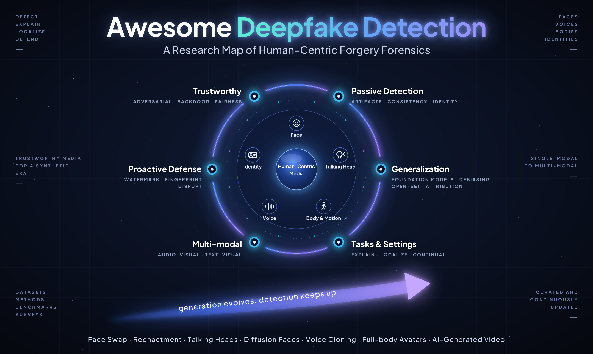
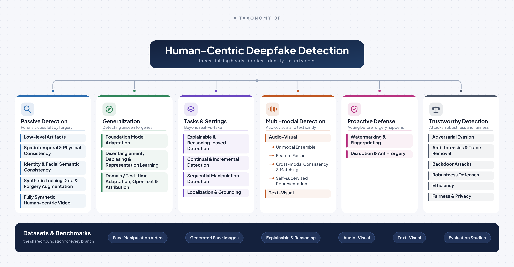

<a id="readme-top"></a>
<div align="center">



[](https://awesome.re)
[](https://arxiv.org/abs/2406.06965)
[](#contents)
[](https://github.com/qiqitao77/Awesome-Comprehensive-Deepfake-Detection/stargazers)
[](https://github.com/qiqitao77/Awesome-Comprehensive-Deepfake-Detection/commits/main)
[](#-contributing)

</div>

<p align="center">This list accompanies our survey<br><b><a href="https://arxiv.org/abs/2406.06965">Evolving from Single-modal to Multi-modal Facial Deepfake Detection: Progress and Challenges</a></b></p>
<p align="center">
  <a href="https://pinglmlcv.github.io/pingliu264/">Ping Liu<sup>1</sup></a>
  ,
  Qiqi Tao<sup>2</sup>
  ,
  <a href="https://joeyzhouty.github.io/">Joey Tianyi Zhou<sup>2,3</sup></a>
</p>

<p align="center">
  <sup>1</sup><a href="https://www.unr.edu/cse">University of Nevada, Reno</a><br>
  <sup>2</sup><a href="https://www.a-star.edu.sg/cfar/home">Centre for Frontier AI Research (CFAR), A*STAR</a><br>
  <sup>3</sup><a href="https://www.catos.sg/"> Centre for Advanced Technologies in Online Safety (CATOS)</a>
</p>

<p align="center"></p>

## 📰 News

- **\[2026.10\]** The list is reorganized around a human-centric scope and a new taxonomy. Duplicate entries are removed, and venues and links are corrected.
- **\[2025.04\]** 🎉 The updated survey is on [arXiv](https://arxiv.org/abs/2406.06965), with more recent works, a systematic taxonomy of detection methods, and broader discussion.
- **\[2024.06\]** The first version of the survey is released on [arXiv](https://arxiv.org/abs/2406.06965).

## 📊 At a Glance

| Section | Papers | Newest |
|:--|:-:|:-:|
| 🔍 [Low-level Artifacts](#low-level-artifacts) | 36 | 2026 |
| 🔍 [Spatiotemporal and Physical Consistency](#spatiotemporal-and-physical-consistency) | 24 | 2026 |
| 🔍 [Identity and Facial Semantic Consistency](#identity-and-facial-semantic-consistency) | 19 | 2026 |
| 🔍 [Synthetic Training Data and Forgery Augmentation](#synthetic-training-data-and-forgery-augmentation) | 17 | 2026 |
| 🔍 [Fully Synthetic Human-centric Video](#fully-synthetic-human-centric-video) | 2 | 2025 |
| 🧭 [Foundation Model Adaptation](#foundation-model-adaptation) | 34 | 2026 |
| 🧭 [Disentanglement, Debiasing and Representation Learning](#disentanglement-debiasing-and-representation-learning) | 37 | 2026 |
| 🧭 [Domain and Test-time Adaptation, Open-set Detection and Attribution](#domain-and-test-time-adaptation-open-set-detection-and-attribution) | 16 | 2026 |
| 🧩 [Explainable and Reasoning-based Detection](#explainable-and-reasoning-based-detection) | 34 | 2026 |
| 🧩 [Continual and Incremental Detection](#continual-and-incremental-detection) | 13 | 2026 |
| 🧩 [Sequential Manipulation Detection](#sequential-manipulation-detection) | 7 | 2025 |
| 🧩 [Localization and Grounding](#localization-and-grounding) | 24 | 2026 |
| 🎙️ [Audio-Visual: Unimodal Ensemble](#audio-visual-unimodal-ensemble) | 4 | 2025 |
| 🎙️ [Audio-Visual: Feature Fusion](#audio-visual-feature-fusion) | 20 | 2026 |
| 🎙️ [Audio-Visual: Cross-modal Consistency and Matching](#audio-visual-cross-modal-consistency-and-matching) | 17 | 2026 |
| 🎙️ [Audio-Visual: Self-supervised Representation](#audio-visual-self-supervised-representation) | 8 | 2026 |
| 🎙️ [Text-Visual Manipulation Detection](#text-visual-manipulation-detection) | 15 | 2026 |
| 🛡️ [Watermarking and Fingerprinting](#watermarking-and-fingerprinting) | 23 | 2026 |
| 🛡️ [Disruption and Anti-forgery](#disruption-and-anti-forgery) | 48 | 2026 |
| ⚖️ [Adversarial Evasion](#adversarial-evasion) | 17 | 2026 |
| ⚖️ [Anti-forensics and Trace Removal](#anti-forensics-and-trace-removal) | 10 | 2024 |
| ⚖️ [Backdoor Attacks](#backdoor-attacks) | 4 | 2025 |
| ⚖️ [Robustness Defenses](#robustness-defenses) | 7 | 2026 |
| ⚖️ [Efficiency](#efficiency) | 5 | 2026 |
| ⚖️ [Fairness and Privacy](#fairness-and-privacy) | 10 | 2026 |
| 📚 [Benchmarks and Evaluation Studies](#benchmarks-and-evaluation-studies) | 31 | 2026 |

Badge colors:      &nbsp; 🔥 marks 2026 papers.

<details>
<summary><b>Scope and inclusion rules</b></summary>

We include a work when the forged subject is a person (face, body, motion, voice, or identity), or when a general detector is evaluated substantially on human data. We do not include detectors for non-human AI-generated images (scenes, objects, artwork) or for AI-generated text. A few widely used general AIGI baselines are kept for reference and marked `General AIGI`. For voice, we include identity-linked forgery such as voice cloning and speaker impersonation, with priority on audio-visual work.

Within each section, entries run from newest to oldest. Each paper appears once, in the section that matches its main contribution.

</details>

## Contents

- [📦 Datasets and Benchmarks](#-datasets-and-benchmarks)
  - [Single-modal Face Manipulation Video Datasets](#single-modal-face-manipulation-video-datasets)
  - [Single-modal Generated Face Image Datasets](#single-modal-generated-face-image-datasets)
  - [Explainable and Reasoning Benchmarks](#explainable-and-reasoning-benchmarks)
  - [Single-modal Mixed-generation Video Benchmarks](#single-modal-mixed-generation-video-benchmarks)
  - [Multi-modal Audio-Visual Datasets](#multi-modal-audio-visual-datasets)
  - [Multi-modal Text-Visual Datasets](#multi-modal-text-visual-datasets)
  - [Benchmarks and Evaluation Studies](#benchmarks-and-evaluation-studies)
- [🔍 Passive Detection](#-passive-detection)
  - [Low-level Artifacts](#low-level-artifacts) (36)
  - [Spatiotemporal and Physical Consistency](#spatiotemporal-and-physical-consistency) (24)
  - [Identity and Facial Semantic Consistency](#identity-and-facial-semantic-consistency) (19)
  - [Synthetic Training Data and Forgery Augmentation](#synthetic-training-data-and-forgery-augmentation) (17)
  - [Fully Synthetic Human-centric Video](#fully-synthetic-human-centric-video) (2)
- [🧭 Generalization Strategies](#-generalization-strategies)
  - [Foundation Model Adaptation](#foundation-model-adaptation) (34)
  - [Disentanglement, Debiasing and Representation Learning](#disentanglement-debiasing-and-representation-learning) (37)
  - [Domain and Test-time Adaptation, Open-set Detection and Attribution](#domain-and-test-time-adaptation-open-set-detection-and-attribution) (16)
- [🧩 Detection Tasks and Settings](#-detection-tasks-and-settings)
  - [Explainable and Reasoning-based Detection](#explainable-and-reasoning-based-detection) (34)
  - [Continual and Incremental Detection](#continual-and-incremental-detection) (13)
  - [Sequential Manipulation Detection](#sequential-manipulation-detection) (7)
  - [Localization and Grounding](#localization-and-grounding) (24)
- [🎙️ Multi-modal Detection](#-multi-modal-detection)
  - [Audio-Visual: Unimodal Ensemble](#audio-visual-unimodal-ensemble) (4)
  - [Audio-Visual: Feature Fusion](#audio-visual-feature-fusion) (20)
  - [Audio-Visual: Cross-modal Consistency and Matching](#audio-visual-cross-modal-consistency-and-matching) (17)
  - [Audio-Visual: Self-supervised Representation](#audio-visual-self-supervised-representation) (8)
  - [Text-Visual Manipulation Detection](#text-visual-manipulation-detection) (15)
- [🛡️ Proactive Defense](#-proactive-defense)
  - [Watermarking and Fingerprinting](#watermarking-and-fingerprinting) (23)
  - [Disruption and Anti-forgery](#disruption-and-anti-forgery) (48)
- [⚖️ Trustworthy Detection](#-trustworthy-detection)
  - [Adversarial Evasion](#adversarial-evasion) (17)
  - [Anti-forensics and Trace Removal](#anti-forensics-and-trace-removal) (10)
  - [Backdoor Attacks](#backdoor-attacks) (4)
  - [Robustness Defenses](#robustness-defenses) (7)
  - [Efficiency](#efficiency) (5)
  - [Fairness and Privacy](#fairness-and-privacy) (10)
- [📝 Citation](#-citation)
- [🤝 Contributing](#-contributing)
- [📖 Relevant Surveys](#-relevant-surveys)

---

## 📦 Datasets and Benchmarks
### Single-modal Face Manipulation Video Datasets
|Dataset|Year|Task|Manipulated Modality|\# of real videos|\# of fake videos|Paper|Link|
|:-:|:-:|:-:|:-:|:-:|:-:|-|-|
|FaceForensics++(FF++)|2019|Classification|Visual|1,000|4,000|[FaceForensics++: Learning to Detect Manipulated Facial Images](https://arxiv.org/abs/1901.08971)|[Download](https://github.com/ondyari/FaceForensics)|
|DFD|2019|Classification|Visual|363|3,068|[Contributing data to deepfake detection research](https://blog.research.google/2019/09/contributing-datato-deepfake-detection.html)|[Download](https://github.com/ondyari/FaceForensics)|
|DFFD|2020|Classification|Visual|1,000|3,000|[On the Detection of Digital Face Manipulation](https://arxiv.org/abs/1910.01717)|[Download](https://cvlab.cse.msu.edu/dffd-dataset.html)|
|FaceShifter|2020|Classification|Visual|-|1,000|[FaceShifter: Towards High Fidelity And Occlusion Aware Face Swapping](https://arxiv.org/abs/1912.13457)|[Download](https://github.com/ondyari/FaceForensics)|
|DFDC|2020|Classification|Visual|23,654|104,500|[The DeepFake Detection Challenge (DFDC) Dataset](https://arxiv.org/abs/2006.07397)|[Download](https://ai.meta.com/datasets/dfdc/)|
|Celeb-DF|2020|Classification|Visual|590|5,639|[Celeb-df: A large-scale challenging dataset for deepfake forensics](https://arxiv.org/abs/1909.12962)|[Download](https://github.com/yuezunli/celeb-deepfakeforensics)|
|DeeperForensics-1.0|2020|Classification|Visual|50,000|10,000|[DeeperForensics-1.0: A Large-Scale Dataset for Real-World Face Forgery Detection](https://www.arxiv.org/abs/2001.03024)|[Download](https://github.com/EndlessSora/DeeperForensics-1.0)|
|WildDeepfake|2020|Classification|Visual|3,805|3,509|[WildDeepfake: A Challenging Real-World Dataset for Deepfake Detection](https://dl.acm.org/doi/10.1145/3394171.3413769)|[Download](https://github.com/deepfakeinthewild/deepfake-in-the-wild)|
|KoDF|2020|Classification|Visual|62,166|175,776|[KoDF: A Large-scale Korean DeepFake Detection Dataset](https://arxiv.org/abs/2103.10094)|[Download](https://deepbrainai-research.github.io/kodf/)|
|FFIW_10k|2021|Classification & Spatial Grounding|Visual|10,000|10,000|[Face Forensics in the Wild](https://arxiv.org/abs/2103.16076)|[Download](https://github.com/tfzhou/FFIW)|
|ForgeryNet|2021|Classification & Spatial Grounding & Temporal Grounding|Visual|99,630|121,617|[Forgerynet: A versatile benchmark for comprehensive forgery analysis](https://arxiv.org/abs/2103.05630)|[Download](https://yinanhe.github.io/projects/forgerynet.html)|
|DF-Platter|2023|Classification|Visual|133,260|132,496|[DF-Platter: Multi-Face Heterogeneous Deepfake Dataset](https://openaccess.thecvf.com/content/CVPR2023/papers/Narayan_DF-Platter_Multi-Face_Heterogeneous_Deepfake_Dataset_CVPR_2023_paper.pdf)|[Download](https://iab-rubric.org/df-platter-database)|
|Celeb-DF++|2025|Classification|Visual|590|53,196|[Celeb-DF++: A Large-scale Challenging Video DeepFake Benchmark for Generalizable Forensics](https://arxiv.org/pdf/2507.18015)|[Download](https://github.com/OUC-VAS/Celeb-DF-PP)|
### Single-modal Generated Face Image Datasets
|Dataset|Year|Task|Manipulated Modality|\# of real images|\# of fake images|Paper|Link|
|:-:|:-:|:-:|:-:|:-:|:-:|-|-|
|DeepFakeFace|2023|Classification|Visual|30,000|90,000|[Robustness and Generalizability of Deepfake Detection: A Study with Diffusion Models](https://arxiv.org/abs/2309.02218)|[Download](https://github.com/OpenRL-Lab/DeepFakeFace)|
|GenFace|2024|Classification|Visual|100,000|515,000|[GenFace: A Large-Scale Fine-Grained Face Forgery Benchmark and Cross Appearance-Edge Learning](https://arxiv.org/abs/2402.02003)|[Download](https://github.com/Jenine-321/GenFace)|
|DiFF|2024|Classification|Visual|23,661|537,466|[Diffusion Facial Forgery Detection](https://arxiv.org/abs/2401.15859)|[Download](https://github.com/xaCheng1996/DiFF)|
|DiffusionFace|2024|Classification|Visual|30,000|600,000|[DiffusionFace: Towards a Comprehensive Dataset for Diffusion-Based Face Forgery Analysis](https://arxiv.org/abs/2403.18471)|[Download](https://github.com/Rapisurazurite/DiffFace)|
|DiffusionDB-Face|2024|Classification|Visual|94,120|24,794|[Diffusion Deepfake](https://arxiv.org/abs/2404.01579)|[Download](https://surrey-uplab.github.io/research/diffusion_deepfake/)|
|JourneyDB-Face|2024|Classification|Visual|94,120|87,833|[Diffusion Deepfake](https://arxiv.org/abs/2404.01579)|[Download](https://surrey-uplab.github.io/research/diffusion_deepfake/)|
|TalkingHeadBench|2025|Classification|Visual|2,312|2,984|[TalkingHeadBench: A Multi-Modal Benchmark & Analysis of Talking-Head DeepFake Detection](https://arxiv.org/abs/2505.24866)|[Download](https://huggingface.co/datasets/luchaoqi/TalkingHeadBench)|
|DeepMoiréFake (DMF)|2025|Classification|Visual|12,832 videos in total (35.6 h)|-|[Through the Lens: Benchmarking Deepfake Detectors Against Moiré-Induced Distortions](https://arxiv.org/pdf/2510.23225)|-|
|VIPBench|2025|Identity-aware Classification|Visual|80,080 images in total (22 identities)|-|[Guard Me If You Know Me: Protecting Specific Face-Identity from Deepfakes](https://arxiv.org/abs/2505.19582)|[Download](https://huggingface.co/datasets/Kaiqing/VIPBench)|
### Explainable and Reasoning Benchmarks
|Dataset|Year|Task|Manipulated Modality|\# of real samples|\# of fake samples|Paper|Link|
|:-:|:-:|:-:|:-:|:-:|:-:|-|-|
|MMTT|2024|Classification & Explanation|Visual|100,000|128,303|[A Large-scale Interpretable Multi-modality Benchmark for Facial Image Forgery Localization](https://arxiv.org/abs/2412.19685)|not released yet|
|Beyond Static Artifacts|2026|Reasoning / QA|Video (FS/FR)|1,000|5,000|[Beyond Static Artifacts: A Forensic Benchmark for Video Deepfake Reasoning in Vision-Language Models](https://arxiv.org/pdf/2602.21779)|--|
|CoT-Face|2026|Reasoning / QA|Visual|5,953|--|[EvolveReason: Self-Evolving Reasoning Paradigm for Explainable Deepfake Facial Image Identification](https://arxiv.org/abs/2603.07515)|--|
### Single-modal Mixed-generation Video Benchmarks
|Dataset|Year|Task|Manipulated Modality|\# of real videos|\# of fake videos|Paper|Link|
|:-:|:-:|:-:|:-:|:-:|:-:|-|-|
|FakeI2V-Bench|2026|Classification & Benchmarking|Visual|25,053|72,495|[FakeI2V-Bench: Benchmarking the Applicability of Image-level Deepfake Detectors for Deepfake Video Detection](https://arxiv.org/abs/2608.03096)|[Download](https://github.com/CryptoAILab/FakeI2V-Bench)|

> **Note:** FakeI2V-Bench aggregates 97,548 videos from CDFV2, DFD, GenVideo, and GenVidBench rather than introducing an entirely new video collection.
### Multi-modal Audio-Visual Datasets
|Dataset|Year|Task|Manipulated Modality|\# of real videos|\# of fake videos|Paper|Link|
|:-:|:-:|:-:|:-:|:-:|:-:|-|-|
|FakeAVCeleb|2021|Classification|Visual & Audio|500|19,500|[FakeAVCeleb: A Novel Audio-Video Multimodal Deepfake Dataset](https://arxiv.org/abs/2108.05080)|[Download](https://sites.google.com/view/fakeavcelebdash-lab/)|
|TMC|2022|Classification & Temporal Grounding|Visual & Audio|2,563|4,380|[Trusted Media Challenge Dataset and User Study](https://arxiv.org/abs/2201.04788)|-|
|LAV-DF|2022|Classification & Temporal Grounding|Visual & Audio|36,431|99,873|[Do You Really Mean That? Content Driven Audio-Visual Deepfake Dataset and Multimodal Method for Temporal Forgery Localization](https://arxiv.org/abs/2204.06228)|[Download](https://github.com/ControlNet/LAV-DF)|
|DefakeAVMiT|2023|Classification|Visual & Audio|540|6,480|[AVoiD-DF: Audio-Visual Joint Learning for Detecting Deepfake](https://doi.org/10.1109/TIFS.2023.3262148)|-|
|AV-Deepfake1M|2023|Classification & Temporal Grounding|Visual & Audio|286,721|860,039|[AV-Deepfake1M: A Large-Scale LLM-Driven Audio-Visual Deepfake Dataset](https://arxiv.org/abs/2311.15308)|[Download](https://github.com/ControlNet/AV-Deepfake1M)|
|MMDFD|2023|Classification|Visual & Audio & Text|1,500|5,000|[MMDFD- A Multimodal Custom Dataset for Deepfake Detection](https://doi.org/10.1145/3607947.3608013)|-|
|PolyGlotFake|2024|Classification|Visual & Audio & Text|766|14,472|[PolyGlotFake: A Novel Multilingual and Multimodal DeepFake Dataset](https://arxiv.org/abs/2405.08838)|[Download](https://github.com/tobuta/PolyGlotFake)|
|DeepFake-eval-2024|2025|Classification|Visual & Audio|1,208|767|[Deepfake-Eval-2024: A Multi-Modal In-the-Wild Benchmark of Deepfakes Circulated in 2024](https://arxiv.org/abs/2503.02857)|-|
|DDL|2025|Classification/Spatial Grounding/Temporal Grounding|Visual & Audio|367K(V)/97K(A)|1.8M|[DDL: A Large-Scale Datasets for Deepfake Detection and Localization in Diversified Real-World Scenarios](https://arxiv.org/abs/2506.23292)|-|
|AV-Deepfake1M++|2025|Classification & Temporal Grounding|Visual & Audio|627,936|1,423,218|[AV-Deepfake1M++: A Large-Scale Audio-Visual Deepfake Benchmark with Real-World Perturbations](https://arxiv.org/abs/2507.20579)|[Download](https://deepfakes1m.github.io/2025)|
|DeepfakeBench-MM (Mega-MMDF)|2025|Classification|Visual & Audio|580,000|1,100,000|[DeepfakeBench-MM: A Comprehensive Benchmark for Multimodal Deepfake Detection](https://arxiv.org/pdf/2510.22622)|-|

### Multi-modal Text-Visual Datasets
|Dataset|Year|Task|Manipulated Modality|\# of real image-text pairs|\# of fake image-text pairs|Paper|Link|
|:-:|:-:|:-:|:-:|:-:|:-:|-|-|
|DGM4|2023|Classification & Spatial Grounding & Text Grounding|Visual & Text|77,426|152,574|[DGM4: Detecting and Grounding Multi-Modal Media Manipulation and Beyond](https://arxiv.org/abs/2309.14203)|[Download](https://github.com/rshaojimmy/MultiModal-DeepFake)|

### Benchmarks and Evaluation Studies

-  🔥 **When AUC Misleads: Polarization-Aware Evaluation of Deepfake Detectors under Domain Shift** · [📄 Paper](https://arxiv.org/pdf/2606.19184)
-  🔥 **Pixels Don't Lie (But Your Detector Might): Bootstrapping MLLM-as-a-Judge for Trustworthy Deepfake Detection and Reasoning Supervision** · [📄 Paper](https://arxiv.org/abs/2602.19715) · [💻 Code](https://github.com/KjAeRsTuIsK/DeepfakeJudge)
-  🔥 **A Sanity Check for Multi-In-Domain Face Forgery Detection in the Real World** · [📄 Paper](https://arxiv.org/pdf/2512.04837)
-  🔥 **DeepfakeImpact: A Two-Stage Benchmark with Real-World Impact in Deepfake Detection** · [📄 Paper](https://openaccess.thecvf.com/content/CVPR2026/html/Gong_DeepfakeImpact_A_Two-Stage_Benchmark_with_Real-World_Impact_in_Deepfake_Detection_CVPR_2026_paper.html)
-  🔥 **TriDF: Evaluating Perception, Detection, and Hallucination for Interpretable DeepFake Detection** · [📄 Paper](https://arxiv.org/abs/2512.10652) · [💻 Code](https://github.com/j1anglin/TriDF) `Explainable`
-  🔥 **AVFakeBench: A Comprehensive Audio-Video Forgery Detection Benchmark for AV-LMMs** · [📄 Paper](https://arxiv.org/abs/2511.21251) `Audio-Visual`
-  🔥 **The DeepSpeak Dataset** · [📄 Paper](https://arxiv.org/abs/2408.05366) `Audio-Visual`
-  🔥 **Robust Deepfake Detection, NTIRE 2026 Challenge: Report** · [📄 Paper](https://arxiv.org/abs/2604.24163)
-  🔥 **Tell me Habibi, is it Real or Fake?** · [📄 Paper](https://arxiv.org/abs/2505.22581) `Audio-Visual`
-  🔥 **Proactive Defense Benchmark against Deepfake Generation** · [📄 Paper](https://proceedings.mlr.press/v306/baek26e.html) · [💻 Code](https://github.com/proactivedefensebenchmark/proactivedefensebenchmark)
-  🔥 **ExDDV: A New Dataset for Explainable Deepfake Detection in Video** · [📄 Paper](https://openaccess.thecvf.com/content/WACV2026/html/Hondru_ExDDV_A_New_Dataset_for_Explainable_Deepfake_Detection_in_Video_WACV_2026_paper.html) · [💻 Code](https://github.com/vladhondru25/ExDDV) `Explainable`
-  🔥 **TalkingHeadBench: A Multi-Modal Benchmark & Analysis of Talking-Head DeepFake Detection** · [📄 Paper](https://openaccess.thecvf.com/content/WACV2026/html/Xiong_TalkingHeadBench_A_Multi-Modal_Benchmark__Analysis_of_Talking-Head_DeepFake_Detection_WACV_2026_paper.html)
-  🔥 **Beyond Face Swapping: A Diffusion-Based Digital Human Benchmark for Multimodal Deepfake Detection** · [📄 Paper](https://arxiv.org/abs/2505.16512) · [💻 Code](https://github.com/DigiFakeAV/DigiFakeAV-v1) `Audio-Visual`
-  🔥 **DiffFace-Edit: A Diffusion-Based Facial Dataset for Forgery-Semantic Driven Deepfake Detection Analysis** · [📄 Paper](https://arxiv.org/abs/2601.13551)
-  **LLMs Are Not Yet Ready for Deepfake Image Detection** · [📄 Paper](https://arxiv.org/abs/2506.10474)
-  **SHIELD: An Evaluation Benchmark for Face Spoofing and Forgery Detection with Multimodal Large Language Models** · [📄 Paper](https://arxiv.org/abs/2402.04178) · [💻 Code](https://github.com/laiyingxin2/SHIELD)
-  **Can Multi-Modal (Reasoning) LLMs Work as Deepfake Detectors** · [📄 Paper](https://arxiv.org/pdf/2503.20084)
-  **ILLUSION: Unveiling Truth with a Comprehensive Multi-Modal, Multi-Lingual Deepfake Dataset** · [📄 Paper](https://proceedings.iclr.cc/paper_files/paper/2025/hash/08f9de0232c0b485110237f6e6cf88f1-Abstract-Conference.html) `Audio-Visual`
-  **Forensics-Bench: A Comprehensive Forgery Detection Benchmark Suite for Large Vision Language Models** · [📄 Paper](https://openaccess.thecvf.com/content/CVPR2025/html/Wang_Forensics-Bench_A_Comprehensive_Forgery_Detection_Benchmark_Suite_for_Large_Vision_CVPR_2025_paper.html) · [💻 Code](https://github.com/Forensics-Bench/Forensics-Bench) `Explainable` `General AIGI`
-  **Multiverse Through Deepfakes: The MultiFakeVerse Dataset of Person-Centric Visual and Conceptual Manipulations** · [📄 Paper](https://doi.org/10.1145/3746027.3758283) · [💻 Code](https://github.com/Parul-Gupta/MultiFakeVerse)
-  **A Large-scale Universal Evaluation Benchmark For Face Forgery Detection** · [📄 Paper](https://doi.org/10.1145/3746027.3758194) · [💻 Code](https://github.com/HengruiLou/DeepFaceGen)
-  **MFFI: Multi-Dimensional Face Forgery Image Dataset for Real-World Scenarios** · [📄 Paper](https://doi.org/10.1145/3746027.3758280)
-  **Nearly Solved? Robust Deepfake Detection Requires More than Visual Forensics** · [📄 Paper](https://arxiv.org/abs/2412.05676)
-  **Can ChatGPT Detect DeepFakes? A Study of Using Multimodal Large Language Models for Media Forensics** · [📄 Paper](https://arxiv.org/abs/2403.14077)
-  **Towards Quantitative Evaluation of Explainable AI Methods for Deepfake Detection** · [📄 Paper](https://arxiv.org/abs/2404.18649) · [💻 Code](https://github.com/IDT-ITI/XAI-Deepfakes)
-  **Diffusion Facial Forgery Detection** · [📄 Paper](https://arxiv.org/abs/2401.15859)
-  **1M-Deepfakes Detection Challenge** · [📄 Paper](https://arxiv.org/abs/2409.06991) · [💻 Code](https://github.com/ControlNet/AV-Deepfake1M)
-  **DF40: Toward Next-Generation Deepfake Detection** · [📄 Paper](https://neurips.cc/virtual/2024/poster/97670) · [💻 Code](https://github.com/YZY-stack/DF40)
-  **A Hitchhiker's Guide to Fine-Grained Face Forgery Detection Using Common Sense Reasoning** · [📄 Paper](https://proceedings.neurips.cc/paper_files/paper/2024/hash/059d2b9188cdb7ae00f4d78cc9469704-Abstract-Datasets_and_Benchmarks_Track.html) · [💻 Code](https://github.com/NickyFot/HitchhikersGuide) `Explainable`
-  **Evaluation of an Audio-Video Multimodal Deepfake Dataset using Unimodal and Multimodal Detectors** · [📄 Paper](https://arxiv.org/abs/2109.02993) · [💻 Code](https://github.com/DASH-Lab/FakeAVCeleb)
-  **FaceForensics++: Learning to Detect Manipulated Facial Images** · [📄 Paper](https://arxiv.org/abs/1901.08971) · [💻 Code](https://github.com/ondyari/FaceForensics)

<p align="right"><a href="#readme-top">⬆ back to top</a></p>

---

## 🔍 Passive Detection

### Low-level Artifacts

-  🔥 **Unveiling Deepfakes: A Frequency-Aware Triple Branch Network for Deepfake Detection** · [📄 Paper](https://arxiv.org/pdf/2604.17477) · [💻 Code](https://github.com/injooker/Unveiling_Deepfake)
-  🔥 **Phase4DFD: Multi-Domain Phase-Aware Attention for Deepfake Detection** · [📄 Paper](https://arxiv.org/pdf/2601.05861)
-  🔥 **Deepfake Detection Generalization with Diffusion Noise** · [📄 Paper](https://arxiv.org/pdf/2604.14570)
-  🔥 **Multiple Contexts and Frequencies Aggregation Network for Deepfake Detection** · [📄 Paper](https://arxiv.org/abs/2408.01668v1)
-  🔥 **Exposing DeepFakes via Hyperspectral Domain Mapping** · [📄 Paper](https://arxiv.org/abs/2511.11732)
-  **From Specificity to Generality: Revisiting Generalizable Artifacts in Detecting Face Deepfakes** · [📄 Paper](https://arxiv.org/pdf/2504.04827)
-  **SpecXNet: A Dual-Domain Convolutional Network for Robust Deepfake Detection** · [📄 Paper](https://arxiv.org/abs/2509.22070) · [💻 Code](https://github.com/tanvirnwu/SpecXNet_ACM_MM_2025)
-  **Forgery Guided Learning Strategy with Dual Perception Network for Deepfake Cross-domain Detection** · [📄 Paper](https://arxiv.org/pdf/2508.10741)
-  **Towards Generalizable Deepfake Detection with Spatial-Frequency Collaborative Learning and Hierarchical Cross-Modal Fusion** · [📄 Paper](https://arxiv.org/abs/2504.17223)
-  **WMamba: Wavelet-based Mamba for Face Forgery Detection** · [📄 Paper](https://arxiv.org/abs/2501.09617)
-  **Wavelet-Driven Generalizable Framework for Deepfake Face Forgery Detection** · [📄 Paper](https://arxiv.org/pdf/2409.18301) · [💻 Code](https://github.com/lalithbharadwajbaru/Wavelet-CLIP)
-  **Distilled Transformers with Locally Enhanced Global Representations for Face Forgery Detection** · [📄 Paper](https://www.sciencedirect.com/science/article/abs/pii/S0031320324010045)
-  **ADD: An Automated Neural Architecture Search Baseline for Deepfake Detection** · [📄 Paper](https://ieeexplore.ieee.org/document/11458560) `NAS`
-  **STD-FD: Spatio-Temporal Distribution Fitting Deviation for AIGC Forgery Identification** · [📄 Paper](https://icml.cc/virtual/2025/poster/45231) · [💻 Code](https://github.com/HengruiLou/STDFD) `General AIGI`
-  **Rethinking the Up-Sampling Operations in CNN-based Generative Network for Generalizable Deepfake Detection** · [📄 Paper](https://arxiv.org/abs/2312.10461) · [💻 Code](https://github.com/chuangchuangtan/NPR-DeepfakeDetection) `General AIGI`
-  **LAA-Net: Localized Artifact Attention Network for Quality-Agnostic and Generalizable Deepfake Detection** · [📄 Paper](https://arxiv.org/abs/2401.13856) · [💻 Code](https://github.com/10Ring/LAA-Net)
-  **Data-Independent Operator: A Training-Free Artifact Representation Extractor for Generalizable Deepfake Detection** · [📄 Paper](https://arxiv.org/abs/2403.06803)
-  **GenFace: A Large-Scale Fine-Grained Face Forgery Benchmark and Cross Appearance-Edge Learning** · [📄 Paper](https://arxiv.org/abs/2402.02003) · [💻 Code](https://github.com/Jenine-321/GenFace)
-  **Frequency-Aware Deepfake Detection: Improving Generalizability through Frequency Space Learning** · [📄 Paper](https://arxiv.org/abs/2403.07240) · [💻 Code](https://github.com/chuangchuangtan/FreqNet-DeepfakeDetection)
-  **FakeFormer: Efficient Vulnerability-Driven Transformers for Generalisable Deepfake Detection** · [📄 Paper](https://arxiv.org/pdf/2410.21964) · [💻 Code](https://github.com/10Ring/FakeFormer)
-  **GLFF: Global and Local Feature Fusion for AI-synthesized Image Detection** · [📄 Paper](https://arxiv.org/abs/2211.08615) · [💻 Code](https://github.com/littlejuyan/GLFF)
-  **Noise based deepfake detection via multi-head relative-interaction** · [📄 Paper](https://ojs.aaai.org/index.php/AAAI/article/view/26701/26473)
-  **Dynamic Graph Learning with Content-guided Spatial-Frequency Relation Reasoning for Deepfake Detection** · [📄 Paper](https://openaccess.thecvf.com/content/CVPR2023/papers/Wang_Dynamic_Graph_Learning_With_Content-Guided_Spatial-Frequency_Relation_Reasoning_for_Deepfake_CVPR_2023_paper.pdf)
-  **DIRE for Diffusion-Generated Image Detection** · [📄 Paper](https://arxiv.org/pdf/2303.09295) · [💻 Code](https://github.com/ZhendongWang6/DIRE) `General AIGI`
-  **On the detection of synthetic images generated by diffusion models** · [📄 Paper](https://arxiv.org/abs/2211.00680) · [💻 Code](https://github.com/grip-unina/DMimageDetection) `General AIGI`
-  **FrePGAN: Robust Deepfake Detection Using Frequency-level Perturbations** · [📄 Paper](https://arxiv.org/abs/2202.03347)
-  **ADD: Frequency Attention and Multi-View based Knowledge Distillation to Detect Low-Quality Compressed Deepfake Images** · [📄 Paper](https://arxiv.org/abs/2112.03553) · [💻 Code](https://github.com/Leminhbinh0209/ADD)
-  **Multi-attentional Deepfake Detection** · [📄 Paper](https://openaccess.thecvf.com/content/CVPR2021/papers/Zhao_Multi-Attentional_Deepfake_Detection_CVPR_2021_paper.pdf) · [💻 Code](https://github.com/yoctta/multiple-attention)
-  **Spatial-Phase Shallow Learning: Rethinking Face Forgery Detection in Frequency Domain** · [📄 Paper](https://arxiv.org/abs/2103.01856)
-  **Generalizing Face Forgery Detection with High-frequency Features** · [📄 Paper](https://arxiv.org/abs/2103.12376)
-  **Frequency-aware Discriminative Feature Learning Supervised by Single-Center Loss for Face Forgery Detection** · [📄 Paper](https://arxiv.org/abs/2103.09096)
-  **Local Relation Learning for Face Forgery Detection** · [📄 Paper](https://arxiv.org/pdf/2105.02577)
-  **Beyond the Spectrum: Detecting Deepfakes via Re-Synthesis** · [📄 Paper](https://arxiv.org/abs/2105.14376) · [💻 Code](https://github.com/SSAW14/BeyondtheSpectrum)
-  **Global Texture Enhancement for Fake Face Detection In the Wild** · [📄 Paper](https://openaccess.thecvf.com/content_CVPR_2020/papers/Liu_Global_Texture_Enhancement_for_Fake_Face_Detection_in_the_Wild_CVPR_2020_paper.pdf) · [💻 Code](https://github.com/liuzhengzhe/Global_Texture_Enhancement_for_Fake_Face_Detection_in_the-Wild)
-  **Thinking in Frequency: Face Forgery Detection by Mining Frequency-aware Clues** · [📄 Paper](https://arxiv.org/abs/2007.09355)
-  **Mesonet: a compact facial video forgery detection network** · [📄 Paper](https://ieeexplore.ieee.org/document/8630761/) · [💻 Code](https://github.com/DariusAf/MesoNet)

### Spatiotemporal and Physical Consistency

-  🔥 **Exploring specular reflection inconsistency for generalizable face forgery detection** · [📄 Paper](https://arxiv.org/pdf/2602.06452)
-  🔥 **Ariadne's Thread of LipSync: Unraveling Forgeries via Inconsistency between Lip Motions and Head Poses** · [📄 Paper](https://proceedings.mlr.press/v306/she26a.html) `Audio-Visual`
-  **Face Forgery Video Detection via Temporal Forgery Cue Unraveling** · [📄 Paper](https://openaccess.thecvf.com/content/CVPR2025/papers/Guo_Face_Forgery_Video_Detection_via_Temporal_Forgery_Cue_Unraveling_CVPR_2025_paper.pdf) · [💻 Code](https://github.com/zhenglab/TFCU)
-  **VoD: Learning Volume of Differences for Video-Based Deepfake Detection** · [📄 Paper](https://arxiv.org/pdf/2503.07607) · [💻 Code](https://github.com/xuyingzhongguo/VoD)
-  **GC-ConsFlow: Leveraging Optical Flow Residuals and Global Context for Robust Deepfake Detection** · [📄 Paper](https://arxiv.org/pdf/2501.13435)
-  **Vulnerability-Aware Spatio-Temporal Learning for Generalizable and Interpretable Deepfake Video Detection** · [📄 Paper](https://arxiv.org/pdf/2501.01184) · [💻 Code](https://github.com/10Ring/FakeSTormer)
-  **Beyond Spatial Frequency: Pixel-wise Temporal Frequency-based Deepfake Video Detection** · [📄 Paper](https://arxiv.org/abs/2507.02398) · [💻 Code](https://github.com/rama0126/PwTF-DVD)
-  **Detecting Lip-Syncing Deepfakes: Vision Temporal Transformer for Analyzing Mouth Inconsistencies** · [📄 Paper](https://arxiv.org/pdf/2504.01470) · [💻 Code](https://github.com/skrantidatta/LIPINC-V2)
-  **Do You See What I Say? Generalizable Deepfake Detection based on Visual Speech Recognition** · [📄 Paper](https://arxiv.org/pdf/2511.22443)
-  **DIP: Diffusion Learning of Inconsistency Pattern for General DeepFake Detection** · [📄 Paper](https://arxiv.org/pdf/2410.23663)
-  **DeepShield: Fortifying Deepfake Video Detection with Local and Global Forgery Analysis** · [📄 Paper](https://arxiv.org/abs/2510.25237) · [💻 Code](https://github.com/lijichang/DeepShield)
-  **SpeechForensics: Audio-Visual Speech Representation Learning for Face Forgery Detection** · [📄 Paper](https://arxiv.org/pdf/2508.09913) · [💻 Code](https://github.com/Eleven4AI/SpeechForensics)
-  **Learning Natural Consistency Representation for Face Forgery Video Detection** · [📄 Paper](https://arxiv.org/abs/2407.10550v1)
-  **Learning Spatiotemporal Inconsistency via Thumbnail Layout for Face Deepfake Detection** · [📄 Paper](https://arxiv.org/abs/2403.10261)
-  **Exploiting Style Latent Flows for Generalizing Deepfake Video Detection** · [📄 Paper](https://openaccess.thecvf.com/content/CVPR2024/html/Choi_Exploiting_Style_Latent_Flows_for_Generalizing_Deepfake_Video_Detection_CVPR_2024_paper.html) · [💻 Code](https://github.com/jongwook-Choi/StyleFlow)
-  **Compressed Deepfake Video Detection Based on 3D Spatiotemporal Trajectories** · [📄 Paper](https://arxiv.org/abs/2404.18149)
-  **TALL: Thumbnail Layout for Deepfake Video Detection** · [📄 Paper](https://arxiv.org/abs/2307.07494) · [💻 Code](https://github.com/rainy-xu/TALL4Deepfake)
-  **AltFreezing for More General Video Face Forgery Detection** · [📄 Paper](https://arxiv.org/abs/2307.08317) · [💻 Code](https://github.com/ZhendongWang6/AltFreezing)
-  **MRE-Net: Multi-Rate Excitation Network for Deepfake Video Detection** · [📄 Paper](https://ieeexplore.ieee.org/document/10025759)
-  **Latent pattern sensing: Deepfake video detection via predictive representation learning** · [📄 Paper](https://doi.org/10.1145/3469877.3490586)
-  **Lips don’t lie: A generalisable and robust approach to face forgery detection** · [📄 Paper](https://arxiv.org/abs/2012.07657) · [💻 Code](https://github.com/ahaliassos/LipForensics)
-  **Exploring Temporal Coherence for More General Video Face Forgery Detection** · [📄 Paper](https://arxiv.org/abs/2108.06693) · [💻 Code](https://github.com/yinglinzheng/FTCN)
-  **DeepRhythm: Exposing DeepFakes with Attentional Visual Heartbeat Rhythms** · [📄 Paper](https://arxiv.org/abs/2006.07634)
-  **In Ictu Oculi: Exposing AI Created Fake Videos by Detecting Eye Blinking** · [📄 Paper](https://ieeexplore.ieee.org/document/8630787/) · [💻 Code](https://github.com/yuezunli/WIFS2018_In_Ictu_Oculi)

### Identity and Facial Semantic Consistency

-  🔥 **Identity-Aware Vision-Language Model for Explainable Face Forgery Detection** · [📄 Paper](https://arxiv.org/abs/2504.09439) `Explainable`
-  🔥 **Detecting Deepfake Talking Heads from Facial Biometric Anomalies** · [📄 Paper](https://openaccess.thecvf.com/content/WACV2026W/SAFE-2026/html/Norman_Detecting_Deepfake_Talking_Heads_from_Facial_Biometric_Anomalies_WACVW_2026_paper.html)
-  🔥 **LAKAN: Landmark-Assisted Adaptive Kolmogorov-Arnold Network for Face Forgery Detection** · [📄 Paper](https://arxiv.org/abs/2510.00634)
-  **DiffFake: Exposing Deepfakes using Differential Anomaly Detection** · [📄 Paper](https://arxiv.org/pdf/2502.16247) · [💻 Code](https://github.com/sotossta/DiffFake)
-  **Seeing Through Deepfakes: A Human-Inspired Framework for Multi-Face Detection** · [📄 Paper](https://arxiv.org/pdf/2507.14807)
-  **Detecting Localized Deepfake Manipulations Using Action Unit-Guided Video Representations** · [📄 Paper](https://arxiv.org/pdf/2503.22121) · [💻 Code](https://github.com/Tharun-Anand/Localised-Deepfake-Detection)
-  **SELFI: Selective Fusion of Identity for Generalizable Deepfake Detection** · [📄 Paper](https://arxiv.org/pdf/2506.17592) · [💻 Code](https://github.com/dudgjs0915/SELFI-Selective-Fusion-of-Identity-for-Generalizable-Deepfake-Detection)
-  **Guard Me If You Know Me: Protecting Specific Face-Identity from Deepfakes** · [📄 Paper](https://arxiv.org/pdf/2505.19582) · [💻 Code](https://github.com/KQL11/VIPGuard)
-  **Unmasking Puppeteers: Leveraging Biometric Leakage to Expose Impersonation in AI-Based Videoconferencing** · [📄 Paper](https://proceedings.neurips.cc/paper_files/paper/2025/hash/a34308d616e3193199cfc7e82801a19f-Abstract-Conference.html)
-  **Securing Social Media Against Deepfakes using Identity, Behavioral, and Geometric Signatures** · [📄 Paper](https://arxiv.org/pdf/2412.05487)
-  **DiffusionFake: Enhancing Generalization in Deepfake Detection via Guided Stable Diffusion** · [📄 Paper](https://arxiv.org/abs/2410.04372) · [💻 Code](https://github.com/skJack/DiffusionFake)
-  **Identity-Driven Multimedia Forgery Detection via Reference Assistance** · [📄 Paper](https://arxiv.org/abs/2401.11764) `Audio-Visual`
-  **TI2Net: Temporal Identity Inconsistency Network for Deepfake Detection** · [📄 Paper](https://openaccess.thecvf.com/content/WACV2023/papers/Liu_TI2Net_Temporal_Identity_Inconsistency_Network_for_Deepfake_Detection_WACV_2023_paper.pdf)
-  **AUNet: Learning Relations Between Action Units for Face Forgery Detection** · [📄 Paper](https://openaccess.thecvf.com/content/CVPR2023/papers/Bai_AUNet_Learning_Relations_Between_Action_Units_for_Face_Forgery_Detection_CVPR_2023_paper.pdf)
-  **Implicit Identity Leakage: The Stumbling Block to Improving Deepfake Detection Generalization** · [📄 Paper](https://openaccess.thecvf.com/content/CVPR2023/papers/Dong_Implicit_Identity_Leakage_The_Stumbling_Block_to_Improving_Deepfake_Detection_CVPR_2023_paper.pdf) · [💻 Code](https://github.com/megvii-research/CADDM)
-  **Implicit Identity Driven Deepfake Face Swapping Detection** · [📄 Paper](https://openaccess.thecvf.com/content/CVPR2023/papers/Huang_Implicit_Identity_Driven_Deepfake_Face_Swapping_Detection_CVPR_2023_paper.pdf)
-  **Protecting Celebrities from DeepFake with Identity Consistency Transformer** · [📄 Paper](https://openaccess.thecvf.com/content/CVPR2022/papers/Dong_Protecting_Celebrities_From_DeepFake_With_Identity_Consistency__CVPR_2022_paper.pdf) · [💻 Code](https://github.com/LightDXY/ICT_DeepFake)
-  **DeepFake Detection Based on Discrepancies Between Faces and Their Context** · [📄 Paper](https://ieeexplore.ieee.org/document/9468380)
-  **ID-Reveal: Identity-aware DeepFake Video Detection** · [📄 Paper](https://openaccess.thecvf.com/content/ICCV2021/papers/Cozzolino_ID-Reveal_Identity-Aware_DeepFake_Video_Detection_ICCV_2021_paper.pdf) · [💻 Code](https://github.com/grip-unina/id-reveal)

### Synthetic Training Data and Forgery Augmentation

-  🔥 **Agent4FaceForgery: Multi-Agent LLM Framework for Realistic Face Forgery Detection** · [📄 Paper](https://arxiv.org/pdf/2509.12546)
-  🔥 **Improving Deepfake Detection with Reinforcement Learning-Based Adaptive Data Augmentation** · [📄 Paper](https://arxiv.org/abs/2511.07051)
-  **Generalizing Deepfake Video Detection with Plug-and-Play: Video-Level Blending and Spatiotemporal Adapter Tuning** · [📄 Paper](https://openaccess.thecvf.com/content/CVPR2025/papers/Yan_Generalizing_Deepfake_Video_Detection_with_Plug-and-Play_Video-Level_Blending_and_Spatiotemporal_CVPR_2025_paper.pdf)
-  **Practical Manipulation Model for Robust Deepfake Detection** · [📄 Paper](https://www.arxiv.org/abs/2506.05119) · [💻 Code](https://github.com/BenediktHopf/PMM)
-  **FSBI: Deepfake Detection with Frequency Enhanced Self-Blended Images** · [📄 Paper](https://arxiv.org/html/2406.08625v1) · [💻 Code](https://github.com/gufranSabri/FSBI)
-  **A Quality-Centric Framework for Generic Deepfake Detection** · [📄 Paper](https://arxiv.org/pdf/2411.05335)
-  **Fake It till You Make It: Curricular Dynamic Forgery Augmentations towards General Deepfake Detection** · [📄 Paper](https://arxiv.org/pdf/2409.14444)
-  **Can We Leave Deepfake Data Behind in Training Deepfake Detector?** · [📄 Paper](https://arxiv.org/pdf/2408.17052) · [💻 Code](https://github.com/beautyremain/ProDet)
-  **FreqBlender: Enhancing DeepFake Detection by Blending Frequency Knowledge** · [📄 Paper](https://arxiv.org/abs/2404.13872)
-  **Transcending Forgery Specificity with Latent Space Augmentation for Generalizable Deepfake Detection** · [📄 Paper](https://arxiv.org/abs/2311.11278)
-  **Real Appearance Modeling for More General Deepfake Detection** · [📄 Paper](https://www.ecva.net/papers/eccv_2024/papers_ECCV/html/6913_ECCV_2024_paper.php)
-  **SeeABLE: Soft Discrepancies and Bounded Contrastive Learning for Exposing Deepfakes** · [📄 Paper](https://openaccess.thecvf.com/content/ICCV2023/papers/Larue_SeeABLE_Soft_Discrepancies_and_Bounded_Contrastive_Learning_for_Exposing_Deepfakes_ICCV_2023_paper.pdf) · [💻 Code](https://github.com/anonymous-author-sub/seeable)
-  **Detecting Deepfakes with Self-Blended Images** · [📄 Paper](https://openaccess.thecvf.com/content/CVPR2022/papers/Shiohara_Detecting_Deepfakes_With_Self-Blended_Images_CVPR_2022_paper.pdf) · [💻 Code](https://github.com/mapooon/SelfBlendedImages)
-  **Self-supervised Learning of Adversarial Example: Towards Good Generalizations for Deepfake Detection** · [📄 Paper](https://openaccess.thecvf.com/content/CVPR2022/papers/Chen_Self-Supervised_Learning_of_Adversarial_Example_Towards_Good_Generalizations_for_Deepfake_CVPR_2022_paper.pdf) · [💻 Code](https://github.com/liangchen527/SLADD)
-  **Representative Forgery Mining for Fake Face Detection** · [📄 Paper](https://openaccess.thecvf.com/content/CVPR2021/papers/Wang_Representative_Forgery_Mining_for_Fake_Face_Detection_CVPR_2021_paper.pdf) · [💻 Code](https://github.com/crywang/RFM)
-  **Learning Self-Consistency for Deepfake Detection** · [📄 Paper](https://openaccess.thecvf.com/content/ICCV2021/papers/Zhao_Learning_Self-Consistency_for_Deepfake_Detection_ICCV_2021_paper.pdf)
-  **Face X-ray for More General Face Forgery Detection** · [📄 Paper](https://arxiv.org/abs/1912.13458)

### Fully Synthetic Human-centric Video

-  **Towards a Universal Synthetic Video Detector: From Face or Background Manipulations to Fully AI-Generated Content** · [📄 Paper](https://arxiv.org/pdf/2412.12278)
-  **HumanSAM: Classifying Human-centric Forgery Videos in Human Spatial, Appearance, and Motion Anomaly** · [📄 Paper](https://openaccess.thecvf.com/content/ICCV2025/html/Liu_HumanSAM_Classifying_Human-centric_Forgery_Videos_in_Human_Spatial_Appearance_and_ICCV_2025_paper.html) · [💻 Code](https://github.com/dejian-lc/humansam) `Human Motion`

> 🌱 This section is new and still sparse. Suggestions are welcome.

<p align="right"><a href="#readme-top">⬆ back to top</a></p>

---

## 🧭 Generalization Strategies

### Foundation Model Adaptation

-  🔥 **DBCF: Dual-Branch Complementary Fusion of Foundation Models for Generalized Deepfake Detection** · [📄 Paper](https://arxiv.org/pdf/2609.34720)
-  🔥 **Harnessing CLIP and DINO: An Uncertainty-Aware Cascaded Fusion Network for Generalizable Deepfake Image Detection** · [📄 Paper](https://arxiv.org/pdf/2609.07670)
-  🔥 **GLID: Gated Local Intrinsic Dimension Repairs the Blind Spots of Face-Forgery Detectors** · [📄 Paper](https://arxiv.org/pdf/2607.18770)
-  🔥 **Deepfake Forensics Adapter: A Dual-Stream Network for Generalizable Deepfake Detection** · [📄 Paper](https://arxiv.org/pdf/2603.01450) · [💻 Code](https://github.com/Liao330/DFA)
-  🔥 **Deepfake Detection that Generalizes Across Benchmarks** · [📄 Paper](https://arxiv.org/abs/2508.06248) · [💻 Code](https://github.com/yermandy/GenD)
-  🔥 **Unleashing Vision-Language Semantics for Deepfake Video Detection** · [📄 Paper](https://arxiv.org/pdf/2603.24454) · [💻 Code](https://github.com/mala-lab/VLAForge)
-  🔥 **Fine-Grained DINO Tuning with Dual Supervision for Face Forgery Detection** · [📄 Paper](https://arxiv.org/pdf/2511.12107)
-  🔥 **Beyond [CLS] Token: Query-Driven Token-Level Forgery Purification for Generalizable Deepfake Detection** · [📄 Paper](https://openaccess.thecvf.com/content/CVPR2026/html/Wang_Beyond_CLS_Token_Query-Driven_Token-Level_Forgery_Purification_for_Generalizable_Deepfake_CVPR_2026_paper.html)
-  🔥 **ResProto-FD: Visual-Language Residual Prototype Sets for Generalized Face Forgery Detection** · [📄 Paper](https://ojs.aaai.org/index.php/AAAI/article/view/37473)
-  🔥 **Break Visual-Linguistic Asymmetry: Unleashing VLM's Cross-Modal Potential for General Face Forgery Detection** · [📄 Paper](https://media.eventhosts.cc/Conferences/ECCV2026/pdfs/7845.pdf)
-  🔥 **DFD-HR: Generalizable Deepfake Detection via Hierarchical Routing Learning** · [📄 Paper](https://openaccess.thecvf.com/content/CVPR2026/html/Sun_DFD-HR_Generalizable_Deepfake_Detection_via_Hierarchical_Routing_Learning_CVPR_2026_paper.html)
-  🔥 **A Rich Knowledge Space for Scalable Deepfake Detection** · [📄 Paper](https://openreview.net/forum?id=hNd5L7WnjC)
-  🔥 **SAFE: Semantic- and Frequency-Enhanced Curriculum for Cross-Domain Deepfake Detection** · [📄 Paper](https://ojs.aaai.org/index.php/AAAI/article/view/38179) · [💻 Code](https://github.com/kingkongs7/SAFE)
-  🔥 **BPL: Generalizable Deepfake Detection via Bias-only Pair-aware Learning** · [📄 Paper](https://proceedings.mlr.press/v306/xu26s.html)
-  **Revisiting Simple Baselines for In-The-Wild Deepfake Detection** · [📄 Paper](https://arxiv.org/pdf/2509.04150) · [💻 Code](https://github.com/Deepfake-Detection-KKO/deepfake-detection)
-  **Patch-Discontinuity Mining for Generalized Deepfake Detection** · [📄 Paper](https://arxiv.org/pdf/2512.22027)
-  **Towards More General Video-based Deepfake Detection through Facial Component Guided Adaptation for Foundation Model** · [📄 Paper](https://openaccess.thecvf.com/content/CVPR2025/papers/Han_Towards_More_General_Video-based_Deepfake_Detection_through_Facial_Component_Guided_CVPR_2025_paper.pdf) · [💻 Code](https://github.com/aiiu-lab/DFD-FCG)
-  **Unlocking the Hidden Potential of CLIP in Generalizable Deepfake Detection** · [📄 Paper](https://arxiv.org/pdf/2503.19683) · [💻 Code](https://github.com/yermandy/deepfake-detection)
-  **Deepfake Detection via Knowledge Injection** · [📄 Paper](https://arxiv.org/pdf/2503.02503)
-  **Standing on the Shoulders of Giants: Reprogramming Visual-Language Model for General Deepfake Detection** · [📄 Paper](https://arxiv.org/pdf/2409.02664)
-  **Forensics Adapter: Adapting CLIP for Generalizable Face Forgery Detection** · [📄 Paper](https://arxiv.org/abs/2411.19715) · [💻 Code](https://github.com/OUC-VAS/ForensicsAdapter)
-  **DeepFake-Adapter: Dual-Level Adapter for DeepFake Detection** · [📄 Paper](https://arxiv.org/abs/2306.00863) · [💻 Code](https://github.com/rshaojimmy/DeepFake-Adapter)
-  **MoE-FFD: Mixture of Experts for Generalized and Parameter-Efficient Face Forgery Detection** · [📄 Paper](https://arxiv.org/abs/2404.08452) · [💻 Code](https://github.com/LoveSiameseCat/MoE-FFD)
-  **Towards General Visual-Linguistic Face Forgery Detection** · [📄 Paper](https://arxiv.org/pdf/2502.20698) · [💻 Code](https://github.com/skJack/VLFFD)
-  **Knowledge-Guided Prompt Learning for Deepfake Facial Image Detection** · [📄 Paper](https://arxiv.org/pdf/2501.00700)
-  **Orthogonal Subspace Decomposition for Generalizable AI-Generated Image Detection** · [📄 Paper](https://arxiv.org/abs/2411.15633) · [💻 Code](https://github.com/YZY-stack/Effort-AIGI-Detection)
-  **MFCLIP: Multi-modal Fine-grained CLIP for Generalizable Diffusion Face Forgery Detection** · [📄 Paper](https://www.arxiv.org/abs/2409.09724) · [💻 Code](https://github.com/Jenine-321/MFCLIP)
-  **GM-DF: Generalized Multi-Scenario Deepfake Detection** · [📄 Paper](https://arxiv.org/pdf/2406.20078)
-  **HAMLET-FFD: Hierarchical Adaptive Multi-modal Learning Embeddings Transformation for Face Forgery Detection** · [📄 Paper](https://doi.org/10.1145/3746027.3755137)
-  **Forgery-aware Adaptive Learning with Vision Transformer for Generalized Face Forgery Detection** · [📄 Paper](https://ieeexplore.ieee.org/abstract/document/10813581) · [💻 Code](https://github.com/LoveSiameseCat/FAViT)
-  **Understanding and Improving Training-Free AI-Generated Image Detections with Vision Foundation Models** · [📄 Paper](https://arxiv.org/pdf/2411.19117)
-  **Face Forgery Detection with Elaborate Backbone** · [📄 Paper](https://arxiv.org/abs/2409.16945) · [💻 Code](https://github.com/zhenglab/FFDBackbone)
-  **Exploring Self-Supervised Vision Transformers for Deepfake Detection: A Comparative Analysis** · [📄 Paper](https://arxiv.org/abs/2405.00355)
-  **Enhancing General Face Forgery Detection via Vision Transformer with Low-Rank Adaptation** · [📄 Paper](https://ieeexplore.ieee.org/document/10254409)

### Disentanglement, Debiasing and Representation Learning

-  🔥 **EviStress: Evidence Stress Learning for Generalizable Face Forgery Detection with Textual Explanations** · [📄 Paper](https://arxiv.org/abs/2610.16879) `Explainable`
-  🔥 **Learning Unified Video and Image Representation for Video Face Forgery Detection** · [📄 Paper](https://arxiv.org/pdf/2608.13064) · [💻 Code](https://github.com/haotianll/UVIF)
-  🔥 **Uncertainty-Aware Deepfake Detection via Multi-View Structural Learning** · [📄 Paper](https://arxiv.org/pdf/2607.28769)
-  🔥 **Revisiting Face Forgery Detection: From Facial Representation to Forgery Detection** · [📄 Paper](https://ieeexplore.ieee.org/stamp/stamp.jsp?tp=&arnumber=11435922) · [💻 Code](https://github.com/zhenglab/FFDBackbone)
-  🔥 **From Spurious to Causal: Low-rank Orthogonal Subspace Intervention for Generalizable Face Forgery Detection** · [📄 Paper](https://arxiv.org/pdf/2601.11915)
-  🔥 **Fusion-SSAT: Unleashing the Potential of Self-supervised Auxiliary Task by Feature Fusion for Generalized Deepfake Detection** · [📄 Paper](https://arxiv.org/pdf/2601.00789)
-  🔥 **Environment-Invariant Subspace Learning for Generalizable Deepfake Detection** · [📄 Paper](https://arxiv.org/pdf/2608.17700)
-  🔥 **Tutor-Student Reinforcement Learning: A Dynamic Curriculum for Robust Deepfake Detection** · [📄 Paper](https://arxiv.org/abs/2603.24139) · [💻 Code](https://github.com/wannac1/TSRL)
-  🔥 **Divide and Conquer: Reliable Multi-View Evidential Learning for Deepfake Detection** · [📄 Paper](https://arxiv.org/abs/2606.01885) · [💻 Code](https://github.com/kxl0825/DiCoME)
-  🔥 **Breaking Manifold Continuity: Vector Quantized Modeling for Real-Centric Deepfake Detection** · [📄 Paper](https://proceedings.mlr.press/v306/wang26it.html)
-  **ED4: Explicit Data-level Debiasing for Deepfake Detection** · [📄 Paper](https://arxiv.org/html/2408.06779v1) · [💻 Code](https://github.com/beautyremain/ED4)
-  **FreqDebias: Towards Generalizable Deepfake Detection via Consistency-Driven Frequency Debiasing** · [📄 Paper](https://openaccess.thecvf.com/content/CVPR2025/papers/Kashiani_FreqDebias_Towards_Generalizable_Deepfake_Detection_via_Consistency-Driven_Frequency_Debiasing_CVPR_2025_paper.pdf)
-  **Robust AI-Generated Face Detection with Imbalanced Data** · [📄 Paper](https://arxiv.org/pdf/2505.02182) · [💻 Code](https://github.com/Purdue-M2/SP_CUP)
-  **Exploring Unbiased Deepfake Detection via Token-Level Shuffling and Mixing** · [📄 Paper](https://arxiv.org/pdf/2501.04376)
-  **Bi-Level Optimization for Self-Supervised AI-Generated Face Detection** · [📄 Paper](https://arxiv.org/pdf/2507.22824) · [💻 Code](https://github.com/MZMMSEC/AIGFD_BLO)
-  **FSFM: A Generalizable Face Security Foundation Model via Self-Supervised Facial Representation Learning** · [📄 Paper](https://openaccess.thecvf.com/content/CVPR2025/html/Wang_FSFM_A_Generalizable_Face_Security_Foundation_Model_via_Self-Supervised_Facial_CVPR_2025_paper.html) · [💻 Code](https://github.com/wolo-wolo/FSFM-CVPR25)
-  **Learning Real Facial Concepts for Independent Deepfake Detection** · [📄 Paper](https://arxiv.org/abs/2505.04460)
-  **Semantics-Oriented Multitask Learning for DeepFake Detection: A Joint Embedding Approach** · [📄 Paper](https://arxiv.org/pdf/2408.16305)
-  **FakeDiffer: Distributional Disparity Learning on Differentiated Reconstruction for Face Forgery Detection** · [📄 Paper](https://ojs.aaai.org/index.php/AAAI/article/view/32809)
-  **Critical Forgetting-Based Multi-Scale Disentanglement for Deepfake Detection** · [📄 Paper](https://ojs.aaai.org/index.php/AAAI/article/view/32021)
-  **Mixture-of-Attack-Experts with Class Regularization for Unified Physical-Digital Face Attack Detection** · [📄 Paper](https://ojs.aaai.org/index.php/AAAI/article/view/32218)
-  **UniForensics: Face Forgery Detection via General Facial Representation** · [📄 Paper](https://arxiv.org/pdf/2407.19079)
-  **DPL: Cross-quality DeepFake Detection via Dual Progressive Learning** · [📄 Paper](https://arxiv.org/pdf/2410.07633)
-  **Domain-invariant and Patch-discriminative Feature Learning for General Deepfake Detection** · [📄 Paper](https://dl.acm.org/doi/10.1145/3657297)
-  **Capture Artifacts via Progressive Disentangling and Purifying Blended Identities for Deepfake Detection** · [📄 Paper](https://arxiv.org/pdf/2410.10244)
-  **Decoupling Forgery Semantics for Generalizable Deepfake Detection** · [📄 Paper](https://arxiv.org/pdf/2406.09739) · [💻 Code](https://github.com/leaffeall/DFS-GDD)
-  **Beyond the Prior Forgery Knowledge: Mining Critical Clues for General Face Forgery Detection** · [📄 Paper](https://arxiv.org/abs/2304.12489) · [💻 Code](https://github.com/LoveSiameseCat/CFM)
-  **Exposing the Deception: Uncovering More Forgery Clues for Deepfake Detection** · [📄 Paper](https://ojs.aaai.org/index.php/AAAI/article/view/27829) · [💻 Code](https://github.com/QingyuLiu/Exposing-the-Deception)
-  **Domain-Invariant Feature Learning for General Face Forgery Detection** · [📄 Paper](https://ieeexplore.ieee.org/document/10219778/)
-  **Concentric Ring Loss for Face Forgery Detection** · [📄 Paper](https://www.computer.org/csdl/proceedings-article/icdm/2023/078800b505/1Ui3cRpq3ug)
-  **Improving Cross-dataset Deepfake Detection with Deep Information Decomposition** · [📄 Paper](https://arxiv.org/abs/2310.00359)
-  **UCF: Uncovering Common Features for Generalizable Deepfake Detection** · [📄 Paper](https://openaccess.thecvf.com/content/ICCV2023/papers/Yan_UCF_Uncovering_Common_Features_for_Generalizable_Deepfake_Detection_ICCV_2023_paper.pdf)
-  **MARLIN: Masked Autoencoder for facial video Representation LearnINg** · [📄 Paper](https://arxiv.org/abs/2211.06627) · [💻 Code](https://github.com/ControlNet/MARLIN)
-  **Controllable Guide-Space for Generalizable Face Forgery Detection** · [📄 Paper](https://arxiv.org/abs/2307.14039)
-  **Exploring Disentangled Content Information for Face Forgery Detection** · [📄 Paper](https://arxiv.org/abs/2207.09202)
-  **End-to-End Reconstruction-Classification Learning for Face Forgery Detection** · [📄 Paper](https://openaccess.thecvf.com/content/CVPR2022/papers/Cao_End-to-End_Reconstruction-Classification_Learning_for_Face_Forgery_Detection_CVPR_2022_paper.pdf) · [💻 Code](https://github.com/VISION-SJTU/RECCE)
-  **Dual Contrastive Learning for General Face Forgery Detection** · [📄 Paper](https://arxiv.org/abs/2112.13522)

### Domain and Test-time Adaptation, Open-set Detection and Attribution

-  🔥 **Open-World Deepfake Attribution via Confidence-Aware Asymmetric Learning** · [📄 Paper](https://arxiv.org/pdf/2512.12667) · [💻 Code](https://github.com/HaiyangZheng/OWDFA-CAL)
-  🔥 **AdaForensics: Learning A Characteristic-aware Adaptive Deepfake Detector** · [📄 Paper](https://arxiv.org/pdf/2608.02160)
-  🔥 **μFlow: Leveraging Average Images for Improving Generalisation of Deepfake Faces Detectors** · [📄 Paper](https://arxiv.org/abs/2606.30528v1) · [💻 Code](https://github.com/opontorno/MuFlow)
-  🔥 **Leveraging Unlabeled Data from Unknown Sources via Dual-Path Guidance for Deepfake Face Detection** · [📄 Paper](https://arxiv.org/pdf/2508.09022)
-  🔥 **Learning Forgery-Aware Lip Representations Without Forgery Priors** · [📄 Paper](https://openaccess.thecvf.com/content/CVPR2026/html/Chen_Learning_Forgery-Aware_Lip_Representations_Without_Forgery_Priors_CVPR_2026_paper.html) · [💻 Code](https://github.com/blair00822/VSA)
-  🔥 **Beyond Deepfake vs Real: Facial Deepfake Detection in the Open-Set Paradigm** · [📄 Paper](https://arxiv.org/abs/2503.08055)
-  🔥 **Leveraging Failed Samples: A Few-Shot and Training-Free Framework for Generalized Deepfake Detection** · [📄 Paper](https://arxiv.org/pdf/2508.09475)
-  **FakeRadar:Probing Forgery Outliers to Detect Unknown Deepfake Videos** · [📄 Paper](https://arxiv.org/pdf/2512.14601)
-  **Open Set Face Forgery Detection via Dual-Level Evidence Collection** · [📄 Paper](https://arxiv.org/pdf/2512.04331) · [💻 Code](https://github.com/zhyczy/DLED)
-  **THINK TWICE BEFORE ADAPTATION: IMPROVING ADAPTABILITY OF DEEPFAKE DETECTION VIA ONLINE TEST-TIME ADAPTATION** · [📄 Paper](https://arxiv.org/pdf/2505.18787)
-  **Towards Open-world Generalized Deepfake Detection: General Feature Extraction via Unsupervised Domain Adaptation** · [📄 Paper](https://doi.org/10.1145/3746027.3755495)
-  **Open-Set Deepfake Detection: A Parameter-Efficient Adaptation Method with Forgery Style Mixture** · [📄 Paper](https://arxiv.org/abs/2408.12791v1)
-  **DomainForensics: Exposing Face Forgery across Domains via Bi-directional Adaptation** · [📄 Paper](https://arxiv.org/pdf/2312.10680)
-  **Mastering Deepfake Detection: A Cutting-Edge Approach to Distinguish GAN and Diffusion-Model Images** · [📄 Paper](https://dl.acm.org/doi/10.1145/3652027)
-  **Boosting Non-causal Semantic Elimination: An Unconventional Harnessing of LVM for Open-World Deepfake Interpretation** · [📄 Paper](https://doi.org/10.1145/3664647.3680737) `Explainable`
-  **OC-FakeDect: Classifying Deepfakes Using One-class Variational Autoencoder** · [📄 Paper](https://openaccess.thecvf.com/content_CVPRW_2020/papers/w39/Khalid_OC-FakeDect_Classifying_Deepfakes_Using_One-Class_Variational_Autoencoder_CVPRW_2020_paper.pdf)

<p align="right"><a href="#readme-top">⬆ back to top</a></p>

---

## 🧩 Detection Tasks and Settings

### Explainable and Reasoning-based Detection

-  🔥 **Not Every Cue Is Evidence: Cue Supportability for Forensic Distillation in Face Forgery Detection** · [📄 Paper](https://arxiv.org/abs/2610.16452)
-  🔥 **Look Before You Judge: Training-Free Region Mining for Grounded and Explainable Deepfake Detection** · [📄 Paper](https://arxiv.org/pdf/2609.35536)
-  🔥 **PATE-Forensics: Perception-as-Tool for Explainable Deepfake Forensics with General-Purpose MLLMs** · [📄 Paper](https://arxiv.org/pdf/2608.18573) · [💻 Code](https://github.com/yqli00000/PATE-Forensics)
-  🔥 **Multi-Agent Forensic Reasoning for Generalizable Deepfake Video Detection** · [📄 Paper](https://arxiv.org/pdf/2608.06865) · [💻 Code](https://github.com/XavierJiezou/ARGUS)
-  🔥 **VIGIL: Part-Grounded Structured Reasoning for Generalizable Deepfake Detection** · [📄 Paper](https://arxiv.org/pdf/2603.21526)
-  🔥 **EvolveReason: Self-Evolving Reasoning Paradigm for Explainable Deepfake Facial Image Identification** · [📄 Paper](https://arxiv.org/pdf/2603.07515)
-  🔥 **MARE: Multimodal Alignment and Reinforcement for Explainable Deepfake Detection via Vision-Language Models** · [📄 Paper](https://arxiv.org/pdf/2601.20433)
-  🔥 **DF-CBM: Region-Aware Concept Bottleneck Models for Deepfake Detection** · [📄 Paper](https://arxiv.org/pdf/2609.35096) · [💻 Code](https://github.com/GeorgeTsoumplekas/DF-CBM)
-  🔥 **Leveraging large multimodal models for audio-video deepfake detection: a pilot study** · [📄 Paper](https://arxiv.org/abs/2602.23393)
-  🔥 **VRAG-DFD: Verifiable Retrieval-Augmentation for MLLM-based Deepfake Detection** · [📄 Paper](https://arxiv.org/abs/2604.13660) · [💻 Code](https://github.com/abigcatcat/VRAG-DFD)
-  🔥 **Explainable Deepfake Detection with Feature-robust Augmentation and Evidence-grounded Explanation Optimization** · [📄 Paper](https://arxiv.org/abs/2608.20913) · [💻 Code](https://github.com/oceanflowlab/EDD)
-  🔥 **Deepfake-Agent: Aggregating Semantic Forgery Clues for Generalizable Detection** · [📄 Paper](https://cvpr.thecvf.com/virtual/2026/poster/40986)
-  🔥 **Veritas: Generalizable Deepfake Detection via Pattern-Aware Reasoning** · [📄 Paper](https://arxiv.org/abs/2508.21048) · [💻 Code](https://github.com/EricTan7/Veritas)
-  🔥 **PRPO: Paragraph-level Policy Optimization for Vision-Language Deepfake Detection** · [📄 Paper](https://arxiv.org/abs/2509.26272) · [💻 Code](https://github.com/tuanrpt/PRPO)
-  🔥 **AuthGuard: Generalizable Deepfake Detection via Language Guidance** · [📄 Paper](https://openaccess.thecvf.com/content/WACV2026/html/Shen_AuthGuard_Generalizable_Deepfake_Detection_via_Language_Guidance_WACV_2026_paper.html)
-  🔥 **Explainable Deepfake Detection with RL Enhanced Self-Blended Images** · [📄 Paper](https://arxiv.org/abs/2601.15624)
-  **From Prediction to Explanation: Multimodal, Explainable, and Class (Real/Fake) Interactive Deepfake Detection Framework for Non-Expert Users** · [📄 Paper](https://zenodo.org/records/15198666)
-  **Fake-in-Facext: Towards Fine-Grained Explainable DeepFake Analysis** · [📄 Paper](https://arxiv.org/pdf/2510.20531)
-  **Visual Language Models as Zero-Shot Deepfake Detectors** · [📄 Paper](https://arxiv.org/pdf/2507.22469)
-  **MGFFD-VLM:Multi-Granularity Prompt Learning for Face Forgery Detection with VLM** · [📄 Paper](https://arxiv.org/pdf/2507.12232)
-  **CorrDetail: Visual Detail Enhanced Self-Correction for Face Forgery Detection** · [📄 Paper](https://arxiv.org/pdf/2507.05302)
-  **AvatarShield: Visual Reinforcement Learning for Human-Centric Video Forgery Detection** · [📄 Paper](https://arxiv.org/pdf/2505.15173)
-  **Unlocking the Capabilities of Vision-Language Models for Generalizable and Explainable Deepfake Detection** · [📄 Paper](https://arxiv.org/pdf/2503.14853) · [💻 Code](https://github.com/botianzhe/LVLM-DFD)
-  **MLLM-Enhanced Face Forgery Detection: A Vision-Language Fusion Solution** · [📄 Paper](https://arxiv.org/pdf/2505.02013)
-  **Rethinking Vision-Language Model in Face Forensics: Multi-Modal Interpretable Forged Face Detector** · [📄 Paper](https://arxiv.org/pdf/2503.20188) · [💻 Code](https://github.com/CHELSEA234/M2F2_Det)
-  **TruthLens: A Training-Free Paradigm for DeepFake Detection** · [📄 Paper](https://arxiv.org/pdf/2503.15342)
-  **Towards Interactive Deepfake Analysis** · [📄 Paper](https://arxiv.org/pdf/2501.01164)
-  **X2-DFD: A Framework for eXplainable and eXtendable Deepfake Detection** · [📄 Paper](https://arxiv.org/pdf/2410.06126) · [💻 Code](https://github.com/chenyize111/X2DFD)
-  **Unlocking the Capabilities of Large Vision-Language Models for Generalizable and Explainable Deepfake Detection** · [📄 Paper](https://proceedings.mlr.press/v267/yu25d.html)
-  **VLForgery Face Triad: Detection, Localization and Attribution via Multimodal Large Language Models** · [📄 Paper](https://proceedings.neurips.cc/paper_files/paper/2025/hash/ee94bf235482e4c1f689c04c81656dbf-Abstract-Conference.html)
-  **FFAA: Multimodal Large Language Model based Explainable Open-World Face Forgery Analysis Assistant** · [📄 Paper](https://www.arxiv.org/abs/2408.10072) · [💻 Code](https://github.com/thu-huangzc/FFAA)
-  **Common Sense Reasoning for Deepfake Detection** · [📄 Paper](https://arxiv.org/abs/2402.00126)
-  **Counterfactual Explanations for Face Forgery Detection via Adversarial Removal of Artifacts** · [📄 Paper](https://arxiv.org/abs/2404.08341) · [💻 Code](https://github.com/yangli-lab/Artifact-Eraser)
-  **Multimodal Neurosymbolic Approach for Explainable Deepfake Detection** · [📄 Paper](https://dl.acm.org/doi/10.1145/3624748)

### Continual and Incremental Detection

-  🔥 **InfoDense: Density-Aware Regional Decisive Replay for Memory-Efficient Incremental Face Forgery Detection** · [📄 Paper](https://arxiv.org/pdf/2607.16873)
-  🔥 **Continuously Evolving Deepfake Detection: An Architecture and Public-Benchmark Evaluation of a Dynamic Detection System** · [📄 Paper](https://arxiv.org/pdf/2607.13234)
-  🔥 **AIFIND: Artifact-Aware Interpreting Fine-Grained Alignment for Incremental Face Forgery Detection** · [📄 Paper](https://arxiv.org/pdf/2604.16207)
-  🔥 **Face-D2CL: Multi-Domain Synergistic Representation with Dual Continual Learning for Facial DeepFake Detection** · [📄 Paper](https://arxiv.org/pdf/2604.08159)
-  🔥 **Preserving Knowledge across Space and Time for Continual Video Deepfake Detection** · [📄 Paper](https://arxiv.org/abs/2609.03446) · [💻 Code](https://github.com/rama0126/MSFD)
-  🔥 **HSIC Bottleneck for Cross-Generator and Domain-Incremental Synthetic Image Detection** · [📄 Paper](https://openreview.net/forum?id=msLnKDvhBx)
-  🔥 **Unifying Locality of KANs and Feature Drift Compensation Projection for Data-Free Replay Based Continual Face Forgery Detection** · [📄 Paper](https://arxiv.org/abs/2508.03189)
-  **DevFD: Developmental Face Forgery Detection by Learning Shared and Orthogonal LoRA Subspaces** · [📄 Paper](https://arxiv.org/pdf/2509.19230)
-  **Stacking Brick by Brick: Aligned Feature Isolation for Incremental Face Forgery Detection** · [📄 Paper](https://arxiv.org/pdf/2411.11396) · [💻 Code](https://github.com/beautyremain/SUR-LID)
-  **Generalization-Preserved Learning: Closing the Backdoor to Catastrophic Forgetting in Continual Deepfake Detection** · [📄 Paper](https://openaccess.thecvf.com/content/ICCV2025/papers/Zhang_Generalization-Preserved_Learning_Closing_the_Backdoor_to_Catastrophic_Forgetting_in_Continual_ICCV_2025_paper.pdf)
-  **When Generative Replay Meets Evolving Deepfakes: Domain-Aware Relative Weighting for Incremental Face Forgery Detection** · [📄 Paper](https://arxiv.org/pdf/2511.18436)
-  **CoReD: Generalizing Fake Media Detection with Continual Representation using Distillation** · [📄 Paper](https://arxiv.org/abs/2107.02408) · [💻 Code](https://github.com/alsgkals2/CoReD)
-  **FReTAL: Generalizing Deepfake Detection using Knowledge Distillation and Representation Learning** · [📄 Paper](https://arxiv.org/abs/2105.13617)

### Sequential Manipulation Detection

-  **FakeChain:ExposingShallowCuesinMulti-StepDeepfake Detection** · [📄 Paper](https://arxiv.org/pdf/2509.16602) · [💻 Code](https://github.com/minjihh/FakeChain)
-  **SEED: A Benchmark Dataset for Sequential Facial Attribute Editing with Diffusion Models** · [📄 Paper](https://arxiv.org/abs/2506.00562)
-  **Robust Sequential DeepFake Detection** · [📄 Paper](https://arxiv.org/abs/2309.14991) · [💻 Code](https://github.com/rshaojimmy/SeqDeepFake)
-  **Contrastive Learning for DeepFake Classification and Localization via Multi-Label Ranking** · [📄 Paper](https://openaccess.thecvf.com/content/CVPR2024/papers/Hong_Contrastive_Learning_for_DeepFake_Classification_and_Localization_via_Multi-Label_Ranking_CVPR_2024_paper.pdf)
-  **MMNet: Multi-Collaboration and Multi-Supervision Network for Sequential Deepfake Detection** · [📄 Paper](http://ieeexplore.ieee.org/document/10418195)
-  **Detecting Sequential Deepfake Manipulation via Spectral Transformer With Pyramid Attention in Consumer IoT** · [📄 Paper](https://ieeexplore.ieee.org/abstract/document/10556749/)
-  **Detecting and Recovering Sequential DeepFake Manipulation** · [📄 Paper](https://arxiv.org/abs/2207.02204) · [💻 Code](https://github.com/rshaojimmy/SeqDeepFake)

### Localization and Grounding

-  🔥 **Segmentation-Guided Spatial Indexing for Generalizable and Explainable Deepfake Detection** · [📄 Paper](https://arxiv.org/pdf/2606.00098)
-  🔥 **AuViRe: Audio-visual Speech Representation Reconstruction for Deepfake Temporal Localization** · [📄 Paper](https://arxiv.org/pdf/2511.18993) · [💻 Code](https://github.com/mever-team/auvire)
-  🔥 **MG-RWKV: Multi-Grained Context-Aware RWKV for Temporal Forgery Localization** · [📄 Paper](https://arxiv.org/abs/2607.00902) `Audio-Visual`
-  🔥 **DiffusionFF: A Diffusion-based Framework for Joint Face Forgery Detection and Fine-Grained Artifact Localization** · [📄 Paper](https://arxiv.org/pdf/2508.01873)
-  🔥 **Inconsistency-aware Multimodal Schrödinger Bridge for Deepfake Localization** · [📄 Paper](https://arxiv.org/abs/2605.23113) `Audio-Visual`
-  🔥 **Structural-Semantic Perception for Diffusion-Guided Temporal Forgery Localization** · [📄 Paper](https://openaccess.thecvf.com/content/CVPR2026/html/Cao_Structural-Semantic_Perception_for_Diffusion-Guided_Temporal_Forgery_Localization_CVPR_2026_paper.html)
-  🔥 **GEM-TFL: Bridging Weak and Full Supervision for Forgery Localization through EM-Guided Decomposition and Temporal Refinement** · [📄 Paper](https://arxiv.org/abs/2603.05095) `Audio-Visual`
-  🔥 **ActivityForensics: A Comprehensive Benchmark for Localizing Manipulated Activity in Videos** · [📄 Paper](https://arxiv.org/abs/2604.03819) · [💻 Code](https://github.com/ActivityForensics/activityforensics) `Human Motion`
-  🔥 **DeformTrace: A Deformable State Space Model with Relay Tokens for Temporal Forgery Localization** · [📄 Paper](https://arxiv.org/abs/2603.04882) `Audio-Visual`
-  **OmniFD: A Unified Model for Versatile Face Forgery Detection** · [📄 Paper](https://arxiv.org/pdf/2512.01128) · [💻 Code](https://github.com/haotianll/OmniFD)
-  **DeCLIP: Decoding CLIP representations for deepfake localization** · [📄 Paper](https://arxiv.org/pdf/2409.08849v1) · [💻 Code](https://github.com/bit-ml/DeCLIP)
-  **Localizing Audio-Visual Deepfakes via Hierarchical Boundary Modeling** · [📄 Paper](https://arxiv.org/pdf/2508.02000)
-  **A Multimodal Deviation Perceiving Framework for Weakly-Supervised Temporal Forgery Localization** · [📄 Paper](https://arxiv.org/pdf/2507.16596) · [💻 Code](https://github.com/wenboxu98/MDP)
-  **Weakly Supervised Multimodal Temporal Forgery Localization via Multitask Learning** · [📄 Paper](https://arxiv.org/pdf/2508.02179)
-  **Mixture-of-Noises Enhanced Forgery-Aware Predictor for Multi-Face Manipulation Detection and Localization** · [📄 Paper](https://doi.org/10.1145/3746027.3755231) · [💻 Code](https://github.com/miaoct/MoNFAP)
-  **Query-Based Audio-Visual Temporal Forgery Localization with Register-Enhanced Representation Learning** · [📄 Paper](https://doi.org/10.1145/3746027.3755563) `Audio-Visual`
-  **Weakly-supervised deepfake localization in diffusion-generated images** · [📄 Paper](https://arxiv.org/pdf/2311.04584) · [💻 Code](https://github.com/bit-ml/dolos)
-  **Delocate: Detection and Localization for Deepfake Videos with Randomly-Located Tampered Traces** · [📄 Paper](https://arxiv.org/abs/2401.13516)
-  **UMMAFormer: A Universal Multimodal-adaptive Transformer Framework for Temporal Forgery Localization** · [📄 Paper](https://dl.acm.org/doi/abs/10.1145/3581783.3613767?casa_token=4_UWCDtymB8AAAAA%3AUxF0VgXIUNp7IWSXOTP1RFz5H-lVZIIUgEpxs4h7uoy20fBuR_Ygt_rB_dIrqoy6ari5DY92_TaFuQ) · [💻 Code](https://github.com/ymhzyj/UMMAFormer)
-  **Undercover Deepfakes: Detecting Fake Segments in Videos** · [📄 Paper](https://openaccess.thecvf.com/content/ICCV2023W/DFAD/papers/Saha_Undercover_Deepfakes_Detecting_Fake_Segments_in_Videos_ICCVW_2023_paper.pdf) · [💻 Code](https://github.com/sanjaysaha1311/temporal-deepfake-segmentation)
-  **Locate and Verify: A Two-Stream Network for Improved Deepfake Detection** · [📄 Paper](https://arxiv.org/abs/2309.11131) · [💻 Code](https://github.com/sccsok/Locate-and-Verify)
-  **Hierarchical Fine-Grained Image Forgery Detection and Localization** · [📄 Paper](https://arxiv.org/abs/2303.17111) · [💻 Code](https://github.com/CHELSEA234/HiFi_IFDL)
-  **Do You Really Mean That? Content Driven Audio-Visual Deepfake Dataset and Multimodal Method for Temporal Forgery Localization** · [📄 Paper](https://arxiv.org/abs/2204.06228) · [💻 Code](https://github.com/ControlNet/LAV-DF)
-  **On the Detection of Digital Face Manipulation** · [📄 Paper](https://arxiv.org/abs/1910.01717) · [💻 Code](https://github.com/JStehouwer/FFD_CVPR2020)

<p align="right"><a href="#readme-top">⬆ back to top</a></p>

---

## 🎙️ Multi-modal Detection

### Audio-Visual: Unimodal Ensemble

-  **KLASSify to Verify: Audio-Visual Deepfake Detection Using SSL-based Audio and Handcrafted Visual Features** · [📄 Paper](https://arxiv.org/pdf/2508.07337)
-  **Pindrop it! Audio and Visual Deepfake Countermeasures for Robust Detection and Fine Grained-Localization** · [📄 Paper](https://arxiv.org/pdf/2508.08141)
-  **AVFakeNet: A unified end-to-end Dense Swin  deep learning model for audio–visual​ deepfakes detection** · [📄 Paper](https://www.sciencedirect.com/science/article/abs/pii/S1568494623001424)
-  **Multimodal Forgery Detection Using Ensemble Learning** · [📄 Paper](https://ieeexplore.ieee.org/document/9980255)

### Audio-Visual: Feature Fusion

-  🔥 **DF-MoE: Generalizable Deepfake Detection via Multimodal Sparse Mixture-of-Experts** · [📄 Paper](https://arxiv.org/abs/2608.23363) · [💻 Code](https://github.com/vladhondru25/DF-MoE)
-  🔥 **MSCT: Differential Cross-Modal Attention for Deepfake Detection** · [📄 Paper](https://arxiv.org/abs/2604.07741)
-  **HOLA: Enhancing Audio-visual Deepfake Detection via Hierarchical Contextual Aggregations and Efficient Pre-training** · [📄 Paper](https://arxiv.org/abs/2507.22781)
-  **Towards Generalizable Deepfake Detection via Forgery-aware Audio-Visual Adaptation: A Variational Bayesian Approach** · [📄 Paper](https://arxiv.org/html/2511.19080v1)
-  **Multi-modal Deepfake Detection via Multi-task Audio-Visual Prompt Learning** · [📄 Paper](https://ojs.aaai.org/index.php/AAAI/article/view/32042)
-  **Multiscale Adaptive Conflict-Balancing Model For Multimedia Deepfake Detection** · [📄 Paper](https://arxiv.org/abs/2505.12966)
-  **FauForensics: Boosting Audio-Visual Deepfake Detection with Facial Action Units** · [📄 Paper](https://arxiv.org/abs/2505.08294)
-  **GLCF: A Global-Local Multimodal Coherence Analysis Framework for Talking Face Generation Detection** · [📄 Paper](https://ojs.aaai.org/index.php/AAAI/article/view/31982)
-  **FRADE: Forgery-aware Audio-distilled Multimodal Learning for Deepfake Detection** · [📄 Paper](https://dl.acm.org/doi/abs/10.1145/3664647.3681672)
-  **Contextual Cross-Modal Attention for Audio-Visual Deepfake Detection and Localization** · [📄 Paper](https://arxiv.org/abs/2408.01532v1) · [💻 Code](https://github.com/vcbsl/audio-visual-deepfake)
-  **AVT2-DWF: Improving Deepfake Detection with Audio-Visual Fusion and Dynamic Weighting Strategies** · [📄 Paper](https://arxiv.org/abs/2403.14974)
-  **Cross-Modality and Within-Modality Regularization for Audio-Visual DeepFake Detection** · [📄 Paper](https://arxiv.org/abs/2401.05746) · [💻 Code](https://github.com/Vincent-ZHQ/MRDF)
-  **Integrating Audio-Visual Features for Multimodal Deepfake Detection** · [📄 Paper](https://arxiv.org/pdf/2310.03827)
-  **AVoiD-DF: Audio-Visual Joint Learning for Detecting Deepfake** · [📄 Paper](https://ieeexplore.ieee.org/document/10081373)
-  **Magnifying multimodal forgery clues for Deepfake detection** · [📄 Paper](https://dl.acm.org/doi/abs/10.1016/j.image.2023.117010)
-  **DF-TransFusion: Multimodal Deepfake Detection via Lip-Audio Cross-Attention and Facial Self-Attention** · [📄 Paper](https://arxiv.org/abs/2309.06511)
-  **MIS-AVoiDD: Modality Invariant and Specific Representation for Audio-Visual Deepfake Detection** · [📄 Paper](https://arxiv.org/abs/2310.02234)
-  **Multimodaltrace: Deepfake Detection using Audiovisual Representation Learning** · [📄 Paper](https://openaccess.thecvf.com/content/CVPR2023W/WMF/papers/Raza_Multimodaltrace_Deepfake_Detection_Using_Audiovisual_Representation_Learning_CVPRW_2023_paper.pdf)
-  **An Audio-Visual Attention Based Multimodal Network for Fake Talking Face Videos Detection** · [📄 Paper](https://arxiv.org/abs/2203.05178)
-  **Joint Audio-Visual Deepfake Detection** · [📄 Paper](https://openaccess.thecvf.com/content/ICCV2021/papers/Zhou_Joint_Audio-Visual_Deepfake_Detection_ICCV_2021_paper.pdf)

### Audio-Visual: Cross-modal Consistency and Matching

-  🔥 **Physics-Aware Deepfake Detection via Distance-Speech Consistency** · [📄 Paper](https://arxiv.org/abs/2610.18485) · [💻 Code](https://byulharang.github.io/PADD/) `Physics`
-  🔥 **PVSync: A Unified Lip-Sync Expert for Timing and Articulation** · [📄 Paper](https://arxiv.org/abs/2610.09223)
-  🔥 **ExposeAnyone: Personalized Audio-to-Expression Diffusion Models Are Robust Zero-Shot Face Forgery Detectors** · [📄 Paper](https://arxiv.org/pdf/2601.02359)
-  🔥 **X-AVDT: Audio-Visual Cross-Attention for Robust Deepfake Detection** · [📄 Paper](https://arxiv.org/abs/2603.08483) · [💻 Code](https://github.com/youngseo0526/X-AVDT)
-  🔥 **EMO-BOOST: Emotion-Augmented Audio-Visual Features for Improved Generalization in Deepfake Detection** · [📄 Paper](https://arxiv.org/abs/2605.19630)
-  🔥 **From Talking to Singing: A New Challenge for Audio-Visual Deepfake Detection** · [📄 Paper](https://arxiv.org/abs/2605.27944) `Audio-Visual`
-  **AUDIO-VISUAL DEEPFAKEDETECTIONWITHLOCALTEMPORALINCONSISTENCIES** · [📄 Paper](https://arxiv.org/pdf/2501.08137)
-  **Audio-Visual Asynchrony Mitigation: Cross-Modal Alignment and Feature Reconstruction for Deepfake Detection** · [📄 Paper](https://doi.org/10.1145/3746027.3755455)
-  **Detecting Audio-Visual Deepfakes with Fine-Grained Inconsistencies** · [📄 Paper](https://www.arxiv.org/abs/2408.06753)
-  **DiMoDif: Discourse Modality-information Differentiation for Audio-visual Deepfake Detection and Localization** · [📄 Paper](https://arxiv.org/pdf/2411.10193) · [💻 Code](https://github.com/mever-team/dimodif)
-  **Explicit Correlation Learning for Generalizable Cross-Modal Deepfake Detection** · [📄 Paper](https://arxiv.org/abs/2404.19171) · [💻 Code](https://github.com/ljj898/CMDFD-Dataset-and-Deepfake-Detection)
-  **Statistics-aware Audio-visual Deepfake Detector** · [📄 Paper](https://arxiv.org/pdf/2407.11650)
-  **Lips Are Lying: Spotting the Temporal Inconsistency between Audio and Visual in Lip-Syncing DeepFakes** · [📄 Paper](https://neurips.cc/virtual/2024/poster/93027) · [💻 Code](https://github.com/AaronComo/LipFD)
-  **MCL: Multimodal Contrastive Learning for Deepfake Detection** · [📄 Paper](https://doi.org/10.1109/TCSVT.2023.3312738)
-  **Voice-Face Homogeneity Tells Deepfake** · [📄 Paper](https://dl.acm.org/doi/10.1145/3625231) · [💻 Code](https://github.com/xaCheng1996/MVF)
-  **Unsupervised Multimodal Deepfake Detection Using Intra- and Cross-Modal Inconsistencies** · [📄 Paper](https://arxiv.org/abs/2311.17088)
-  **Audio-Visual Person-of-Interest DeepFake Detection** · [📄 Paper](https://arxiv.org/abs/2204.03083) · [💻 Code](https://github.com/grip-unina/poi-forensics)

### Audio-Visual: Self-supervised Representation

-  🔥 **Leave No Stone Unturned: Uncovering Holistic Audio-Visual Intrinsic Coherence for Deepfake Detection** · [📄 Paper](https://arxiv.org/pdf/2603.23960) · [💻 Code](https://github.com/tuffy-studio/HAVIC)
-  🔥 **Investigating Self-Supervised Representations for Audio-Visual Deepfake Detection** · [📄 Paper](https://arxiv.org/abs/2511.17181) · [💻 Code](https://github.com/bit-ml/ssr-dfd)
-  🔥 **A-V Representation Learning via Audio Shift Prediction for Multimodal Deepfake Detection and Temporal Localization** · [📄 Paper](https://openaccess.thecvf.com/content/WACV2026/html/Anshul_A-V_Representation_Learning_via_Audio_Shift_Prediction_for_Multimodal_Deepfake_WACV_2026_paper.html)
-  **Circumventing shortcuts in audio-visual deepfake detection datasets with unsupervised learning** · [📄 Paper](https://arxiv.org/abs/2412.00175) · [💻 Code](https://github.com/bit-ml/AVH-Align)
-  **Intra-modal and Cross-modal Synchronization for Audio-visual Deepfake Detection and Temporal Localization** · [📄 Paper](https://openaccess.thecvf.com/content/ICCV2025/html/Anshul_Intra-modal_and_Cross-modal_Synchronization_for_Audio-visual_Deepfake_Detection_and_Temporal_ICCV_2025_paper.html)
-  **AVFF: Audio-Visual Feature Fusion for Video Deepfake Detection** · [📄 Paper](https://arxiv.org/abs/2406.02951)
-  **Self-Supervised Video Forensics by Audio-Visual Anomaly Detection** · [📄 Paper](https://arxiv.org/abs/2301.01767) · [💻 Code](https://github.com/cfeng16/audio-visual-forensics)
-  **PVASS-MDD: Predictive Visual-audio Alignment Self-supervision for Multimodal Deepfake Detection** · [📄 Paper](https://ieeexplore.ieee.org/document/10233898)

### Text-Visual Manipulation Detection

-  🔥 **The Coherence Trap: When MLLM-Crafted Narratives Exploit Manipulated Visual Contexts** · [📄 Paper](https://arxiv.org/pdf/2505.17476) · [💻 Code](https://github.com/yczhangSing/AMD)
-  🔥 **ProcessOverOutcome: Cultivating Forensic Reasoning for Generalizable Multimodal Manipulation Detection** · [📄 Paper](https://arxiv.org/pdf/2603.01993) · [💻 Code](https://github.com/YcZhangSing/REFORM)
-  🔥 **CORE: Conflict-Oriented Reasoning for General Multimodal Manipulation Detection** · [📄 Paper](https://arxiv.org/abs/2606.03066) · [💻 Code](https://github.com/shen8424/CORE) `Explainable`
-  🔥 **OmniVL-Guard: Towards Unified Vision-Language Forgery Detection and Grounding via Balanced RL** · [📄 Paper](https://arxiv.org/abs/2602.10687) · [💻 Code](https://github.com/shen8424/OmniVL-Guard) `Explainable`
-  **Fine-grained Multiple Supervisory Network for Multi-modal Manipulation Detecting and Grounding** · [📄 Paper](https://arxiv.org/pdf/2508.02479)
-  **M4-BLIP: Advancing Multi-Modal Media Manipulation Detection through Face-Enhanced Local Analysis** · [📄 Paper](https://arxiv.org/pdf/2512.01214)
-  **ASAP: Advancing Semantic Alignment Promotes Multi-Modal Manipulation Detecting and Grounding** · [📄 Paper](https://arxiv.org/pdf/2412.12718) · [💻 Code](https://github.com/CriliasMiller/ASAP)
-  **IDseq: Decoupled and Sequentially Detecting and Grounding Multi-Modal Media Manipulation** · [📄 Paper](https://ojs.aaai.org/index.php/AAAI/article/view/32029)
-  **Unleashing the Potential of Consistency Learning for Detecting and Grounding Multi-Modal Media Manipulation** · [📄 Paper](https://openaccess.thecvf.com/content/CVPR2025/html/Li_Unleashing_the_Potential_of_Consistency_Learning_for_Detecting_and_Grounding_CVPR_2025_paper.html) · [💻 Code](https://github.com/liyih/CSCL)
-  **Beyond Artificial Misalignment: Detecting and Grounding Semantic-Coordinated Multimodal Manipulations** · [📄 Paper](https://arxiv.org/abs/2509.12653) · [💻 Code](https://github.com/shen8424/SAMM-RamDG-CAP)
-  **Multimodal Fake News Detection: MFND Dataset and Shallow-Deep Multitask Learning** · [📄 Paper](https://www.ijcai.org/proceedings/2025/891)
-  **Detecting and Grounding Multi-Modal Media Manipulation and Beyond** · [📄 Paper](https://arxiv.org/abs/2309.14203) · [💻 Code](https://github.com/rshaojimmy/MultiModal-DeepFake)
-  **Exploiting Modality-Specific Features For Multi-Modal Manipulation Detection And Grounding** · [📄 Paper](https://arxiv.org/abs/2309.12657)
-  **Unified Frequency-Assisted Transformer Framework for Detecting and Grounding Multi-Modal Manipulation** · [📄 Paper](https://arxiv.org/abs/2309.09667)
-  **Detecting and Grounding Multi-Modal Media Manipulation** · [📄 Paper](https://arxiv.org/abs/2304.02556) · [💻 Code](https://github.com/rshaojimmy/MultiModal-DeepFake)

<p align="right"><a href="#readme-top">⬆ back to top</a></p>

---

## 🛡️ Proactive Defense

### Watermarking and Fingerprinting

-  🔥 **All in One: Unifying Deepfake Detection, Tampering Localization, and Source Tracing with a Robust Landmark-Identity Watermark** · [📄 Paper](https://arxiv.org/abs/2602.23523) · [💻 Code](https://github.com/vpsg-research/LIDMark)
-  🔥 **RecoverMark: Robust Watermarking for Localization and Recovery of Manipulated Faces** · [📄 Paper](https://arxiv.org/abs/2602.20618)
-  🔥 **Watermarking Matters for Deepfake Detection: A Proactive Method for Detecting Forgeries under Conventional Attacks** · [📄 Paper](https://cvpr.thecvf.com/virtual/2026/poster/40675)
-  **DeepForgeSeal: Latent Space-Driven Semi-Fragile Watermarking for Deepfake Detection Using Multi-Agent Adversarial Reinforcement Learning** · [📄 Paper](https://arxiv.org/pdf/2511.04949)
-  **Towards Generalized Proactive Defense against Face Swapping with Contour-Hybrid Watermark** · [📄 Paper](https://arxiv.org/pdf/2505.19081)
-  **Big Brother is Watching: Proactive Deepfake Detection via Learnable Hidden Face** · [📄 Paper](https://arxiv.org/abs/2504.11309)
-  **FractalForensics: Proactive Deepfake Detection and Localization via Fractal Watermarks** · [📄 Paper](https://arxiv.org/pdf/2504.09451)
-  **Robust Secure Swap: Responsible Face Swap With Persons of Interest Redaction and Provenance Traceability** · [📄 Paper](https://proceedings.mlr.press/v267/dai25f.html)
-  **Proactive Deepfake Detection via Self-Verifiable Semantic Watermarking** · [📄 Paper](https://doi.org/10.1145/3746027.3755587)
-  **Toward Robust Deepfake Detection: A Proactive Method Based on Watermarking and Knowledge Distillation** · [📄 Paper](https://doi.org/10.1145/3746027.3755621)
-  **SepVAMark: Deep Separable Visual-Audio Fusion Watermarking for Source Tracing and Deepfake Detection** · [📄 Paper](https://doi.org/10.1145/3746027.3755783) `Audio-Visual`
-  **Facial Features Matter: a Dynamic Watermark based Proactive Deepfake Detection Approach** · [📄 Paper](https://arxiv.org/pdf/2411.14798)
-  **Are Watermarks Bugs for Deepfake Detectors? Rethinking Proactive Forensics** · [📄 Paper](https://arxiv.org/abs/2404.17867) · [💻 Code](https://github.com/sh1newu/AdvMark)
-  **Dual Defense: Adversarial, Traceable, and Invisible Robust Watermarking against Face Swapping** · [📄 Paper](https://arxiv.org/abs/2310.16540)
-  **Proactive Detection of Voice Cloning with Localized Watermarking** · [📄 Paper](https://icml.cc/virtual/2024/poster/34713) · [💻 Code](https://github.com/facebookresearch/audioseal) `Voice`
-  **LampMark: Proactive Deepfake Detection via Training-Free Landmark Perceptual Watermarks** · [📄 Paper](https://doi.org/10.1145/3664647.3680869) · [💻 Code](https://github.com/wangty1/lampmark)
-  **Pluggable Watermarking of Deepfake Models for Deepfake Detection** · [📄 Paper](https://www.ijcai.org/proceedings/2024/37) · [💻 Code](https://github.com/GuaiZao/Pluggable-Watermarking)
-  **MaLP: Manipulation Localization Using a Proactive Scheme** · [📄 Paper](https://arxiv.org/abs/2303.16976) · [💻 Code](https://github.com/vishal3477/pro_loc)
-  **SepMark: Deep Separable Watermarking for Unified Source Tracing and Deepfake Detection** · [📄 Paper](https://arxiv.org/abs/2305.06321) · [💻 Code](https://github.com/sh1newu/SepMark)
-  **Robust Identity Perceptual Watermark Against Deepfake Face Swapping** · [📄 Paper](https://arxiv.org/abs/2311.01357)
-  **The Stable Signature: Rooting Watermarks in Latent Diffusion Models** · [📄 Paper](https://arxiv.org/abs/2303.15435) · [💻 Code](https://github.com/facebookresearch/stable_signature) `General AIGI`
-  **Proactive Image Manipulation Detection** · [📄 Paper](https://arxiv.org/abs/2203.15880) · [💻 Code](https://github.com/vishal3477/proactive_IMD)
-  **Responsible Disclosure of Generative Models Using Scalable Fingerprinting** · [📄 Paper](https://arxiv.org/abs/2012.08726) · [💻 Code](https://github.com/ningyu1991/ScalableGANFingerprints)

### Disruption and Anti-forgery

-  🔥 **Can Tainted Pixels Expose Deepfake Videos?** · [📄 Paper](https://arxiv.org/pdf/2608.27492)
-  🔥 **Phantom: A Unified Face-Swap Deepfake Protection Framework with Latent and Spatial Constraints** · [📄 Paper](https://arxiv.org/pdf/2606.31703)
-  🔥 **ID-Eraser:ProactiveDefenseAgainstFaceSwappingviaIdentity Perturbation** · [📄 Paper](https://arxiv.org/pdf/2604.21465)
-  🔥 **FaceArmor: A Universal Facial Image Protection Against Diffusion-Based Manipulations** · [📄 Paper](https://eccv.ecva.net/virtual/2026/poster/5785)
-  🔥 **No Way To Steal My Face: Proactive Defense Against Identity-Preserving Personalized Generation** · [📄 Paper](https://openaccess.thecvf.com/content/CVPR2026/html/Xiong_No_Way_To_Steal_My_Face_Proactive_Defense_Against_Identity-Preserving_CVPR_2026_paper.html) · [💻 Code](https://github.com/OpenAscent-L/IDGuardian)
-  🔥 **DeepProtect: Proactive Face-Swapping Defense using Identity Blending and Attribute Distortion** · [📄 Paper](https://openaccess.thecvf.com/content/CVPR2026/html/Lee_DeepProtect_Proactive_Face-Swapping_Defense_using_Identity_Blending_and_Attribute_Distortion_CVPR_2026_paper.html) · [💻 Code](https://github.com/BACKAI/DeepProtect)
-  🔥 **DiffVax: Optimization-Free Image Immunization Against Diffusion-Based Editing** · [📄 Paper](https://arxiv.org/abs/2411.17957) · [💻 Code](https://github.com/ozdentarikcan/DiffVax)
-  🔥 **Anti-Avatar: Protect Against Unauthorized 3D Head Avatar Generation via Dual-Space Divergence** · [📄 Paper](https://ojs.aaai.org/index.php/AAAI/article/view/37744)
-  🔥 **VoiceCloak: A Multi-Dimensional Defense Framework Against Unauthorized Diffusion-Based Voice Cloning** · [📄 Paper](https://arxiv.org/abs/2505.12332) `Voice`
-  🔥 **Fragile by Design: On the Limits of Adversarial Defenses in Personalized DreamBooth Generation** · [📄 Paper](https://arxiv.org/abs/2511.10382) · [💻 Code](https://github.com/TrustAI/AntiDB_Purify)
-  🔥 **Targeted Data Protection for Diffusion Model by Matching Training Trajectory** · [📄 Paper](https://arxiv.org/abs/2512.10433)
-  🔥 **Visual-Friendly Concept Protection via Selective Adversarial Perturbations** · [📄 Paper](https://arxiv.org/abs/2408.08518)
-  **Defending Deepfake via Texture Feature Perturbation** · [📄 Paper](https://arxiv.org/pdf/2508.17315)
-  **Boosting Active Defense Persistence: A Two-Stage Defense Framework Combining Interruption and Poisoning Against Deepfake** · [📄 Paper](https://arxiv.org/pdf/2508.07795) · [💻 Code](https://github.com/vpsg-research/TSDF)
-  **NullSwap: Proactive Identity Cloaking Against Deepfake Face Swapping** · [📄 Paper](https://arxiv.org/pdf/2503.18678)
-  **FaceSwapGuard: Safeguarding Facial Privacy from DeepFake Threats through Identity Obfuscation** · [📄 Paper](https://arxiv.org/pdf/2502.10801)
-  **Hiding Faces in Plain Sight: Defending DeepFakes by Disrupting Face Detection** · [📄 Paper](https://arxiv.org/pdf/2412.01101) · [💻 Code](https://github.com/OUC-VAS/FacePoison)
-  **ID-Guard: A Universal Framework for Combating Facial Manipulation via Breaking Identification** · [📄 Paper](https://arxiv.org/pdf/2409.13349) · [💻 Code](https://github.com/ZOMIN28/ID-Guard)
-  **Silence is Golden: Leveraging Adversarial Examples to Nullify Audio Control in LDM-based Talking-Head Generation** · [📄 Paper](https://arxiv.org/abs/2506.01591) · [💻 Code](https://github.com/yuangan/Silencer)
-  **Edit Away and My Face Will not Stay: Personal Biometric Defense against Malicious Generative Editing** · [📄 Paper](https://openaccess.thecvf.com/content/CVPR2025/html/Wang_Edit_Away_and_My_Face_Will_not_Stay_Personal_Biometric_CVPR_2025_paper.html) · [💻 Code](https://github.com/taco-group/FaceLock)
-  **My Face Is Mine, Not Yours: Facial Protection Against Diffusion Model Face Swapping** · [📄 Paper](https://arxiv.org/pdf/2505.15336)
-  **FaceShield: Defending Facial Image against Deepfake Threats** · [📄 Paper](https://arxiv.org/pdf/2412.09921) · [💻 Code](https://github.com/kuai-lab/iccv25_faceshield)
-  **IDProtector: An Adversarial Noise Encoder to Protect Against ID-Preserving Image Generation** · [📄 Paper](https://openaccess.thecvf.com/content/CVPR2025/html/Song_IDProtector_An_Adversarial_Noise_Encoder_to_Protect_Against_ID-Preserving_Image_CVPR_2025_paper.html) · [💻 Code](https://github.com/showlab/IDProtector)
-  **Anti-Tamper Protection for Unauthorized Individual Image Generation** · [📄 Paper](https://openaccess.thecvf.com/content/ICCV2025/html/Li_Anti-Tamper_Protection_for_Unauthorized_Individual_Image_Generation_ICCV_2025_paper.html) · [💻 Code](https://github.com/Seeyn/Anti-Tamper-Perturbation)
-  **Towards Robust Defense against Customization via Protective Perturbation Resistant to Diffusion-based Purification** · [📄 Paper](https://openaccess.thecvf.com/content/ICCV2025/html/Yang_Towards_Robust_Defense_against_Customization_via_Protective_Perturbation_Resistant_to_ICCV_2025_paper.html)
-  **MYOPIA: Protecting Face Privacy from Malicious Personalized Text-to-Image Synthesis via Unlearnable Examples** · [📄 Paper](https://ojs.aaai.org/index.php/AAAI/article/view/32075) · [💻 Code](https://github.com/ZhihaoWu95/myopia)
-  **Perturb a Model, Not an Image: Towards Robust Privacy Protection via Anti-Personalized Diffusion Models** · [📄 Paper](https://openreview.net/forum?id=5XoqKCmkS7) · [💻 Code](https://github.com/KU-VGI/APDM)
-  **De-AntiFake: Rethinking the Protective Perturbations Against Voice Cloning Attacks** · [📄 Paper](https://proceedings.mlr.press/v267/fan25b.html) · [💻 Code](https://github.com/cyberrrange/de-antifake) `Voice`
-  **E2E-VGuard: Adversarial Prevention for Production LLM-based End-To-End Speech Synthesis** · [📄 Paper](https://proceedings.neurips.cc/paper_files/paper/2025/hash/281e9aa15d152fb9c1dbd99e49579c5c-Abstract-Conference.html) · [💻 Code](https://github.com/wxzyd123/E2E-VGuard) `Voice`
-  **Latent Diffusion Unlearning: Protecting Against Unauthorized Personalization Through Trajectory Shifted Perturbations** · [📄 Paper](https://doi.org/10.1145/3746027.3755112) · [💻 Code](https://github.com/naresh-ub/unlearnable_samples)
-  **An h-space Based Adversarial Attack for Protection Against Few-shot Personalization** · [📄 Paper](https://doi.org/10.1145/3746027.3755659)
-  **SCOL: Style Code Orchestration in Latent Space for Proactive Face-Swapping Defense** · [📄 Paper](https://doi.org/10.1145/3746027.3755344)
-  **DFPD: Dual-Forgery Proactive Defense against Both Deepfakes and Traditional Image Manipulations** · [📄 Paper](https://doi.org/10.1145/3746027.3755768)
-  **Preventing Latent Diffusion Model-Based Image Mimicry via Angle Shifting and Ensemble Learning** · [📄 Paper](https://www.ijcai.org/proceedings/2025/156) · [💻 Code](https://github.com/MinghaoLi01/cosattack)
-  **DF-RAP: A Robust Adversarial Perturbation for Defending Against Deepfakes in Real-World Social Network Scenarios** · [📄 Paper](https://ieeexplore.ieee.org/document/10458678)
-  **Adversarial Robust Safeguard for Evading Deep Facial Manipulation** · [📄 Paper](https://ojs.aaai.org/index.php/AAAI/article/view/27762)
-  **IDGuard: Robust General Identity-centric POI Proactive Defense Against Face Editing Abuse** · [📄 Paper](https://openaccess.thecvf.com/content/CVPR2024/html/Dai_IDGuard_Robust_General_Identity-centric_POI_Proactive_Defense_Against_Face_Editing_CVPR_2024_paper.html)
-  **SimAC: A Simple Anti-Customization Method for Protecting Face Privacy against Text-to-Image Synthesis of Diffusion Models** · [📄 Paper](https://openaccess.thecvf.com/content/CVPR2024/html/Wang_SimAC_A_Simple_Anti-Customization_Method_for_Protecting_Face_Privacy_against_CVPR_2024_paper.html) · [💻 Code](https://github.com/somuchtome/SimAC)
-  **Perturbing Attention Gives You More Bang for the Buck: Subtle Imaging Perturbations That Efficiently Fool Customized Diffusion Models** · [📄 Paper](https://openaccess.thecvf.com/content/CVPR2024/html/Xu_Perturbing_Attention_Gives_You_More_Bang_for_the_Buck_Subtle_CVPR_2024_paper.html)
-  **Can Protective Perturbation Safeguard Personal Data from Being Exploited by Stable Diffusion?** · [📄 Paper](https://openaccess.thecvf.com/content/CVPR2024/html/Zhao_Can_Protective_Perturbation_Safeguard_Personal_Data_from_Being_Exploited_by_CVPR_2024_paper.html) · [💻 Code](https://github.com/ZhengyueZhao/GrIDPure)
-  **Feature Extraction Matters More: Universal Deepfake Disruption through Attacking Ensemble Feature Extractors** · [📄 Paper](https://arxiv.org/abs/2303.00200)
-  **LEAT: Towards Robust Deepfake Disruption in Real-World Scenarios via Latent Ensemble Attack** · [📄 Paper](https://arxiv.org/abs/2307.01520)
-  **TAFIM: Targeted Adversarial Attacks against Facial Image Manipulations** · [📄 Paper](https://arxiv.org/abs/2112.09151) · [💻 Code](https://github.com/shivangi-aneja/TAFIM)
-  **CMUA-Watermark: A Cross-Model Universal Adversarial Watermark for Combating Deepfake** · [📄 Paper](https://arxiv.org/pdf/2105.10872) · [💻 Code](https://github.com/VDIGPKU/CMUA-Watermark)
-  **Anti-Forgery: Towards a Stealthy and Robust DeepFake Disruption Attack via Adversarial Perceptual-aware Perturbations** · [📄 Paper](https://arxiv.org/abs/2206.00477) · [💻 Code](https://github.com/AbstractTeen/AntiForgery)
-  **Initiative Defense against Facial Manipulation** · [📄 Paper](https://ojs.aaai.org/index.php/AAAI/article/view/16254)
-  **Disrupting Deepfakes: Adversarial Attacks Against Conditional Image Translation Networks and Facial Manipulation Systems** · [📄 Paper](https://arxiv.org/abs/2003.01279) · [💻 Code](https://github.com/natanielruiz/disrupting-deepfakes)
-  **Disrupting Image-Translation-Based DeepFake Algorithms with Adversarial Attacks** · [📄 Paper](https://openaccess.thecvf.com/content_WACVW_2020/papers/w4/Yeh_Disrupting_Image-Translation-Based_DeepFake_Algorithms_with_Adversarial_Attacks_WACVW_2020_paper.pdf)

<p align="right"><a href="#readme-top">⬆ back to top</a></p>

---

## ⚖️ Trustworthy Detection

### Adversarial Evasion

-  🔥 **Uncovering and Mitigating Destructive Multi-Embedding Attacks in Deepfake Proactive Forensics** · [📄 Paper](https://arxiv.org/pdf/2508.17247)
-  **Exploring Strengths and Weaknesses of Super-Resolution Attack in Deepfake Detection** · [📄 Paper](https://arxiv.org/abs/2410.04205)
-  **Adversarial Magnification to Deceive Deepfake Detection through Super Resolution** · [📄 Paper](https://arxiv.org/pdf/2407.02670) · [💻 Code](https://github.com/davide-coccomini/Adversarial-Magnification-to-Deceive-Deepfake-Detection-through-Super-Resolution)
-  **TraceEvader: Making DeepFakes More Untraceable via Evading the Forgery Model Attribution** · [📄 Paper](https://ojs.aaai.org/index.php/AAAI/article/view/29973)
-  **AdvShadow: Evading DeepFake Detection via Adversarial Shadow Attack** · [📄 Paper](https://ieeexplore.ieee.org/document/10448251/)
-  **Evading Forensic Classifiers with Attribute-Conditioned Adversarial Faces** · [📄 Paper](https://arxiv.org/abs/2306.13091) · [💻 Code](https://github.com/koushiksrivats/face_attribute_attack)
-  **Exploring Decision-based Black-box Attacks on Face Forgery Detection** · [📄 Paper](https://arxiv.org/abs/2310.12017)
-  **AVA: Inconspicuous Attribute Variation-based Adversarial Attack bypassing DeepFake Detection** · [📄 Paper](https://arxiv.org/abs/2312.08675)
-  **Turn Fake into Real: Adversarial Head Turn Attacks Against Deepfake Detection** · [📄 Paper](https://arxiv.org/abs/2309.01104)
-  **Exploring Frequency Adversarial Attacks for Face Forgery Detection** · [📄 Paper](https://openaccess.thecvf.com/content/CVPR2022/papers/Jia_Exploring_Frequency_Adversarial_Attacks_for_Face_Forgery_Detection_CVPR_2022_paper.pdf)
-  **Evaluating Robustness of Sequence-based Deepfake Detector Models by Adversarial Perturbation** · [📄 Paper](https://dl.acm.org/doi/abs/10.1145/3494109.3527194)
-  **Imperceptible Adversarial Examples for Fake Image Detection** · [📄 Paper](https://arxiv.org/abs/2106.01615)
-  **Adversarial Threats to DeepFake Detection: A Practical Perspective** · [📄 Paper](https://arxiv.org/abs/2011.09957)
-  **Adversarial Deepfakes: Evaluating Vulnerability of Deepfake Detectors to Adversarial Examples** · [📄 Paper](https://doi.ieeecomputersociety.org/10.1109/WACV48630.2021.00339) · [💻 Code](https://github.com/paarthneekhara/AdversarialDeepFakes)
-  **Evading Deepfake-Image Detectors with White- and Black-Box Attacks** · [📄 Paper](https://arxiv.org/abs/2004.00622)
-  **Adversarial Attack on Deepfake Detection Using RL Based Texture Patches** · [📄 Paper](https://link.springer.com/chapter/10.1007/978-3-030-66415-2_14)
-  **Adversarial Perturbations Fool Deepfake Detectors** · [📄 Paper](https://arxiv.org/abs/2003.10596) · [💻 Code](https://github.com/ApGa/adversarial_deepfakes)

### Anti-forensics and Trace Removal

-  **Spectrum Translation for Refinement of Image Generation (STIG) Based on Contrastive Learning and Spectral Filter Profile** · [📄 Paper](https://arxiv.org/abs/2403.05093)
-  **On the Vulnerability of DeepFake Detectors to Attacks Generated by Denoising Diffusion Models** · [📄 Paper](https://arxiv.org/abs/2307.05397)
-  **Frequency-aware GAN for Adversarial Manipulation Generation** · [📄 Paper](https://openaccess.thecvf.com/content/ICCV2023/papers/Zhu_Frequency-aware_GAN_for_Adversarial_Manipulation_Generation_ICCV_2023_paper.pdf)
-  **Dodging DeepFake Detection via Implicit Spatial-Domain Notch Filtering** · [📄 Paper](https://arxiv.org/abs/2009.09213)
-  **Evading DeepFake Detectors via Adversarial Statistical Consistency** · [📄 Paper](https://openaccess.thecvf.com/content/CVPR2023/papers/Hou_Evading_DeepFake_Detectors_via_Adversarial_Statistical_Consistency_CVPR_2023_paper.pdf)
-  **Making DeepFakes More Spurious: Evading Deep Face Forgery Detection via Trace Removal Attack** · [📄 Paper](https://ieeexplore.ieee.org/document/10035845)
-  **Think Twice Before Detecting GAN-generated Fake Images from their Spectral Domain Imprints** · [📄 Paper](https://openaccess.thecvf.com/content/CVPR2022/papers/Dong_Think_Twice_Before_Detecting_GAN-Generated_Fake_Images_From_Their_Spectral_CVPR_2022_paper.pdf) · [💻 Code](https://web.comp.polyu.edu.hk/csajaykr/deepdeepfake.htm)
-  **Defeating DeepFakes via Adversarial Visual Reconstruction** · [📄 Paper](https://dl.acm.org/doi/abs/10.1145/3503161.3547923)
-  **Exploring Adversarial Fake Images on Face Manifold** · [📄 Paper](https://openaccess.thecvf.com/content/CVPR2021/papers/Li_Exploring_Adversarial_Fake_Images_on_Face_Manifold_CVPR_2021_paper.pdf) · [💻 Code](https://github.com/ldz666666/Style-atk)
-  **FakePolisher: Making DeepFakes More Detection-Evasive by Shallow Reconstruction** · [📄 Paper](https://arxiv.org/abs/2006.07533)

### Backdoor Attacks

-  **Where the Devil Hides: Deepfake Detectors Can No Longer Be Trusted** · [📄 Paper](https://arxiv.org/pdf/2505.08255)
-  **Poisoned Forgery Face: Towards Backdoor Attacks on Face Forgery Detection** · [📄 Paper](https://arxiv.org/abs/2402.11473) · [💻 Code](https://github.com/JWLiang007/PFF)
-  **Is It Possible to Backdoor Face Forgery Detection with Natural Triggers?** · [📄 Paper](https://arxiv.org/pdf/2401.00414)
-  **Real is not True: Backdoor Attacks Against Deepfake Detection** · [📄 Paper](https://arxiv.org/abs/2403.06610)

### Robustness Defenses

-  🔥 **Deepfake detectors are DUMB: A benchmark to assess adversarial training robustness under transferability constraints** · [📄 Paper](https://arxiv.org/pdf/2601.05986)
-  **D4: Detection of Adversarial Diffusion Deepfakes Using Disjoint Ensembles** · [📄 Paper](https://openaccess.thecvf.com/content/WACV2024/papers/Hooda_D4_Detection_of_Adversarial_Diffusion_Deepfakes_Using_Disjoint_Ensembles_WACV_2024_paper.pdf)
-  **Adversarially Robust Deepfake Detection via Adversarial Feature Similarity Learning** · [📄 Paper](https://arxiv.org/abs/2403.08806)
-  **XAI-Based Detection of Adversarial Attacks on Deepfake Detectors** · [📄 Paper](https://arxiv.org/abs/2403.02955) · [💻 Code](https://github.com/razla/XAI-Based-Detection-of-Adversarial-Attacks-on-Deepfake-Detectors)
-  **Adversarially Robust Deepfake Video Detection** · [📄 Paper](https://ieeexplore.ieee.org/document/10022079/)
-  **EnsembleDet: ensembling against adversarial attack on deepfake detection** · [📄 Paper](https://doi.org/10.1117/1.JEI.30.6.063030)
-  **Adversarially robust deepfake media detection using fused convolutional neural network predictions** · [📄 Paper](https://arxiv.org/abs/2102.05950)

### Efficiency

-  🔥 **R2M: Real-Aware Residual Model Merging for Robust and Generalizable Deepfake Detection** · [📄 Paper](https://arxiv.org/abs/2509.24367)
-  **WhenDeepfake Detection Meets Graph Neural Network: a Unified and Lightweight Learning Framework** · [📄 Paper](https://arxiv.org/pdf/2508.05526)
-  **Uncovering Critical Features for Deepfake Detection through the Lottery Ticket Hypothesis** · [📄 Paper](https://arxiv.org/pdf/2507.15636)
-  **Real-Time Deepfake Detection in the Real-World** · [📄 Paper](https://arxiv.org/abs/2406.09398)
-  **Faster than lies: Real-time deepfake detection using binary neural networks** · [📄 Paper](https://arxiv.org/abs/2406.04932) · [💻 Code](https://github.com/fedeloper/binary_deepfake_detection)

### Fairness and Privacy

-  🔥 **Decoupling Bias, Aligning Distributions: Synergistic Fairness Optimization for Deepfake Detection** · [📄 Paper](https://arxiv.org/abs/2511.10150) · [💻 Code](https://github.com/ywh1093/Fairness-Optimization)
-  **Open-Unfairness Adversarial Mitigation for Generalized Deepfake Detection** · [📄 Paper](https://openaccess.thecvf.com/content/ICCV2025/html/Li_Open-Unfairness_Adversarial_Mitigation_for_Generalized_Deepfake_Detection_ICCV_2025_paper.html)
-  **AI-Face: A Million-Scale Demographically Annotated AI-Generated Face Dataset and Fairness Benchmark** · [📄 Paper](https://openaccess.thecvf.com/content/CVPR2025/html/Lin_AI-Face_A_Million-Scale_Demographically_Annotated_AI-Generated_Face_Dataset_and_Fairness_CVPR_2025_paper.html) · [💻 Code](https://github.com/Purdue-M2/AI-Face-FairnessBench)
-  **Thinking Racial Bias in Fair Forgery Detection: Models, Datasets and Evaluations** · [📄 Paper](https://ojs.aaai.org/index.php/AAAI/article/view/32572)
-  **Fair Deepfake Detectors Can Generalize** · [📄 Paper](https://proceedings.neurips.cc/paper_files/paper/2025/hash/4bd8c35573f0a011d84f5bf5c6c887f0-Abstract-Conference.html) · [💻 Code](https://github.com/iLearn-Lab/NeurIPS25-DAID)
-  **Rethinking Individual Fairness in Deepfake Detection** · [📄 Paper](https://doi.org/10.1145/3746027.3755244) · [💻 Code](https://github.com/Purdue-M2/Individual-Fairness-Deepfake-Detection)
-  **Preserving Fairness Generalization in Deepfake Detection** · [📄 Paper](https://arxiv.org/abs/2402.17229) · [💻 Code](https://github.com/Purdue-M2/Fairness-Generalization)
-  **Federated Face Forgery Detection Learning with Personalized Representation** · [📄 Paper](https://arxiv.org/html/2406.11145v1)
-  **FedForgery: generalized face forgery detection with residual federated learning** · [📄 Paper](https://arxiv.org/abs/2210.09563) · [💻 Code](https://github.com/GANG370/FedForgery)
-  **Deepfake Detection with Data Privacy Protection** · [📄 Paper](https://ieeexplore.ieee.org/document/9949458)

<p align="right"><a href="#readme-top">⬆ back to top</a></p>

---

## 📝 Citation

If you find our survey helpful in your research, please consider citing it 😺

```bibtex
@article{liu2024_deepfakesurvey,
    title={Evolving from Single-modal to Multi-modal Facial Deepfake Detection: Progress and Challenges},
    author={Liu, Ping and Tao, Qiqi and Zhou, Joey Tianyi},
    journal={arXiv preprint arXiv:2406.06965},
    year={2024}
}
```

## 🤝 Contributing

Missing a paper, or found a wrong venue or link? Open an issue or a pull request, or email us at `pingl@unr.edu`, `tao.qiqi@outlook.com`, or `zhouty@cfar.a-star.edu.sg`. For a new entry, please give the venue and year, the title, and the paper link, and tell us which section it belongs to.

---

## 📖 Relevant Surveys


### Deepfake/AIGC Generation and Detection
- \[arXiv 2025\] Unmasking Synthetic Realities in Generative Ai: A Comprehensive Review of Adversarially Robust Deepfake Detection Systems [Paper](https://arxiv.org/pdf/2507.21157)
- \[arXiv 2024\] A Timely Survey on Vision Transformer for Deepfake Detection [Paper](https://arxiv.org/abs/2405.08463)
- \[arXiv 2024\] Passive Deepfake Detection Across Multi-Modalities: A Comprehensive Survey [Paper](https://arxiv.org/pdf/2411.17911)
- \[arxiv 2024\] Deepfake Generation and Detection: A Benchmark and Survey [Paper](https://arxiv.org/abs/2403.17881) [Project](https://github.com/flyingby/Awesome-Deepfake-Generation-and-Detection)
- \[arxiv 2024\] Detecting Multimedia Generated by Large AI Models: A Survey [Paper](https://arxiv.org/abs/2402.00045) [Project](https://github.com/Purdue-M2/Detect-LAIM-generated-Multimedia-Survey)
- \[ECAI 2023\] GAN-generated Faces Detection: A Survey and New Perspectives [Paper](https://arxiv.org/abs/2202.07145)
- \[NeurIPS 2023\] DeepfakeBench: A Comprehensive Benchmark of Deepfake Detection [Paper](https://arxiv.org/abs/2307.01426) [Project](https://github.com/SCLBD/DeepfakeBench)
- \[arxiv 2023\] Deepfake detection: A comprehensive study from the reliability perspective [Paper](https://arxiv.org/abs/2211.10881)
- \[IJCV 2022\] Countering Malicious DeepFakes: Survey, Battleground, and Horizon [Paper](https://arxiv.org/abs/2103.00218) [Project](https://www.xujuefei.com/dfsurvey)

### Multi-modal Fact-checking
- \[EMNLP 2023\] Multimodal automated fact-checking: A survey [Paper](https://arxiv.org/abs/2305.13507)

<p align="right"><a href="#readme-top">⬆ back to top</a></p>

## ⭐ Star History

[](https://star-history.com/#qiqitao77/Awesome-Comprehensive-Deepfake-Detection&Date)
